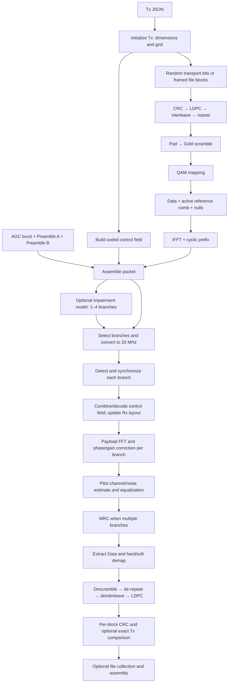

# RomanK FlexLink Python implementation analysis

**Source directory:** `RomanKucbel/Flexlink_py`  
**Review date:** 26 October 2026 (America/Los_Angeles)  
**Git baseline:** `8aaf398`; review includes the current working-tree edits  
**Coverage:** 112 Python files; 799 named function/method definitions, including nested helpers and properties.


### Document navigation

1. [Scope and evidence](#1-scope-and-evidence)
2. [Implemented architecture](#2-what-is-implemented)
3. [Configuration and numerology](#3-configuration-terminology-and-numerology)
4. [Transmitter flow](#4-transmitter-processing-step-by-step)
5. [Control field](#5-control-field-construction-and-decoding-contract)
6. [Preamble and synchronization](#6-preamble-generation-and-synchronization)
7. [Impairment models](#7-impairment-simulation)
8. [Receiver flow](#8-receiver-processing-step-by-step)
9. [Channel estimation](#9-channel-estimation-and-equalization-algorithms)
10. [Coding and soft values](#10-coding-primitives-and-soft-value-conventions)
11. [File delivery](#11-file-delivery-experiment)
12. [App, sweeps and metrics](#12-desktop-app-sweeps-and-measurement-definitions)
13. [Artifacts](#13-artifact-and-data-contracts)
14. [Tests](#14-tests-and-diagnostic-workflows-present-in-the-tree)
15. [Boundaries and findings](#15-implementation-boundaries-and-review-findings)
16. [Every function](#16-function-by-function-reference)

## 1. Scope and evidence

This document describes the implementation present in the working directory. It explains the processing sequence, module responsibilities, signal and file representations, modeled impairments, experiments and every named function. The code is the authority where existing prose differs from it.

The review is static. Python source, JSON configuration, packaging/launcher files and the available Markdown descriptions were inspected. No simulator, GUI, generator or test script was executed. Those workflows write JSON, HDF5, logs or received-file state. The default Python command on this machine resolved to the Windows application alias rather than a usable interpreter. No runtime pass rate, BER curve or interoperability claim is established by this review. Binary HDF5/NPZ/NPY contents were not decoded; their schemas below are derived from their producers and consumers.

There are local edits to both initializers, both payload JSON files and the control-field JSON. Reported values refer to that working copy. No source or configuration changes are part of this analysis.

The scope is the RomanK implementation. It does not compare every parameter against a separate FlexLink specification or the other implementations elsewhere in the repository. Labels such as IEEE 802.11 and EPA/EVA/ETU describe the tables and models used by this code; they are not certifications of standards conformance.

## 2. What is implemented

The project is a packet-oriented floating-point baseband link simulator with a desktop controller and command-line stages. It includes a complete simulated payload Tx/Rx path, acquisition preambles, a decoded PHY control field, up to four simulated receive branches, several pilot-based channel estimators, coding/modulation primitives, diagnostic experiments and framed-file delivery.

Processing stages exchange HDF5 artifacts. The chain runners start individual Python processes in sequence. This makes intermediate signals inspectable and each stage independently runnable, at the cost of repeated process/import/file overhead and shared mutable run state.

| Area | Implemented behavior |
| --- | --- |
| Payload coding | Per-transport-block CRC; systematic LDPC; block interleaving; whole-block repetition; packet padding; Gold-code scrambling |
| Payload modulation | BPSK, QPSK, 16QAM and 64QAM; 841-tone OFDM |
| Packet acquisition | AGC burst waveform, repeated Preamble A detection, coarse/fine CFO estimation, Preamble B correlation timing |
| Control field | 54 message bits, CRC-10, terminated K=7 convolutional code, BCC interleaving, repetition, scrambling, BPSK, four OFDM symbols |
| Channel simulation | Static FIR or delay/Doppler fading; integer timing shift; sampling drift; CFO; phase noise; AWGN; IQ imbalance |
| Receive diversity | Per-branch acquisition/equalization followed by inverse-noise-weighted maximum-ratio combining |
| Channel estimation | Linear; adaptive LMMSE; LMMSE with linear time interpolation; trained PCA with fallback |
| Diagnostics | CRC and exact Tx/Rx comparison; BER/BLER/PER sweep; EVM; waveform/constellation/PAPR/CCDF plots; impairment isolation |
| File experiment | Framed blocks, persistent CRC-gated collection, missing-block retransmission rounds and size/SHA-256 verification |
| Hardware wrappers | Configuration/logging scaffolding; actual connect/apply/readback driver calls remain TODOs |

The Tx emits one complex waveform from one populated pilot port. A control flag can advertise two transmit antennas, but the inspected payload builder does not generate a second Tx waveform or a space-time/spatial-multiplexing encoder. The receive branches represent copies of that waveform through independent simulated channels. “Ray” in filenames means receive branch; multipath taps are a separate concept.

### Overall signal flow



The control decoder runs after detection on all successful branches and before payload FFT/equalization. It can change payload configuration, so downstream scripts load the updated receiver JSON.

## 3. Configuration, terminology and numerology

The principal configuration files are:

| File | Sections and responsibility |
| --- | --- |
| [Tx/Parameters_Tx_payload.json](../Tx/Parameters_Tx_payload.json) | `Defined` selects payload behavior; `Calculated` contains derived sizes/counts; `File` names artifacts |
| [Rx/Parameters_Rx_payload.json](../Rx/Parameters_Rx_payload.json) | `Defined_Rx`, `Calculated_Rx` and `File_Rx` mirror the receive assumptions and artifact names |
| [Tx/ControlSignals/Parameters_Control_Field.json](../Tx/ControlSignals/Parameters_Control_Field.json) | Fixed control PHY, derived dimensions, artifact names and ordered field widths |
| [Channel_Defects.json](../Flexlink_BasicModules/Channel_Defects/Channel_Defects.json) | `Mode` enables impairments; `Settings` controls their magnitudes, profiles and random seed |
| [Receive_Packet_Detector.json](../Flexlink_BasicModules/Preamble/Receive_Packet_Detector.json) | Detector averaging length and hysteresis thresholds |
| [PCA_Training_Profiles.json](../Flexlink_BasicModules/Equalizer/PCA/PCA_Training_Profiles.json) | Offline channel covariance classes and PCA training settings |

Initializers calculate sizes and grid counts; they are operational preprocessing steps. Editing Defined alone does not refresh Calculated or the saved layout.

### OFDM geometry

| Quantity | Value |
| --- | --- |
| Ordered tone indices | -420 through +420, 841 entries |
| Grid convention in packet artifacts | Rows = OFDM symbols; columns = the 841 tones |
| Low-level OFDM module convention | Rows = tones; columns = OFDM symbols |
| Tx sample rates | 20 MHz or 40 MHz, enforced by the waveform wrapper |
| IFFT size | 1024 at 20 MHz; 2048 at 40 MHz |
| CP length | 116 at 20 MHz; 232 at 40 MHz |
| Subcarrier spacing | 19,531.25 Hz |
| Useful-symbol duration | 51.2 microseconds |
| CP duration | 5.8 microseconds |
| Whole-symbol duration | 57 microseconds |
| Payload symbol counts | 37, 49, 73, 97 or 121 |
| Reference-symbol period | 1, 3, 6 or 12 symbols |
| Pilot-comb spacing | 3, 6, 12 or 24 tone positions |
| Control layout | Four symbols: Ref, Data, Data, Ref |

Grid codes are Ref_P0=10, Ref_P1=20, DC=30 and Data=40. “DC” denotes designated zero cells, including central and layout-specific edge/null positions.

Every ordinary Data symbol has 826 Data cells and 15 nulls at array indices 414..428, corresponding to tones -6..+8. Reference-symbol layouts interleave P0 and P1 pilot positions and assign their own null ranges. Only the selected port's comb is populated. The other comb remains zero and is useful for estimating noise.

For comb spacing 3/6/12/24, each port has 280/140/70/35 reference cells per reference-bearing symbol. Those cells occupy the same tone positions in each reference-bearing symbol. The implemented estimators reject staggered pilot patterns.

### Payload-size equations

Let N be EncoderBlockSize, r be EncoderCodeRate, C the CRC width, R the configured Repetition, b the modulation bits per symbol and D the number of Data grid cells.

- DataBlockSize K = N*r.
- TransportBlockSize T = K-C.
- CodeBlockSize = N.
- CodeWordSize W = N*(R+1).
- NumberOfDataSigs B = D*b.
- AvailableDataBlocks A = floor(B/W).
- ZeroPadding Z = B mod W.
- ScrambledSequenceSize = A*W+Z = B.

The name NumberOfDataSigs denotes **coded bit capacity** after initialization. It is not the number of QAM symbols. The resource-grid Data-cell count is the QAM-symbol count.

Repetition is the count of **extra copies**. Repetition=1 transmits two copies; it does not disable repetition. Supported payload control codes cover R=1,3,5,7,11,15,19,23,31. The low-level repeat primitive allows zero extra copies, but both current payload initializers reject R<=0.

### Working-copy example

The reviewed payload configuration is QPSK, N=1296, rate 5/6, R=1, 73 payload symbols, pilot tone spacing 3 and reference-symbol period 6. The configured reference/data seeds are 129/128 for the two pilot ports and 57 for payload scrambling. Tx samples are 40 MHz; Rx processing is 20 MHz. The receiver requests two branches and LMMSE estimation with a 700 Hz time-filter design value.

An independent arithmetic reconstruction of the source grid rules gives:

| Quantity | Reconstructed value |
| --- | --- |
| Total resource cells | 61,393 |
| P0 / P1 / DC cells | 3,640 / 3,640 / 991 |
| Data cells / coded bits | 53,122 / 106,244 |
| K / CRC / transport bits per block | 1,080 / 24 / 1,056 |
| Repeated codeword length | 2,592 bits |
| Transport blocks / padding | 40 / 2,564 coded bits |
| Transport bits per packet | 42,240 |
| Preamble / control / payload duration | 312 / 228 / 4,161 microseconds |
| Complete packet duration | 4.701 milliseconds |
| Ideal transport-bit rate over complete packet | Approximately 8.985 Mbit/s |

These values agree with the reviewed payload JSON's derived dimensions. The rate is arithmetic, before decoding losses and file framing; it is not measured execution throughput.

## 4. Transmitter processing, step by step

### Tx initialization

[Initialize_Tx.py](../Tx/Initialize_Tx.py) locates/loads the payload JSON, calculates K, CRC width, transport size and repeated-codeword size, then constructs the layout using Resource_Grid. It counts signal types, converts Data cells to bit capacity and derives A/Z. It writes the Tx resource grid to the configured file in Tx and updates Calculated using atomic JSON replacement.

FlexlinkTransmitter then logs settings through its placeholder context methods. Build_Control_Field is invoked unless the relevant initialization option suppresses rebuilding. A successful initialization message does not demonstrate a radio connection: connect/apply/verify are scaffolding.

### Step 3 — generate transport bits

[Generate_TransportBlock_Bitstream.py](../Tx/Generate_RandomPacketOfData/Generate_TransportBlock_Bitstream.py) produces A*T bits, exactly filling all transport blocks. Its generator chooses a specified number of ones, then randomly places them, rather than requiring an independent Bernoulli draw for every bit. A seed makes the packet repeatable.

The output is stored under Tx/Generate_RandomPacketOfData using dataset TransportBlock_Bitstream. The file-generation path can replace this step with framed file bits in the same dataset/shape.

### Step 4 — CRC, LDPC, interleave, repeat, pad and scramble

[Construct_Encoded_Bitstream_Tx.py](../Tx/Construct_Encoded_Bitstream_Tx.py) loads transport bits and constructs an Encoder object once per packet.

For each T-bit transport block:

1. Attach_CRC appends the selected C-bit CRC and verifies zero residue over the appended block.
2. LDPC_Encode multiplies K information bits by a precomputed systematic G matrix over GF(2), producing N bits. The wrapper validates dimensions and checks that the systematic prefix matches the input.
3. Interleave_LDPC permutes the codeword using the precomputed block-size-specific index vector.
4. rate_match concatenates R extra copies of the complete interleaved word.

The packet encoder concatenates all repeated words, appends Z zeros and checks the final capacity. It then XORs the entire packet sequence, including padding, with the Gold sequence selected by C_init_Dat.

The scrambler helper normally writes an HDF5 Gold cache. The packet encoder supplies a temporary path so this side effect does not leave the normal cache in Tx. The encoded output preserves both scrambled data and the unscrambled sequence for inspection.

LDPC sizes are 648, 1296 and 1944; each has rate 1/2, 2/3, 3/4 or 5/6 tables. This is repetition-based rate matching, with no payload puncturing or incremental-redundancy scheme in the inspected chain.

### Step 5 — QAM mapping

[Construct_Datasigs_QAM.py](../Tx/Construct_Datasigs_QAM.py) loads the scrambled coded bits, checks bit capacity/modulation grouping and invokes qam_map.

The mapper groups bits MSB first, with I-axis bits followed by Q-axis bits, using its local Gray tables. Average-power normalization is 1, 1/sqrt(2), 1/sqrt(10), or 1/sqrt(42) for BPSK, QPSK, 16QAM and 64QAM. BPSK data maps 0 to -1 and 1 to +1. The output is one complex value per Data resource cell.

### Step 6 — fill payload grid

[Construct_Payload_Grid.py](../Tx/Construct_Payload_Grid.py) loads the resource map and QAM sequence. It checks the saved layout matches PacketLength, RefSymbolSpacing and RefSignalSpacing. It fills Data cells in increasing symbol index, then increasing tone index within each symbol.

It loads Ref_P<port>_<comb spacing>_<bits per symbol>.h5 and repeats the vector on every reference-bearing symbol's active port. All designated nulls and inactive-port reference cells remain zero. The output carries layout metadata and the filenames used to construct it.

Pilot generation is separate. Generate_Reference_Signal_Vectors creates alternating bit sequences, scrambles them using the relevant port seed and maps to two constellation corners. BPSK pilot polarity is 0→+1, 1→-1, opposite to the payload BPSK mapper; the receiver uses the known pilot vector so the convention is explicit. QPSK/16QAM/64QAM pilots use upper-left/lower-right corners. Their powers are 1, 1.8 and 7/3 respectively. This boost is accounted for when estimating pilot noise.

### Step 7 — OFDM and packet assembly

[Construct_Payload_Waveform.py](../Tx/Construct_Payload_Waveform.py) transposes the stored grid for the low-level OFDM modulator. The modulator maps negative/positive tones to the corresponding IFFT bins, leaves unused bins zero, transforms each symbol, prepends its cyclic prefix and joins all symbols. Its sqrt(N_IFFT) scale compensates part of NumPy's IFFT normalization.

The wrapper optionally prepends the preamble and inserts the separately built control waveform between preamble and payload. Each is scaled to the measured payload's average power. The final order is:

```text
[ AGC burst | Preamble A | Preamble B ] [ four-symbol control field ] [ payload symbols ]
```

Use_Preamble and Use_ControlField independently permit bypass experiments, provided the receiver expects the same structure. The wrapper checks component sample rates and records segment offsets, lengths, scaling and PHY dimensions. The source does not implement DAC quantization, RF upconversion or streaming output here.

### Step 8 — optional impairment model

Defect_Model creates branch waveforms only when the chain runner sees enabled Mode flags. Every ordinary Tx run models a new channel unless the supplied/configured seed fixes it. Its exact order and formulas are described in Section 7.

Run_Tx_Chain orchestrates steps 3–8 and returns status 3 on subprocess failure. It assumes initialization artifacts already exist and are current. --keep-blocks skips random generation for a file packet; --no-defects skips modeling.

## 5. Control-field construction and decoding contract

The control field communicates payload settings that must be known before payload processing. Its own waveform is fixed and known to both ends. Initialization runs five steps: Initialize_Control_Field, Construct_Encoded_Control_Tx, Construct_ControlSigs_QAM, Construct_Control_Grid and Create_ControlField_Waveform.

### Control-message fields

The ordered widths in Parameters_Control_Field.json define MSB-first serialization:

| Field | Width | Meaning in this implementation |
| --- | --- | --- |
| RefSymbolSpacing | 2 | Encoded payload reference-symbol period |
| RefSignalSpacing | 2 | Encoded payload reference-comb spacing |
| PacketLength | 3 | Encoded payload symbol count |
| PayloadFieldMod | 2 | BPSK/QPSK/16QAM/64QAM code |
| NoOfTxAntenna | 1 | Advertised transmit-antenna count |
| CBS_A_Flag | 2 | LDPC block-size code |
| FEC_A_Flag | 2 | LDPC code-rate code |
| RM_A_Flag | 4 | Extra-copy repetition code |
| NDB_A | 10 | Calculated transport-block count |
| ClientFlag | 1 | Service/Client identity flag |
| Tx_Ref_Clk_Cnt | 14 | Fixed zero placeholder |
| C_init | 8 | Payload scrambler ID |
| Reserved | 3 | Fixed zero |
| **Total** | **54** | Message before CRC |

Values in the JSON ControlField object are widths, not the transmitted setting codes. Coding tables live in Initialize_Control_Field.CONTROL_FIELD_CODING. The initializer checks every encoded value fits its allotted width and round-trips through parsing.

### Encoding geometry

54 message bits + CRC-10 = 64 bits. Six zero tail bits terminate the K=7, [133,171] octal, rate-1/2 convolutional encoder, giving 70 input bits and 140 coded bits. The codeword is BCC-interleaved and repeated 15 times (Repetition=14), giving 2,100 bits. Another 100 padding bits fill 2,200 Data cells. A fixed Gold ID of 130 scrambles the control field; the payload scrambler ID is the independent eight-bit C_init field.

The control resource grid has 560 P0 reference cells, 560 inactive P1 cells, 44 null cells and 2,200 BPSK Data cells. It uses tone spacing 3 and Ref/Data/Data/Ref symbol order. Its duration is four times 57 microseconds, or 228 microseconds.

The control encoder locally Viterbi-decodes its freshly encoded block as a structural self-check. The dedicated build log records the five construction steps.

### Receiver dependency

Process_Control_Field_Rx knows the fixed control PHY and reference vector from the local control configuration. It does not bootstrap those fixed constants from the payload waveform itself. Each detected branch is demodulated/equalized for four control symbols. BPSK evidence is positive for bit 1, using 4*real(x)/noise_var; branch evidence is summed. The decoder removes scrambling by sign flips, sums repeated copies, reverses interleaving and Viterbi-decodes with forced end-state zero. CRC-10 gates acceptance.

Accepted fields update payload spacing, length, modulation, advertised Tx antenna count, LDPC size/rate, repetition, ClientFlag and payload scrambler ID. Changes affecting layout trigger Initialize_Rx; a change solely to C_init_Dat does not require grid rebuilding. The control interval is removed from every participating packet file. A repeated invocation detects ControlFieldRemoved and requires packet detection to be rerun.

Invalid control codes or failed CRC produce chain status 4 and stop payload processing. NDB_A mismatch is currently a warning. CRC choice, selected pilot Port, preamble/control presence and fixed control PHY assumptions are not all carried in this message; they still require consistent local configuration.


## 6. Preamble generation and synchronization

### Transmitted acquisition sequence

Construct_Preamble concatenates three generated complex arrays and saves their lengths as dataset attributes.

| Component | Construction | Duration and purpose |
| --- | --- | --- |
| AGC burst | DFT of a root-54, length-887 Zadoff-Chu sequence; mapped into the IFFT with DC nulled; first 100/200 samples retained | 5 microseconds of broadband acquisition energy |
| Preamble A | cos(2*pi*625 kHz*t+pi/4) + cos(2*pi*1.875 MHz*t+3*pi/4), stored in complex dtype | 250 microseconds for periodic detection and CFO |
| Preamble B | Same broadband sequence construction, whole 1024/2048-sample IFFT body plus 116/232-sample CP | 57 microseconds for correlation timing |
| Complete preamble | Concatenation in that order | 312 microseconds; 6,240 samples at 20 MHz or 12,480 at 40 MHz |

The AGC signal exists, but there is no adaptive analog/digital gain-control loop in the inspected receiver. The final packet assembler scales the entire preamble's mean power to the payload's mean power.

### Detection path

Packet_Detector uses a fixed 17-tap, approximately 2.75 MHz acquisition low-pass FIR on the 20 MHz input. This narrows acquisition noise while retaining Preamble A's tones.

Receive_Packet_Detector forms a lag-32 delayed copy. With sliding average length L, it calculates:

```text
A[n] = average_L(x[n] * conj(x[n-32]))
V[n] = average_L(|x[n]|²)
ratio[n] = |A[n]| / V[n]
```

A hysteresis state becomes detected above the high threshold and clears below the low threshold. Settings are loaded from Receive_Packet_Detector.json, with built-in defaults available. This looks for periodic structure; it is not a decoded packet identity check. A failed detection raises the packet-stage no-packet result, which the chain can tolerate on one branch if another succeeds.

### Coarse and fine carrier-frequency offset

Receive_Get_Frequency_Offset starts from the first asserted detection flag and takes a 4,096-sample section, padding a short section if necessary. It applies a tapered mask and an FFT-domain acquisition-band mask.

The coarse estimator searches bins 5..251 around the nominal 625 kHz tone at bin 128. Bin spacing is 20 MHz/4096, approximately 4.883 kHz. The resulting coarse search covers approximately ±600.6 kHz around that tone.

After removing the coarse offset, it computes lag-32 autocorrelation with a 64-sample average. The mean phase over the selected internal sample range becomes the residual frequency estimate:

```text
fine_CFO = mean(angle(autocorrelation)) * Fs / (2*pi*32)
total_CFO = coarse_CFO + fine_CFO
```

Packet_Detector applies the negative coarse and fine rotations to the original full-band input, rather than passing the acquisition low-pass output to payload demodulation.

The CFO estimate is made from the preamble. The payload chain does not contain a separate continuously running carrier tracking loop.

### Timing and packet cutting

Receive_Get_Timing_Offset extracts the known Preamble B from the local preamble file and converts a 40 MHz reference to 20 MHz by taking alternate samples. It cross-correlates the corrected received waveform with the conjugate-reversed reference, finds the strongest magnitude peak and returns its end position using the original MATLAB-style index convention.

Packet_Detector uses that returned end position as the first sample after the preamble. With control enabled, those next samples belong to the control field; they are not yet the payload. Process_Control_Field_Rx removes the control interval later.

Strongest-path timing can land after the earliest multipath component. FFT_StartTime=-12 moves the payload FFT window early; channel-estimation windows can include negative relative delays, and PCA can recenter them. These mechanisms are related but distinct: FFT placement protects the observation interval, while the estimator's delay prior controls which channel response can be reconstructed.

Synchronization is performed independently on each receive branch. The simulator does not jointly estimate shared oscillator/timing from all branches before acquisition.

## 7. Impairment simulation

[Tx/Defect_Model.py](../Tx/Defect_Model.py) applies the following order to a copy of the full transmitted packet for each receive branch:

```text
Multipath → TimingOffset → TimingDrift → Freq_Offset → PhaseNoise → ThermalNoise → IQ_Imbalance
```

A Mode flag controls whether a step runs. Order matters: the IQ stage also distorts the added noise, and sampling drift changes sample positions before the constant CFO/phase-noise stages.

The output data array has shape (NumberOfRays, samples), up to four rows. Every row starts from the same Tx packet. SeedSequence spawns one RNG per branch and another for shared phase noise. Multipath/noise draws differ across branches; phase noise is shared to model a common receiver oscillator. Other impairment magnitudes are common to the branches. Settings/RandomSeed is used unless the command-line seed overrides it.

### Static FIR multipath

Get_Multipath_Filter generates circular complex Gaussian tap coefficients. Tap n has an exponential variance envelope proportional to exp(-n/(Fs*delay_spread)). Default normalization divides by the square root of the expected total tap energy, allowing individual realizations to fade. The helper optionally supports normalization to each realization's actual energy.

Fixed_Tap_Channel convolves the waveform with these taps and keeps only the first input-length samples. Coefficients remain constant within the packet. This branch has no Doppler evolution. Truncation drops the final channel tail rather than extending the packet.

### Delay/Doppler fading: EPA, EVA and ETU

Delay_Doppler_Channel takes the selected JSON delay/power vectors. It converts dB path powers to linear values and normalizes their sum to one.

For each path it generates a complex time-varying fading sequence using a finite sum of sinusoids with randomized angles/phases. The default sinusoid count is 16. The model approximates Rayleigh/Jakes-like fading. A positive KFactor mixes a deterministic complex LOS term into the first path; KFactor is linear, not dB. The helper's direct-path Doppler default is -20 Hz. KFactor=0 removes the LOS component.

Fractional path delays are implemented with normalized windowed-sinc interpolation filters. A common filter offset makes them causal. Each delayed signal is multiplied by its fading process and the paths are summed. The main defect wrapper consumes only the waveform; optional helper diagnostics expose fading and filter-delay details.

The selected profile names supply delay/power geometry. The caller independently sets Doppler and K factor, so choosing ETU does not imply a particular canonical Doppler or pure-Rayleigh condition. In the reviewed JSON, ETU uses DopplerFreq=1200 Hz and KFactor=8. Those are configurable experimental choices.

Time variation occurs at the sample rate. Therefore this waveform model can produce intra-symbol interference effects, unlike a diagonal frequency-domain H*X-only experiment.

### Integer timing offset

Cause_Timing_Offset requires an integer sample setting.

- Positive d returns x[d:], dropping initial samples and shortening the waveform.
- Negative d prepends spline-extrapolated samples at positions d..-1, lengthening the waveform.

This sign convention is explicitly “positive arrives earlier.” The negative-offset branch creates an extrapolated prehistory; it does not prepend an idle zero interval. Timing metadata copied from the original Tx packet is nominal after this operation, so receiver acquisition must find the actual arrival.

### Sample-clock drift

Cause_Timing_Drift requires integral ppm but evaluates between samples. It fits a complex cubic spline and samples it at:

```text
u[m] = (1 + drift_ppm/1e6) * m
```

Positive ppm advances through the original sequence faster and yields fewer output samples. Negative ppm yields more samples. This is a constant sampling-rate mismatch over the packet. There is no separately modeled random clock wander. The receiver does not explicitly resample to undo the drift; pilot estimation can absorb part of its phase/channel manifestation, subject to operating conditions.

### Carrier-frequency offset

Cause_Frequency_Offset returns x[n]*exp(j*(2*pi*delta_f*n/Fs+initial_phase)). Positive delta_f shifts the spectrum upward. This is a constant CFO, distinct from path Doppler and stochastic phase noise. Receive synchronization estimates and removes it using the preamble.

### Phase noise

The phase-noise settings give SSB levels in dBc/Hz at ascending offset frequencies. _mask_linear interpolates in dB versus log-frequency and holds endpoint levels beyond the list.

cause_phase_noise generates real white Gaussian noise on an FFT length equal to the next power of two at least twice the waveform length. It shapes the spectrum by sqrt(L(f)*Fs), forces DC phase to zero, transforms back and takes the requested sample interval. Output is x*exp(j*phi).

integrated_phase_error_deg numerically integrates twice the positive-frequency mask between specified bounds and returns RMS phase error in degrees. Defect_Model records this theoretical mask-based integrated value as PhaseNoiseRMS_deg; it is not the measured standard deviation of every realized branch's phase samples.

The shared realization makes oscillator phase noise correlated across branches. The model does not implement a receiver phase-noise canceller or an explicit per-symbol common-phase-error loop.

### Thermal noise and SNR reference

Generate_AWGN returns noise; Defect_Model performs the addition. For input signal power P, the primitive sets:

```text
sigma² = P / 10^(SNR_dB/10)
noise = sqrt(sigma²/2) * (normal_I + j*normal_Q)
```

SNR_Reference selects how the wrapper interprets branch SNR:

| Setting | Noise reference | Consequence |
| --- | --- | --- |
| Transmit | Original Tx waveform mean power | Faded branches have lower instantaneous received SNR |
| Received | Each branch's current mean signal power | Noise is adjusted so each branch approaches the configured SNR regardless of its gain |

The wrapper generates branch noise independently. MeasuredSNR_dB compares mean signal power and realized added-noise power at that stage, before the later IQ imbalance. It is a waveform-stage measurement. It differs from null-tone noise estimates and per-tone post-equalizer SNR.

### IQ imbalance

Cause_IQ_Imbalance implements:

```text
I_temp = I + Q*sin(phase_error)
Q_temp = Q*cos(phase_error)
y = i_gain*I_temp + j*q_gain*Q_temp
i_gain = 10^(amplitude_imbalance_dB/20), q_gain = 1
```

The phase error is in radians. This introduces quadrature leakage and gain mismatch, including mirror-image contamination. No explicit image-rejection correction is present in the receiver. One-tap channel estimation is not a general inverse for conjugate leakage.

### Impairment output and limits

The output preserves input attributes and adds enabled-order, branch count, power/SNR measurements, seed and impairment settings. Nominal PreambleLength/PayloadStart from the Tx remain unchanged even when filtering or timing changes arrival.

This model has no RF frontend, finite-precision ADC/DAC, clipping/power-amplifier nonlinearity, separate adjacent-channel/interferer waveform, path-loss geometry, branch spatial-correlation matrix or noise-correlation model. The reported MRC behavior assumes the modeled branch independence except for explicitly shared effects.

## 8. Receiver processing, step by step

### Rx initialization

Initialize_Rx uses the same coding/capacity equations as Tx, with Defined_Rx and Calculated_Rx sections. It writes the expected type map under Flexlink_BasicModules/Construct_Grid using File_Rx.ResourceGrid_Rx. Its hardware wrapper logs settings and returns placeholder verification success.

It may be invoked once before the chain, then invoked again after control decoding if decoded payload geometry differs.

### Step 3 — select input, select branches and decimate

Decimate_Payload_Rx reads Mode flags from the selected impairment JSON. With any enabled Mode it selects Waveform_Payload_DefectsModeled_Rx and retains the first NumberOfAntennas rows. With no enabled Mode it selects the clean waveform and uses one branch.

Relative waveform names are sought in Rx first, then Tx. A stale or manually copied Rx waveform can therefore override the normal Tx artifact. Explicit --input can select another waveform, but Mode flags still influence the surrounding shape/branch behavior.

At 40 MHz, automatic clean processing uses alternate samples; automatic impaired processing uses scipy.signal.resample_poly with factors 1/2. At 20 MHz, no sample-rate conversion is needed. The stage removes the known 1/sqrt(decimation) amplitude difference caused by the Tx IFFT scaling, unless requested otherwise.

It writes the 20 MHz array and records the actual run antenna count. Later target-name selection uses this recorded count, not simply the configured count.

### Step 4 — per-branch packet detection

Packet_Detector selects row N, applies the Section 6 acquisition chain and writes a _RayN packet artifact. Use_Preamble=0 passes the waveform through. Failed acquisition returns a distinct no-packet result, enabling the runner to exclude the branch and continue with others.

### Step 4a — control field

All branches that found the packet contribute to one control decode. CRC failure stops the packet. Successful decoding can update receiver payload parameters, rebuild the layout and remove the four control symbols from participating packet files.

### Step 5 — payload FFT and normalization

Demodulate_Waveform_Rx calls the low-level 20 MHz FFT demodulator and transposes its output to (PacketLength,841). It selects exactly the configured payload-symbol count and rejects insufficient symbols.

FFT_StartTime offsets the FFT relative to its nominal post-CP window. The wrapper removes the deterministic ramp exp(-j*2*pi*tone*FFT_StartTime/1024). It also removes the low-level demodulator's extra 1/sqrt(2) amplitude gain, so a clean normalized grid is restored after the earlier decimator correction.

These explicit corrections matter: calling only the low-level demodulator reproduces its legacy scale; the full packet wrapper uses compensated values.

### Step 6 — branch channel estimation and equalization

Equalize_Payload_Grid checks grid shape/layout metadata, loads the selected reference vector, estimates noise from inactive/null cells and runs the chosen channel estimator.

It writes three arrays: data (equalized grid), noise_var (post-equalizer variance per cell) and channel (H). It also records estimated noise/SNR, port detection, pilot power, chosen delay window and PCA diagnostics when relevant.

The main path produces unbiased equalized symbols x=Y/H and variance v=sigma²/|H|². It does not use the separate biased MMSE helper for these demapper inputs. Only Data and the active reference comb are retained; unused cells are zeroed. Details appear in Section 9.

### Step 6b — receive diversity combining

For multiple branches, Combine_Antennas_Rx loads successful equalized grids and their v values. For each resource cell:

```text
weight_r = 1/v_r
combined_x = sum(weight_r*x_r) / sum(weight_r)
combined_v = 1 / sum(weight_r)
```

Invalid/nonpositive variances and nonfinite symbols receive zero weight. With no usable weight, the implementation returns a mean symbol and infinite variance. The default-file path also checks artifact freshness against the current decimated waveform. The chain explicitly supplies the branch files that completed equalization.

This is MRC expressed after per-branch one-tap equalization. It preserves the noise confidence information needed for soft demapping. Failed branches are excluded; a multi-branch run can continue with a subset.

### Step 7 — serialize Data cells

Get_DataSigs_QAM selects only Data cells from the saved grid map and preserves Tx's symbol-major/tone-major order. If a noise_var grid exists, the same mask produces one variance per QAM symbol. It checks dimensions and coded capacity before writing the sequence.

### Step 8 — hard or soft demapping

Get_Demapped_Bitstream invokes QAM_Demapper with the selected modulation. Hard mode writes uint8 bits. Soft mode uses max-log LLRs and converts them to probabilities:

```text
LLR = ln(P(bit=0 | y) / P(bit=1 | y))
P1 = 1 / (1 + exp(clipped_LLR))
```

Per-symbol post-equalizer variance is used when supplied. A fixed CLI variance can override it. Without variance metadata, a nearest-constellation decision-directed residual estimates a scalar noise variance; this can be biased when decisions are wrong.

The low-level demapper also supports exact log-MAP LLRs, but the packet wrapper's soft branch chooses max-log.

### Step 9 — descramble, de-repeat, deinterleave, LDPC and CRC

Get_Decoded_Bitstream validates the packet dimensions and loads 0..1 values. The same Gold sequence descrambles hard/probability inputs using p→1-p where a Gold bit is one. It removes packet padding after descrambling and records padding decisions inconsistent with zero.

For each repeated codeword, Decoder:

1. Averages the R+1 repeated chunks.
2. Applies the inverse LDPC permutation.
3. Converts values to signed beliefs using 2*p-1, positive for bit 1.
4. Runs min-sum LDPC for the configured iteration count, default 15.
5. Takes the systematic K information bits, splits transport bits from CRC and compares the recomputed CRC.

The output contains TransportBlock_Bitstream and CRC_Pass per block. CorrectedBits counts changes between initial systematic-bit decisions and decoder decisions; it is not an oracle count of every corrected codeword error.

An optional Tx reference comparison counts exact recovered transport-bit mismatches. This is post-decoding BER. It depends on access to the matching transmitter reference and is an offline simulation measurement.

### Chain outcomes

Run_Rx_Chain's statuses are 0 for all block CRCs passing, 1 for a final block failure, 2 for no detected packet on any branch, 3 for processing failure and 4 for bad control field. The standalone payload decoder has its own exit-code mapping; the chain interprets its output into the above result.

The runner optionally decodes each branch alone for comparison, then decodes the combined grid. It captures child stdout/stderr and extracts summaries using regular expressions. The console message format is therefore an interface between scripts as well as user output.


## 9. Channel-estimation and equalization algorithms

The main receiver imports [Equalizer/Channel_Estimator.py](../Flexlink_BasicModules/Equalizer/Channel_Estimator.py). The separate pilot_ce implementation is a research/benchmark copy with additional layout/pilot helpers; changes in one are not automatically changes in the other.

### Shared observations and noise estimate

GridLayout carries the cell-type map, tone indices, FFT size, CP and spacing. reference_grid puts known reference values at the active comb positions. On reference-bearing symbol m and pilot tone k:

```text
H_LS[m,k] = Y[m,k] / X_ref[m,k]
```

detect_port compares energy on the P0 and P1 combs. The packet wrapper still uses configured Port and warns if the detected port disagrees.

estimate_noise_var averages received power on the inactive comb plus in-band designated nulls of reference-bearing symbols. This estimates noise plus leakage/ICI seen in those cells. It assumes the other port is silent. It is unsuitable as-is if a second simultaneous transmitter populates the other comb.

Pilot LS noise is divided by known mean pilot power. This accounts for 16QAM/64QAM corner-pilot boosting.

### Frequency reconstruction

| Method | Implementation |
| --- | --- |
| Linear | Piecewise linear interpolation between pilot tones, with held edge values |
| Delay-domain LS helper | Fits a finite-delay impulse response to sparse pilots using a regularized complex Fourier matrix, then evaluates all tones |
| LMMSE | Uses pilot/full-tone covariance from a delay prior: W=R_hp*(R_pp+sigma²*I)^-1 |
| PCA | Uses a precomputed low-rank eigenspace and noise-dependent component shrinkage/reconstruction |

The DFT/delay-LS option is available in the estimator class and research tools; the main packet CLI exposes the five named modes below.

### Time reconstruction and public modes

Frequency estimates on reference-bearing symbols are interpolated to every payload symbol. Linear time interpolation holds the edge values. Wiener time filtering uses a Jakes/Clarke J0(2*pi*fd*delta_t) correlation and the estimated frequency-filtered error variance. The main module approximates J0 with a numerical integral; the research module uses its own implementation/import path.

| EqualizerMode | Frequency estimate | Time estimate |
| --- | --- | --- |
| Linear | Linear interpolation | Linear interpolation |
| LMMSE_LinearTime | Adaptive-window LMMSE | Linear interpolation |
| LMMSE | Adaptive-window LMMSE | Wiener filter |
| PCA | Trained/fallback low-rank reconstruction | Wiener filter in the packet path |
| None | H=1 | Bypass, while retaining the surrounding noise/layout processing |

EqualizerMaxDoppler is a design setting. It is not a measured per-packet velocity/Doppler estimate.

### Adaptive delay window

The adaptive estimator forms a Hann-windowed pilot-derived power-delay profile, averages across reference symbols and finds energy above both a relative-to-peak threshold and a multiple of the noise floor. It adds margin and quantizes the selected interval to predefined window boundaries.

The main implementation searches negative as well as positive delays to retain paths preceding strongest-path timing. The end is capped by CP and the pilot-comb resolvability limit, approximately 0.9*N_FFT/comb_spacing. An overly long interval causes fallback of the start boundary. Sparse pilots therefore limit the delay support that can be reconstructed even when the physical CP is longer.

The selected noise level is quantized onto an SNR design grid. Fixed ChannelEstimator matrices are cached by window/design point within the AdaptiveChannelEstimator instance. The packet wrapper creates a new estimator for its invocation, so this cache is not a persistent cross-process cache.

### PCA training and runtime use

Train_PCA_Basis reads configured profile mixtures and forms 841-by-841 covariance matrices. It includes a uniform-delay floor/timing-jitter term according to configuration. For each spacing, port and class, it eigen-decomposes pilot covariance and retains the configured energy fraction. It saves pilot eigenvectors U, eigenvalues lambda, a reconstruction matrix A0 and pilot indices. Uniform-delay fallback twins are saved alongside the trained classes.

PCAChannelEstimator loads classes, verifies pilot positions and chooses the smallest class covering the estimated delay. If earliest energy lies beyond its early-path tolerance, it shifts the LS frequency response to recenter the delay support, estimates in that coordinate system and shifts H back afterward.

It estimates channel power, evaluates residual energy/model-fit statistics and selects a uniform fallback when mismatch limits are exceeded. Modes whose Wiener component gain falls below the configured threshold are discarded. The retained components reconstruct all-tone frequency estimates, followed by time filtering. Diagnostics expose chosen class, effective rank, fit statistic and window.

The trained HDF5 bases are required for PCA mode. They must be regenerated when their pilot geometry/training configuration changes.

### Equalizer output and confidence

The main path uses:

```text
x = Y/H
v = sigma² / max(|H|², small_floor)
```

This keeps higher-order QAM decision regions unbiased and makes faded cells less confident in demapping/MRC. The noise variance excludes an explicit posterior channel-estimation-error term. It is a practical confidence estimate rather than a full joint model of every impairment.

The utility equalize helper separately supports zero forcing and biased MMSE conj(H)*Y/(|H|²+sigma²). It is used in research experiments; it is not the main demapper-grid operation.

An implementation boundary deserves testing: the variance calculation floors |H|², but symbol division is still literally Y/H. An exact zero channel estimate can yield nonfinite symbols before later consumers reject/downweight them.

## 10. Coding primitives and soft-value conventions

### LDPC matrices and decoder

Prototype tables cover twelve block-length/rate combinations. create_parity_check_matrix expands each prototype element into a zero block or shifted identity. Generator construction performs GF(2) elimination, tracks column permutations and builds systematic G=[I|A^T].

The generator batch writer rejects nonidentity column permutations before saving and verifies G*H^T=0. Matrix files use separate G and H datasets and code-dimension attributes. Duplicate generator/prototype helper files exist in the G/H generation directories; these are offline generators, not separate signal stages.

LDPC_Decode builds a Tanner-graph edge representation from H. Each iteration computes variable-to-check extrinsic messages, vectorized minimum/sign check-node messages and accumulated bit-node beliefs. The implementation handles minimum/second-minimum values and zero signs. Batch chunking bounds padded work-array size.

It executes a fixed number of iterations, with no syndrome-based early exit in the inspected decoder. The result is hard decisions on the first K systematic bits. CRC later supplies the payload acceptance test.

### Three distinct soft representations

| Boundary | Representation | Polarity/meaning |
| --- | --- | --- |
| Low-level QAM_Demapper soft output | LLR=ln(P0/P1) | Positive favors bit 0 |
| Packet encoded-bit artifact | P1 in [0,1] | Above 0.5 favors bit 1 |
| LDPC_Decode input | Signed belief 2*P1-1 | Positive favors bit 1 |
| Control BPSK/Viterbi evidence | 4*real(x)/v | Positive favors bit 1 |

Passing packet probabilities directly as LLRs, or low-level LLRs directly to the LDPC decoder, would violate these interfaces.

The payload de-repeater averages probabilities. It does not sum independent LLRs before probability conversion. Near-saturated values are also compressed by the bounded 2*P1-1 transformation. This is the implemented combining/confidence rule; optimal log-likelihood combining would be a separate design change requiring performance comparison.

Control decoding uses summed signed evidence across branches and repeated copies. Its combining path is therefore different from the payload's probability averaging.

### CRC, interleaving and scrambling

GenerateCRC is a zero-initialized MSB-first shift-register calculation using its local polynomial tables. It returns a row-vector remainder. The payload attachment validates zero residue over message+CRC; payload reception compares calculated and received CRC bits. The control receiver checks a zero residue over decoded control information+CRC.

LDPC interleaving gathers by a stored index vector; deinterleaving scatters back. BCC uses fixed tables for 40 and 140 values. Permutation loaders validate the supported length/index structure.

The Gold generator uses two 31-bit recurrences, a 1600-bit initialization skip and XOR output. Scrambler_GC caches a sequence by ID/length and XORs bits. Scrambling is deterministic whitening. It provides no encryption or authentication.

## 11. File-delivery experiment

File_Framing adds an application-level test payload over ordinary transport blocks. It is independent of HDF5; NumPy and standard-library helpers handle bits/bytes and state.

### File stream and transport blocks

The stream begins with magic FLXF, a version byte, an eight-byte file size, a 32-byte SHA-256, a two-byte filename length, the UTF-8 basename and then file bytes. Numeric manifest fields are big-endian.

Every transport block carries a 72-bit header:

| Field | Bits |
| --- | --- |
| Magic 0xF1 | 8 |
| File ID | 16 |
| Block index | 24 |
| Total blocks | 24 |

Remaining whole bytes carry a stream chunk; any leftover bits are zero. ChunkBytes=floor((TransportBlockSize-72)/8). At T=1056 this is 123 bytes per block, so forty blocks carry 4,920 stream bytes per full packet before manifest overhead. The last packet is filled with duplicate block IDs to maintain the fixed PHY capacity.

FileSender makes blocks and packet plans. Generate_File_Bitstream writes one packet in the ordinary transport-bit dataset. Tx --keep-blocks uses it through the unchanged PHY stages.

### Receive collection and retries

Receive_File loads the final _Ray1 or _Combined transport-block artifact, checks it is current relative to the decimated input and feeds bits plus CRC flags to FileReceiver.

CRC-failing blocks are dropped. Valid headers identify file ID/index/total, permit out-of-order arrival and reject geometry inconsistencies. Already held indices count as duplicates.

Per-file state uses memory-mapped .chunks.npy and .have.npy arrays plus JSON metadata. Each packet updates only its own blocks, flushes arrays and replaces metadata atomically. Completed stream assembly checks manifest size and SHA-256 and writes the recovered basename, adding a numeric suffix if needed. The Receive_File workflow discards corrupt completed state when appropriate to allow retransmission.

Run_File_Transfer sends full or missing-block rounds, directly reads the local receiver state to plan retries and finally compares recovered bytes with the original file. Its current runner is serial and has no --workers or --keep-workers option. The feedback is local experiment orchestration; it is not an on-air ACK protocol or a complete MAC layer.

The PHY transport-bit rate excludes this 72-bit block header and manifest overhead. File-transfer wall-clock speed additionally includes process, computation and disk costs.

## 12. Desktop app, sweeps and measurement definitions

### FreeSimpleGUI's role

Flexlinksimulation imports FreeSimpleGUI as sg. It builds the tabs, input fields, Save/Run controls, result text and asynchronous event handling. It is an interface dependency; it does not perform modulation, channel simulation or decoding itself.

The GUI loads channel/Tx/Rx JSON settings and preserves unexposed/comment entries on Save. Typed values are validated before pending saves. Saving Tx also copies the explicitly shared payload settings into Rx. Individual JSON writes use temporary files and atomic replacement; the multi-file save is not one cross-file transaction.

Run starts a worker that calls Initialize_Tx, Run_Tx_Chain, Initialize_Rx and Run_Rx_Chain. The worker sends progress/completion events to the GUI. Selected plots are loaded from fresh artifacts on completion. Controls prevent saving/rerunning through this window while its job is active. Separate terminal processes can still share the same artifact paths.

The sweep worker starts Run_SNR_Sweep and relays tagged PROGRESS/POINT/DONE records. A STOP file requests stopping after the current packet. Plot checkboxes and symbol limits control presentation. The implementation includes Doppler-to-velocity arithmetic for display; it does not infer a carrier frequency or velocity from the waveform.

### SNR sweep

For each ascending SNR point, Run_SNR_Sweep writes a copied impairment JSON, enables thermal noise and applies that SNR to all four branch SNR fields. Other base impairments remain as selected. It initializes Tx/Rx, snapshots settings and repeats full packet simulations.

The per-trial seed is base_seed + point_index*100000 + packet_index. Tx bits and channel generation receive this seed. A point stops at its packet limit or target block-error count. By default, the entire sweep stops after a point with zero observed block errors; --no-early-stop requests continued points. A finite zero-error sample does not establish a zero underlying error probability.

results.csv is flushed point by point. settings.json records seed/configuration/options; errors.log records processing faults; sweep.png presents results.

### Exact metric meanings

| Metric | Calculation and scope |
| --- | --- |
| Transport BER | Mismatched recovered transport bits / compared transport bits; after FEC/CRC processing |
| BLER | Failed blocks / attempted blocks; a missed/undecodable packet contributes all expected blocks as failed |
| PER | Packets with a failure / attempted packets |
| missed | Packets without a parseable final decode result, including acquisition/control/processing failures |
| EVM | sqrt(mean Data-cell error power / mean transmitted Data-cell power), displayed as percent or power-ratio dB |
| Estimated SNR | -10*log10(estimated null/inactive-tone noise variance); includes leakage/ICI and assumes normalized signal power |
| PHY transport rate | A*T / duration of the entire transmitted waveform, including preamble/control |
| Sweep goodput | PHY transport rate * (1-BLER) |
| PAPR | 10*log10(peak sample power / mean sample power) |
| CCDF | Empirical probability that sample power exceeds a threshold above average power |

BER accumulates only trials with a valid exact bit comparison. A complete packet loss has no reconstructed bit vector, so it contributes BLER/PER failure without a synthetic BER numerator. BER is therefore conditional on obtaining comparable decoded bits.

EVM uses the known transmitted Data symbols, with the whole-packet transmitted Data power as the normalization for overall/per-tone/per-symbol values. It does not fit away a residual complex gain in the main plotting path. The standalone OFDM demodulator test separately reports a gain-fitted EVM, so those two figures should not be treated as identical definitions.

The app and full-link sweep's receive EVM and plotted estimated SNR use PLOT_RAY=1. Multi-antenna final BER/CRC may instead come from MRC. A single sweep row can therefore contain combined decoding performance and ray-1 EVM/SNR.

Sweep EVM averages linear error-power ratios before conversion to dB/percent. Estimated SNR values are averaged in linear units. Goodput is a PHY transport-block estimate; it omits file framing/retry feedback overhead and computation latency.

The pilot_ce frequency-domain experiment measures channel MSE and uncoded 16QAM **symbol** errors. Its qam16_bits helper returns nearest-point labels, and the run compares labels. The waveform research experiment measures uncoded QPSK sign errors and EVM. Neither is the full-link LDPC transport BER sweep.


## 13. Artifact and data contracts

Paths below are the default working-tree locations. Most filenames are configurable. Each ordinary run replaces its usual artifacts; retaining multiple runs requires separate output/configuration management.

| Artifact | Producer → consumer | Main content and interpretation |
| --- | --- | --- |
| Tx/Grid_Resource_Tx.h5 | Initialize_Tx → payload-grid builder | Empty data grid; signal_types, symbol_types, k, Tone_i; layout attributes |
| Flexlink_BasicModules/Construct_Grid/Resource_Grid_Rx.h5 | Initialize_Rx → equalizer/data extraction | Expected receive cell map and layout attributes |
| Tx/Generate_RandomPacketOfData/Bitstream_TransportBlks_Tx.h5 | Random or file generator → packet encoder/comparison | TransportBlock_Bitstream, A*T binary values |
| Tx/Bitstream_Encoded_Tx.h5 | Packet encoder → QAM mapper | data scrambled coded bits; unscrambled sequence; seed/source attributes |
| Tx/Sequence_DataSigs_QAM.h5 | QAM stage → grid builder | Complex Data-cell vector in serialization order |
| Tx/Grid_Payload_Tx.h5 | Grid builder → OFDM/plots | data of shape (payload symbols,841), plus layout metadata |
| Preamble/Preamble.h5 under BasicModules | Preamble constructor → packet assembler/timing reference | Preamble dataset with sample rate and component lengths |
| Tx/ControlSignals control artifacts | Five control build stages → packet assembler/control Rx assumptions | Message bits, coded intermediate vectors, control QAM/grid/waveform |
| Tx/Waveform_Payload_Tx.h5 | Packet assembler → impairment model or clean Rx | data complex vector; sample rate, FFT/CP geometry and packet segment metadata |
| Tx/Waveform_Payload_DefectsModeled_Tx.h5 | Defect_Model → decimator | data (branches,samples); impairment/SNR/power/seed attributes |
| Rx/Waveform_Payload_Dec_Rx.h5 | Decimator → branch detector/target selection | 20 MHz samples; actual NumberOfAntennas; conversion/defect attributes |
| Rx/Decimated_Payload_Packet_Rx_RayN.h5 | Detector → control decoder/payload FFT | CFO-corrected packet tail; synchronization/Ray attributes; control processing rewrites it |
| Rx/ControlField_Rx.h5 | Control decoder → diagnostics | ControlMessage, combined LLR/evidence, CRC/field/update attributes |
| Rx/Grid_Payload_Rx_RayN.h5 | FFT wrapper → equalizer/plots | Demodulated (symbols,841) complex data; phase/gain correction metadata |
| Rx/Grid_Equalized_Rx_RayN.h5 | Equalizer → MRC/data extraction | data, noise_var, channel plus estimator diagnostics |
| Rx/Grid_Equalized_Rx_Combined.h5 | MRC → data extraction | Combined data/noise_var and selected/skipped branch metadata |
| Rx/Sequence_DataSigs_QAM_RayN or _Combined.h5 | Data extraction → demapper | Complex symbols and optional per-symbol noise variance |
| Rx/Bitstream_Encoded_Rx_RayN or _Combined.h5 | Demapper → packet decoder | Hard bits or float P1, not raw LLRs |
| Rx/Bitstream_TransportBlks_Rx_RayN or _Combined.h5 | Packet decoder → comparison/file receiver | TransportBlock_Bitstream and CRC_Pass |
| Rx/FileTransfer_State | FileReceiver → later packets/retries | Persistent per-file chunk arrays, received masks and JSON state |
| Rx/Received_Files | File assembly → user/comparison | Recovered bytes after size/hash verification |
| App/Sweeps/<run> | Sweep → CSV/plot consumer | settings.json, results.csv, copied channel settings, error log, plot |
| Tx/Encode/Sequence_*.h5 and Rx/Decode stage files | Standalone coding-stage experiments | Separate stage test vectors; the full packet path reuses functions without routing all data through them |

_RayN indexes modeled receive branches starting at one. _Combined denotes diversity output. The recorded Ray attribute uses zero for combined output. The number of active branches is recorded by decimation and can differ from the configuration after no-defect single-waveform selection.

Reference assets include 32 Ref_P<port>_<spacing>_<bits>.h5 vectors, twelve G matrices, twelve H matrices, three LDPC interleaver index files and four PCA-basis files. Source generators specify their schemas. The included binary contents were not independently regenerated or verified during this review.

## 14. Tests and diagnostic workflows present in the tree

The following describes implemented test code, not results of a fresh execution.

| Test or experiment | Stimulus | Checks/results |
| --- | --- | --- |
| CRC module direct execution | Known byte string converted to bits | Prints CRC values and message+CRC zero-residue checks |
| QAM mapper _selftest | Known bit groups and every constellation point | Exact mapping examples and unit average constellation power |
| QAM demapper _selftest | Noiseless symbols and seeded AWGN | Hard/soft agreement, LLR sign/scale, per-symbol variance behavior |
| Convolutional code direct execution | Known sequence, impulse, noisy soft symbols, tail-biting bits | Encode/decode round trips, polynomial outputs, soft polarity, termination |
| LDPC generator batch | All length/rate table combinations | Matrix geometry, no unexpected column permutation, G*H^T=0, HDF5 read-back |
| H-matrix batch | All length/rate combinations | Dimensions, binary entries, HDF5 read-back |
| Test_LDPC_Encoder | Generated messages | Systematic prefix, file read-back and stored test vectors |
| Test_LDPC_Decoder | Stored codewords converted to signed beliefs; optional real Gaussian perturbation | Recovered information-bit/message mismatches and read-back |
| Test_Interleaver | Stored random LDPC/BCC vectors | Round-trip equality, preserved one count, changed permutation and file output |
| Test_Scrambler | Controlled binary vector | Same-ID recovery, different-ID failure, lengths/changed bits and recorded report |
| Resource_Grid direct execution | Supported packet/profile/spacing combinations | Shape, last-reference condition, cell counts, null placement and rejected combinations |
| Test_OFDM_Modulator_841 | Stored test payload grid | Sample count, CP duplication, power/PAPR/headroom diagnostics |
| Test_OFDM_Demodulator_841 | 40 MHz waveform; optional reference grid | Decimation, CP correlation timing, FFT output and gain-fitted reference EVM |
| Standalone preamble stages | HDF5 acquisition waveforms and optional front/end padding | Filter response, detection ratio/flag, CFO details, correlation peak plots |
| Rx/Diagnose_Defects | Clean/all/single/all-but-one modes, selected seeds and receiver variants | Per-branch/combined outcomes; which impairment or setting changes failure |
| App/Run_SNR_Sweep | Full coded packets across SNR points | Post-decoder BER/BLER/PER, ray-1 EVM/SNR and rate/goodput estimates |
| pilot_ce/simulate | Synthetic diagonal channel and 16QAM plus AWGN | Estimator MSE, uncoded symbol errors, perfect-CSI reference |
| pilot_ce/waveform_test | OFDM waveform through time-varying fractional-delay paths | EVM, uncoded QPSK decisions and perfect diagonal-channel comparison |
| Run_File_Transfer | Arbitrary framed file, channel trials and missing-block rounds | Persistent recovery, manifest hash/size and final byte-for-byte equality |

Many tests are direct-execution scripts and write/replace their named HDF5 or image outputs. Some modules also perform useful work at import time: the reference-vector generator reads configuration and generates temporary cached vectors. Read-only source inspection should not assume importing every module is side-effect free.

A focused future validation sequence would be:

1. Run clean end-to-end packets for all supported modulation/LDPC/repetition/layout combinations using isolated output/configuration copies.
2. Confirm known amplitude and phase restoration for both Tx sample rates and several FFT offsets.
3. Exercise control-field changes, CRC failures, invalid field codes and interrupted/stale packet artifacts.
4. Compare one/two/four receive branches with matched independent noise and known branch gains.
5. Sweep each impairment alone before combined cases; include short signals, all-zero estimates, large offsets and drift boundaries.
6. Validate file recovery across duplicates, missing blocks, partial state, hash failure and restart/resume.
7. Record seeds, revision, full configuration and statistical sample sizes for any reported BER/BLER curve.

These are proposed validation activities. None was run and no new test files were created.

## 15. Implementation boundaries and review findings

### Existing behavior that constrains interpretation

- **Simulation versus hardware:** connect/apply/verify methods do not implement a driver. No RF device operation or real-time throughput is demonstrated.
- **Transmit diversity:** the Tx antenna control flag is implemented as signaling; the inspected waveform builder emits one active port/waveform. Receive MRC is implemented for that waveform.
- **Synchronization/tracking:** CFO/timing are acquired from the preamble per branch. Dedicated payload carrier/phase-noise/clock-drift tracking and widely linear IQ compensation are absent.
- **Pilot assumptions:** only one reference comb is active; inactive-comb noise estimation relies on that. Staggered pilots are explicitly unsupported by the main estimator classes.
- **Confidence combination:** payload repetitions average P1; the LDPC input is bounded signed probability-derived belief. This differs from accumulating raw log likelihoods.
- **Performance measurements:** combined CRC/BER and ray-1 EVM can coexist in the same report. Uncoded estimator SER/QPSK experiments are separate.
- **Run isolation:** subprocesses normally share fixed artifact names and JSON state. Freshness checks reduce some stale-result problems but do not create a transactionally isolated run.
- **File retransmission:** retries use direct local receive-state access; the code does not implement radio feedback.
- **Portability/dependencies:** pyproject declares Python>=3.10 and lower-bounded scientific/GUI dependencies, without a fully pinned environment. Its setuptools module list installs flexlink_paths; the processing scripts/assets are organized as a source tree rather than a fully bundled Python package. Editable/source-tree launch is the documented workflow.

### Specific source-level issues worth resolving

| Finding | Source evidence | Practical implication |
| --- | --- | --- |
| File-transfer --no-defects only suppresses Tx model generation | Transfer.send_packet appends Tx --no-defects, then calls Rx with the same defect JSON and --no-model. Decimate_Payload_Rx selects input from Mode flags | If flags remain enabled, a supposedly clean transfer can seek an old/missing impairment waveform. A clean transfer currently requires consistent clean input selection, not just skipping generation |
| Rx automatic defect refresh checks configuration age, not every Tx dependency | Chain.model_defects regenerates for missing waveform, newer defect JSON or --new-channel | After replacing the clean Tx waveform separately, an existing modeled file can remain selected unless a full Tx/model run or explicit refresh is used |
| Multi-branch BER and EVM have different scopes | Final decode can use _Combined; Flexlink_Plots and packet_evm select ray 1 | Plots/CSV must label branch-1 EVM separately from combined link decoding |
| Exact-zero H division is not regularized | equalize_for_demapper floors the variance denominator but still evaluates Y/H | Zero-channel/zero-input boundary cases can create nonfinite symbols |
| Some prose describes absent file-transfer features | Rx chain Markdown documents --workers/--keep-workers and worker directories; Run_File_Transfer's parser/class do not implement them | Documentation should be reconciled before relying on those command lines |
| Standalone AWGN smoke example uses an old setting name | Generate_AWGN's direct-execution block reads Settings/SNR_dB; current JSON uses SNR1_dB..SNR4_dB | The primitive works through Defect_Model, but that standalone example has a configuration-key mismatch |
| Current channel/equalizer Doppler choices differ | Channel JSON has DopplerFreq=1200; Rx uses EqualizerMaxDoppler=700 | The test configuration includes a model/design mismatch; resulting losses should not automatically be attributed to coding |

These are static findings or directly observed configuration differences, not reproduced failures. They do not change the implementation description. Proposed remedies would be separate approved work.

Existing chain prose also contains examples based on older repetition/capacity settings. Use the equations and current Calculated values when estimating packet/file capacity.

## 16. Function-by-function reference

Every named Python function, method, nested helper and property in the reviewed source is listed below, including repeated helper names in different files. Dataclasses/enums with no explicit methods are described in their module narratives; generated methods and lambda expressions are not counted as named definitions.

Each module has a source link, its role and a table in source order. A row contains the exact source signature, a behavior explanation and, where useful, the explicit HDF5 datasets created in that body. Line links refer to this review snapshot and will move after source edits. Calls made by a wrapper can write artifacts even if its own body has no direct HDF5 write.

The catalog groups Tx, Rx, shared primitives/reference assets, and app/experiment control. It distinguishes main-chain modules from standalone test/generation/research code through each module's role.

### Module index

- [Tx/Construct_Datasigs_QAM.py](#module-1)
- [Tx/Construct_Encoded_Bitstream_Tx.py](#module-2)
- [Tx/Construct_Payload_Grid.py](#module-3)
- [Tx/Construct_Payload_Waveform.py](#module-4)
- [Tx/Defect_Model.py](#module-5)
- [Tx/Encode/Attach_CRC.py](#module-6)
- [Tx/Encode/FEC_LDPC_Tx.py](#module-7)
- [Tx/Encode/Generate_TestVector_TransportBlk_Tx.py](#module-8)
- [Tx/Encode/Interleaver_Tx.py](#module-9)
- [Tx/Encode/Rate_Matching_Tx.py](#module-10)
- [Tx/Generate_FileData/Generate_File_Bitstream.py](#module-11)
- [Tx/Generate_RandomPacketOfData/Generate_TransportBlock_Bitstream.py](#module-12)
- [Tx/Initialize_Tx.py](#module-13)
- [Tx/Run_Tx_Chain.py](#module-14)
- [Rx/Check_TransportBlk.py](#module-15)
- [Rx/Combine_Antennas_Rx.py](#module-16)
- [Rx/Decimate_Payload_Rx.py](#module-17)
- [Rx/Decode/Check_CRC.py](#module-18)
- [Rx/Decode/FEC_LDPC_Rx.py](#module-19)
- [Rx/Decode/Interleaver_Rx.py](#module-20)
- [Rx/Decode/Rate_Matching_Rx.py](#module-21)
- [Rx/Demodulate_Waveform_Rx.py](#module-22)
- [Rx/Diagnose_Defects.py](#module-23)
- [Rx/Equalize_Payload_Grid.py](#module-24)
- [Rx/Get_DataSigs_QAM.py](#module-25)
- [Rx/Get_Decoded_Bitstream.py](#module-26)
- [Rx/Get_Demapped_Bitstream.py](#module-27)
- [Rx/Initialize_Rx.py](#module-28)
- [Rx/Packet_Detector.py](#module-29)
- [Rx/Process_Control_Field_Rx.py](#module-30)
- [Rx/Receive_File.py](#module-31)
- [Rx/Run_Rx_Chain.py](#module-32)
- [Rx/Rx_Antennas.py](#module-33)
- [flexlink_paths.py](#module-34)
- [ReferenceSignals/Generate_Reference_Signal_Vectors.py](#module-35)
- [Flexlink_BasicModules/BCC_Encoder/Convolutionalencoder.py](#module-36)
- [Flexlink_BasicModules/Channel_Defects/Cause_Frequency_Offset.py](#module-37)
- [Flexlink_BasicModules/Channel_Defects/Cause_IQ_Imbalance.py](#module-38)
- [Flexlink_BasicModules/Channel_Defects/Cause_Phase_Noise.py](#module-39)
- [Flexlink_BasicModules/Channel_Defects/Cause_Timing_Drift.py](#module-40)
- [Flexlink_BasicModules/Channel_Defects/Cause_Timing_Offset.py](#module-41)
- [Flexlink_BasicModules/Channel_Defects/Delay_Doppler_Channel.py](#module-42)
- [Flexlink_BasicModules/Channel_Defects/Fixed_Tap_Channel.py](#module-43)
- [Flexlink_BasicModules/Channel_Defects/Generate_AWGN.py](#module-44)
- [Flexlink_BasicModules/Channel_Defects/Get_Multipath_Filter.py](#module-45)
- [Flexlink_BasicModules/Construct_Control_Field/Build_Control_Field.py](#module-46)
- [Flexlink_BasicModules/Construct_Control_Field/Construct_Control_Grid.py](#module-47)
- [Flexlink_BasicModules/Construct_Control_Field/Construct_ControlSigs_QAM.py](#module-48)
- [Flexlink_BasicModules/Construct_Control_Field/Construct_Encoded_Control_Tx.py](#module-49)
- [Flexlink_BasicModules/Construct_Control_Field/Create_ControlField_Waveform.py](#module-50)
- [Flexlink_BasicModules/Construct_Control_Field/Initialize_Control_Field.py](#module-51)
- [Flexlink_BasicModules/Construct_Grid/Construct_Resource_Grid.py](#module-52)
- [Flexlink_BasicModules/Construct_Grid/RG_Get_Number_Of_SigTypes.py](#module-53)
- [Flexlink_BasicModules/CRC_Gen/GenerateCRC.py](#module-54)
- [Flexlink_BasicModules/Equalizer/Channel_Estimator.py](#module-55)
- [Flexlink_BasicModules/Equalizer/PCA/PCA_Estimator.py](#module-56)
- [Flexlink_BasicModules/Equalizer/PCA/Train_PCA_Basis.py](#module-57)
- [Flexlink_BasicModules/Equalizer/pilot_ce/example_rx.py](#module-58)
- [Flexlink_BasicModules/Equalizer/pilot_ce/minih5.py](#module-59)
- [Flexlink_BasicModules/Equalizer/pilot_ce/pilot_ce.py](#module-60)
- [Flexlink_BasicModules/Equalizer/pilot_ce/plot_results.py](#module-61)
- [Flexlink_BasicModules/Equalizer/pilot_ce/simulate.py](#module-62)
- [Flexlink_BasicModules/Equalizer/pilot_ce/waveform_test.py](#module-63)
- [Flexlink_BasicModules/File_Transfer/File_Framing.py](#module-64)
- [Flexlink_BasicModules/Interleaver/DeInterleave_BCC.py](#module-65)
- [Flexlink_BasicModules/Interleaver/DeInterleave_LDPC.py](#module-66)
- [Flexlink_BasicModules/Interleaver/IndexGeneration/Generate_Interleaver_Vector.py](#module-67)
- [Flexlink_BasicModules/Interleaver/Interleave_BCC.py](#module-68)
- [Flexlink_BasicModules/Interleaver/Interleave_LDPC.py](#module-69)
- [Flexlink_BasicModules/Interleaver/Test_Interleaver.py](#module-70)
- [Flexlink_BasicModules/Interleaver/TestGeneration/Generate_Test_Inputs.py](#module-71)
- [Flexlink_BasicModules/LDPC_Encoder/LDPC_Decode.py](#module-72)
- [Flexlink_BasicModules/LDPC_Encoder/LDPC_Encode.py](#module-73)
- [Flexlink_BasicModules/LDPC_Encoder/LDPC_Get_G.py](#module-74)
- [Flexlink_BasicModules/LDPC_Encoder/LDPC_Get_H.py](#module-75)
- [Flexlink_BasicModules/LDPC_Encoder/MatrixGeneration_G/create_parity_check_matrix.py](#module-76)
- [Flexlink_BasicModules/LDPC_Encoder/MatrixGeneration_G/generate_and_save_all_G.py](#module-77)
- [Flexlink_BasicModules/LDPC_Encoder/MatrixGeneration_G/generate_g_matrix.py](#module-78)
- [Flexlink_BasicModules/LDPC_Encoder/MatrixGeneration_G/get_p_ldpc.py](#module-79)
- [Flexlink_BasicModules/LDPC_Encoder/MatrixGeneration_G/ldpc_generator.py](#module-80)
- [Flexlink_BasicModules/LDPC_Encoder/MatrixGeneration_H/create_parity_check_matrix.py](#module-81)
- [Flexlink_BasicModules/LDPC_Encoder/MatrixGeneration_H/generate_and_save_all_H.py](#module-82)
- [Flexlink_BasicModules/LDPC_Encoder/MatrixGeneration_H/generate_h_matrix.py](#module-83)
- [Flexlink_BasicModules/LDPC_Encoder/MatrixGeneration_H/get_p_ldpc.py](#module-84)
- [Flexlink_BasicModules/LDPC_Encoder/Test_LDPC_Decoder.py](#module-85)
- [Flexlink_BasicModules/LDPC_Encoder/Test_LDPC_Encoder.py](#module-86)
- [Flexlink_BasicModules/OFDM_Modulator/OFDM_Demodulator_841.py](#module-87)
- [Flexlink_BasicModules/OFDM_Modulator/OFDM_Modulator_841.py](#module-88)
- [Flexlink_BasicModules/OFDM_Modulator/Test_OFDM_Demodulator_841.py](#module-89)
- [Flexlink_BasicModules/OFDM_Modulator/Test_OFDM_Modulator_841.py](#module-90)
- [Flexlink_BasicModules/Preamble/Construct_Preamble.py](#module-91)
- [Flexlink_BasicModules/Preamble/Generate_AGC_Burst.py](#module-92)
- [Flexlink_BasicModules/Preamble/Generate_Preamble_A.py](#module-93)
- [Flexlink_BasicModules/Preamble/Generate_Preamble_B.py](#module-94)
- [Flexlink_BasicModules/Preamble/Receive_Decimate.py](#module-95)
- [Flexlink_BasicModules/Preamble/Receive_Get_Frequency_Offset.py](#module-96)
- [Flexlink_BasicModules/Preamble/Receive_Get_Timing_Offset.py](#module-97)
- [Flexlink_BasicModules/Preamble/Receive_LP_Filter.py](#module-98)
- [Flexlink_BasicModules/Preamble/Receive_Packet_Detector.py](#module-99)
- [Flexlink_BasicModules/QAM_Mapper/QAM_Demapper.py](#module-100)
- [Flexlink_BasicModules/QAM_Mapper/QAM_Mapper.py](#module-101)
- [Flexlink_BasicModules/Rate_Matching/CreateOriginalSequence/Create_Sequence.py](#module-102)
- [Flexlink_BasicModules/Rate_Matching/Deconstruct_Rate_Match.py](#module-103)
- [Flexlink_BasicModules/Rate_Matching/Rate_Match.py](#module-104)
- [Flexlink_BasicModules/Scrambler/Scrambler_GC.py](#module-105)
- [Flexlink_BasicModules/Scrambler/Scrambler_Gold_Code_Generator.py](#module-106)
- [Flexlink_BasicModules/Scrambler/Test_Scrambler.py](#module-107)
- [Flexlink_BasicModules/Scrambler/TestGeneration/Generate_Test_Inputs.py](#module-108)
- [App/Flexlink_Plots.py](#module-109)
- [App/Flexlinksimulation.py](#module-110)
- [App/Run_File_Transfer.py](#module-111)
- [App/Run_SNR_Sweep.py](#module-112)

<a id="module-1"></a>

### 16.1 — Tx/Construct_Datasigs_QAM.py

Maps the encoded payload bit sequence to normalized BPSK/QPSK/16QAM/64QAM symbols after checking modulation and expected bit count.

[Open source](../Tx/Construct_Datasigs_QAM.py) · 12 named definitions.

| Callable and exact signature | Behavior and result |
| --- | --- |
| [_find_key](../Tx/Construct_Datasigs_QAM.py#L59)<br>`_find_key(obj: Any, key: str) -> tuple[dict \| None, Any]` | Searches nested parameter dictionaries depth first and returns the containing dictionary and value for the requested key. |
| [load_params](../Tx/Construct_Datasigs_QAM.py#L70)<br>`load_params(path: Path) -> dict[str, Any]` | Reads this stage's parameter JSON and returns the configuration dictionary; surrounding checks report missing files or invalid configuration. |
| [get_param](../Tx/Construct_Datasigs_QAM.py#L83)<br>`get_param(params: dict[str, Any], key: str) -> Any` | Looks up a required nested parameter and returns its value, rejecting a missing key. |
| [file_name](../Tx/Construct_Datasigs_QAM.py#L90)<br>`file_name(params: dict[str, Any], key: str) -> str` | File name stored under File/&lt;key&gt; in the JSON. |
| [load_mapper](../Tx/Construct_Datasigs_QAM.py#L101)<br>`load_mapper() -> ModuleType` | Dynamically imports the shared QAM mapper used by the Tx payload stage. |
| [bits_per_symbol](../Tx/Construct_Datasigs_QAM.py#L113)<br>`bits_per_symbol(mapper: ModuleType, mod: str) -> tuple[str, int]` | Normalise the Mod name the same way qam_map does; return (name, bits per symbol). |
| [load_bits](../Tx/Construct_Datasigs_QAM.py#L126)<br>`load_bits(path: Path, dataset: str) -> np.ndarray` | Reads binary stage data from HDF5 and applies this module's dataset, shape and binary-value checks. |
| [save_qam](../Tx/Construct_Datasigs_QAM.py#L142)<br>`save_qam(path: Path, symbols: np.ndarray, attrs: dict[str, Any]) -> None` | Writes the serialized complex symbol sequence and this stage's modulation/noise metadata. Direct datasets: `data`. |
| [log_first_elements](../Tx/Construct_Datasigs_QAM.py#L153)<br>`log_first_elements(bits: np.ndarray, symbols: np.ndarray, nbpsc: int, n: int = N_SHOW) -> None` | Log the first n symbols next to the bit groups they were mapped from. |
| [construct_datasigs_qam](../Tx/Construct_Datasigs_QAM.py#L167)<br>`construct_datasigs_qam(input_path: Path, dataset: str = DEFAULT_DATASET, params_file: Path \| None = None) -> tuple[np.ndarray, str, int]` | Loads/validates coded bits against configured bit capacity, maps them to QAM and returns the complex vector, normalized modulation name and bits per symbol. |
| [parse_args](../Tx/Construct_Datasigs_QAM.py#L196)<br>`parse_args(argv: list[str] \| None = None) -> argparse.Namespace` | Builds this stage's argument parser and returns parsed CLI options, including file overrides and diagnostics. |
| [main](../Tx/Construct_Datasigs_QAM.py#L210)<br>`main(argv: list[str] \| None = None) -> int` | Runs the module workflow: Maps the encoded payload bit sequence to normalized BPSK/QPSK/16QAM/64QAM symbols after checking modulation and expected bit count. See the module's CLI declarations for exact defaults and exit codes. |

<a id="module-2"></a>

### 16.2 — Tx/Construct_Encoded_Bitstream_Tx.py

Encodes every transport block through CRC, LDPC, interleaving and whole-block repetition; appends packet padding, scrambles the sequence and writes encoded bits.

[Open source](../Tx/Construct_Encoded_Bitstream_Tx.py) · 11 named definitions.

| Callable and exact signature | Behavior and result |
| --- | --- |
| [load_tx_module](../Tx/Construct_Encoded_Bitstream_Tx.py#L74)<br>`load_tx_module(name: str, folder: Path = ENCODE_DIR) -> ModuleType` | Loads a Tx/Encode stage by source path so the packet encoder can reuse its processing helpers. |
| [Encoder.__init__](../Tx/Construct_Encoded_Bitstream_Tx.py#L87)<br>`__init__(self, params: dict[str, Any])` | Loads reusable CRC/LDPC/interleaver/repetition functions and the selected G matrix; validates K, N and matching stage dimensions. |
| [Encoder.__call__](../Tx/Construct_Encoded_Bitstream_Tx.py#L126)<br>`__call__(self, tb: np.ndarray) -> np.ndarray` | One transport block becomes CRC-appended information bits, systematic LDPC codewords, permuted bits and Repetition+1 whole-block copies; returns the repeated uint8 word. |
| [load_scrambler](../Tx/Construct_Encoded_Bitstream_Tx.py#L156)<br>`load_scrambler() -> Callable` | scrambler_gc() from Scrambler/Scrambler_GC.py. |
| [scramble](../Tx/Construct_Encoded_Bitstream_Tx.py#L173)<br>`scramble(sequence: np.ndarray, c_init: int) -> np.ndarray` | Generates the requested Gold sequence through a temporary HDF5 artifact and XOR-scrambles the packet bits. |
| [load_bitstream](../Tx/Construct_Encoded_Bitstream_Tx.py#L189)<br>`load_bitstream(path: Path, dataset: str \| None) -> np.ndarray` | Reads the transport-bit vector, selects the expected or unambiguous dataset and validates a nonempty binary input. |
| [save_sequence](../Tx/Construct_Encoded_Bitstream_Tx.py#L212)<br>`save_sequence(path: Path, scrambled: np.ndarray, unscrambled: np.ndarray, attrs: dict[str, Any]) -> None` | Writes scrambled encoded bits, their unscrambled counterpart and packet metadata. Direct datasets: `data`, `unscrambled`. |
| [encode](../Tx/Construct_Encoded_Bitstream_Tx.py#L225)<br>`encode(input_path: Path, dataset: str \| None = None, params_file: Path \| None = None) -> tuple[np.ndarray, np.ndarray, int]` | Return (ScrambledSequence, Sequence, C_init_Dat). Sequence is every encoded transport block followed by ZeroPadding zeros; ScrambledSequence is Sequence scrambled with the Gold code for C_init_Dat. |
| [file_name](../Tx/Construct_Encoded_Bitstream_Tx.py#L284)<br>`file_name(files: Any, key: str) -> str` | File name stored under File/&lt;key&gt; in the JSON. |
| [parse_args](../Tx/Construct_Encoded_Bitstream_Tx.py#L292)<br>`parse_args(argv: list[str] \| None = None) -> argparse.Namespace` | Builds this stage's argument parser and returns parsed CLI options, including file overrides and diagnostics. |
| [main](../Tx/Construct_Encoded_Bitstream_Tx.py#L305)<br>`main(argv: list[str] \| None = None) -> int` | Runs the module workflow: Encodes every transport block through CRC, LDPC, interleaving and whole-block repetition; appends packet padding, scrambles the sequence and writes encoded bits. See the module's CLI declarations for exact defaults and exit codes. |

<a id="module-3"></a>

### 16.3 — Tx/Construct_Payload_Grid.py

Fills Data cells in symbol-major order, inserts the selected port's reference vector and leaves DC and the inactive reference comb zero.

[Open source](../Tx/Construct_Payload_Grid.py) · 15 named definitions.

| Callable and exact signature | Behavior and result |
| --- | --- |
| [get_param](../Tx/Construct_Payload_Grid.py#L85)<br>`get_param(params: dict, key: str)` | Find key anywhere in the (nested) parameter dict. |
| [file_name_from_params](../Tx/Construct_Payload_Grid.py#L98)<br>`file_name_from_params(params: dict, key: str) -> str` | File name stored in the parameter file's File section. |
| [output_file_from_params](../Tx/Construct_Payload_Grid.py#L109)<br>`output_file_from_params(params: dict) -> Path` | Resolves the completed payload-grid output under Tx from File.Grid_Payload_Tx. |
| [grid_file_from_params](../Tx/Construct_Payload_Grid.py#L114)<br>`grid_file_from_params(params: dict) -> Path` | Resolves the initialized resource-map input under Tx from File.Grid_Resource_Tx. |
| [data_file_from_params](../Tx/Construct_Payload_Grid.py#L119)<br>`data_file_from_params(params: dict) -> Path` | Resolves the serialized QAM-symbol input under Tx from File.Sequence_DataSigs_QAM. |
| [check_port](../Tx/Construct_Payload_Grid.py#L124)<br>`check_port(value) -> int` | Validates and returns a supported reference-signal port number, 0 or 1. |
| [check_spacing](../Tx/Construct_Payload_Grid.py#L130)<br>`check_spacing(value) -> int` | Validates and returns one of the supported pilot-comb spacings 3, 6, 12 or 24. |
| [mod_to_bits](../Tx/Construct_Payload_Grid.py#L137)<br>`mod_to_bits(value) -> int` | 'QPSK' -&gt; 2 etc.; a number 1, 2, 4 or 6 is accepted as is. |
| [to_complex](../Tx/Construct_Payload_Grid.py#L154)<br>`to_complex(arr: np.ndarray) -> np.ndarray` | Accept native complex or a (real, imag) compound dtype. |
| [load_values](../Tx/Construct_Payload_Grid.py#L163)<br>`load_values(path: Path) -> np.ndarray` | Loads this stage's numeric sequence from HDF5 while preserving its soft-value representation where applicable. |
| [load_grid](../Tx/Construct_Payload_Grid.py#L172)<br>`load_grid(path: Path)` | Return (signal_types, codes, grid attrs, extra datasets to copy). |
| [fill_data](../Tx/Construct_Payload_Grid.py#L191)<br>`fill_data(payload: np.ndarray, mask: np.ndarray, values: np.ndarray) -> None` | Data in order: symbol 0 k=0..840, symbol 1 k=0..840, ... |
| [fill_ref](../Tx/Construct_Payload_Grid.py#L201)<br>`fill_ref(payload: np.ndarray, mask: np.ndarray, ref: np.ndarray, label: str) -> list[int]` | Write the same ref vector into every symbol that has `label` signals. |
| [construct_payload_grid](../Tx/Construct_Payload_Grid.py#L218)<br>`construct_payload_grid(grid_path: Path \| None = None, params_path: Path = PARAMS_FILE, data_path: Path \| None = None, output_path: Path \| None = None, port: int \| None = None) -> np.ndarray` | Validates the stored layout, fills Data and selected-port pilot cells, leaves null/inactive comb cells zero and writes the completed Tx grid. Direct datasets: `data`. |
| [main](../Tx/Construct_Payload_Grid.py#L284)<br>`main() -> None` | Runs the module workflow: Fills Data cells in symbol-major order, inserts the selected port's reference vector and leaves DC and the inactive reference comb zero. See the module's CLI declarations for exact defaults and exit codes. |

<a id="module-4"></a>

### 16.4 — Tx/Construct_Payload_Waveform.py

OFDM-modulates the payload grid, scales and prepends optional preamble/control waveforms and records packet segment metadata.

[Open source](../Tx/Construct_Payload_Waveform.py) · 13 named definitions.

| Callable and exact signature | Behavior and result |
| --- | --- |
| [load_params](../Tx/Construct_Payload_Waveform.py#L106)<br>`load_params(path: Path) -> dict[str, Any]` | Reads this stage's parameter JSON and returns the configuration dictionary; surrounding checks report missing files or invalid configuration. |
| [file_name](../Tx/Construct_Payload_Waveform.py#L113)<br>`file_name(params: dict[str, Any], key: str) -> str` | File name stored under File/&lt;key&gt; in the JSON. |
| [sample_rate](../Tx/Construct_Payload_Waveform.py#L122)<br>`sample_rate(params: dict[str, Any]) -> float` | Validates the Tx OFDM sample rate, which must be 20 or 40 MHz. |
| [use_preamble](../Tx/Construct_Payload_Waveform.py#L133)<br>`use_preamble(params: dict[str, Any], override: int \| None) -> int` | Resolves the JSON or CLI preamble switch and validates 0/1. |
| [use_controlfield](../Tx/Construct_Payload_Waveform.py#L143)<br>`use_controlfield(params: dict[str, Any], override: int \| None) -> int` | Resolves the control-field enable switch and validates 0/1. |
| [load_modulator](../Tx/Construct_Payload_Waveform.py#L155)<br>`load_modulator() -> ModuleType` | Dynamically imports the 841-tone OFDM modulator. |
| [to_complex](../Tx/Construct_Payload_Waveform.py#L167)<br>`to_complex(arr: np.ndarray) -> np.ndarray` | Accept native complex or a (real, imag) compound dtype. |
| [load_grid](../Tx/Construct_Payload_Waveform.py#L178)<br>`load_grid(path: Path) -> tuple[np.ndarray, dict[str, Any]]` | Return the payload grid as (NumOfdmSymbols, 841) and the file's attributes. |
| [load_preamble](../Tx/Construct_Payload_Waveform.py#L193)<br>`load_preamble(path: Path, fs: float) -> tuple[np.ndarray, dict[str, Any]]` | Return the preamble samples and its attributes (part lengths, SampleRate). |
| [load_controlfield](../Tx/Construct_Payload_Waveform.py#L215)<br>`load_controlfield(fs: float) -> tuple[np.ndarray, dict[str, Any], Path]` | Return the control field samples, their attributes and the file they came from. |
| [save_waveform](../Tx/Construct_Payload_Waveform.py#L240)<br>`save_waveform(path: Path, waveform: np.ndarray, attrs: dict[str, Any]) -> None` | Writes the output waveform dataset and processing attributes to the selected HDF5 file. Direct datasets: `data`. |
| [construct_payload_waveform](../Tx/Construct_Payload_Waveform.py#L251)<br>`construct_payload_waveform(grid: np.ndarray, fs: float, modulator: ModuleType) -> np.ndarray` | Modulate each OFDM symbol (one grid row) and join them in order. |
| [main](../Tx/Construct_Payload_Waveform.py#L257)<br>`main(argv: list[str] \| None = None) -> int` | Runs the module workflow: OFDM-modulates the payload grid, scales and prepends optional preamble/control waveforms and records packet segment metadata. See the module's CLI declarations for exact defaults and exit codes. |

<a id="module-5"></a>

### 16.5 — Tx/Defect_Model.py

Produces one impaired waveform per receive branch with ordered multipath, timing, CFO, shared phase noise, independent AWGN and IQ imbalance.

[Open source](../Tx/Defect_Model.py) · 14 named definitions.

| Callable and exact signature | Behavior and result |
| --- | --- |
| [load_json](../Tx/Defect_Model.py#L109)<br>`load_json(path: Path) -> dict[str, Any]` | Reads the selected JSON configuration and returns its decoded object. |
| [file_name](../Tx/Defect_Model.py#L116)<br>`file_name(params: dict[str, Any], key: str) -> str` | File name stored under File/&lt;key&gt; in the Tx JSON. |
| [enabled_defects](../Tx/Defect_Model.py#L125)<br>`enabled_defects(defects: dict[str, Any]) -> list[str]` | Mode names set to 1, in processing order. |
| [setting](../Tx/Defect_Model.py#L139)<br>`setting(s: dict[str, Any], key: str) -> Any` | Returns a required impairment setting or reports the missing Settings key. |
| [number_of_rays](../Tx/Defect_Model.py#L145)<br>`number_of_rays(s: dict[str, Any]) -> int` | Validates the channel model's requested number of branches, between one and four. |
| [snr_list](../Tx/Defect_Model.py#L152)<br>`snr_list(s: dict[str, Any], n_rays: int) -> list[float]` | Reads the configured SNRk_dB for each modeled receive branch. |
| [snr_reference](../Tx/Defect_Model.py#L156)<br>`snr_reference(s: dict[str, Any]) -> str` | Validates Transmit or Received noise-power referencing and returns the normalized name. |
| [multipath_model](../Tx/Defect_Model.py#L164)<br>`multipath_model(s: dict[str, Any]) -> str` | Validates FIR/EPA/EVA/ETU selection and checks the requested delay/power profile exists. |
| [to_complex](../Tx/Defect_Model.py#L178)<br>`to_complex(arr: np.ndarray) -> np.ndarray` | Accept native complex or a (real, imag) compound dtype. |
| [load_waveform](../Tx/Defect_Model.py#L189)<br>`load_waveform(path: Path) -> tuple[np.ndarray, dict[str, Any]]` | Reads the stage's waveform samples and associated HDF5 attributes, applying the format/shape checks in this module. |
| [save_waveform](../Tx/Defect_Model.py#L203)<br>`save_waveform(path: Path, rays: np.ndarray, attrs: dict[str, Any]) -> None` | Writes the output waveform dataset and processing attributes to the selected HDF5 file. |
| [apply_multipath](../Tx/Defect_Model.py#L214)<br>`apply_multipath(x: np.ndarray, s: dict[str, Any], fs: float, model: str, rng: np.random.Generator) -> np.ndarray` | Dispatches to static FIR or fractional-delay Doppler fading using this branch's random generator. |
| [model_defects](../Tx/Defect_Model.py#L225)<br>`model_defects(x: np.ndarray, fs: float, defects: dict[str, Any], seed: int \| None = None) -> tuple[np.ndarray, dict[str, Any]]` | Apply the enabled defects to waveform x for every ray. |
| [main](../Tx/Defect_Model.py#L325)<br>`main(argv: list[str] \| None = None) -> int` | Runs the module workflow: Produces one impaired waveform per receive branch with ordered multipath, timing, CFO, shared phase noise, independent AWGN and IQ imbalance. See the module's CLI declarations for exact defaults and exit codes. |

<a id="module-6"></a>

### 16.6 — Tx/Encode/Attach_CRC.py

Appends the selected CRC to a transport block and checks the appended block has zero CRC residue. The full payload encoder reuses the relevant helpers; standalone execution uses Sequence_*.h5 test files.

[Open source](../Tx/Encode/Attach_CRC.py) · 13 named definitions.

| Callable and exact signature | Behavior and result |
| --- | --- |
| [_import_flexlink_paths](../Tx/Encode/Attach_CRC.py#L54)<br>`_import_flexlink_paths()` | Makes the project path module importable by searching upward from this script, then loads its path constants. |
| [_flexlink_dir](../Tx/Encode/Attach_CRC.py#L69)<br>`_flexlink_dir(name: str) -> Path \| None` | Gets a named project folder from flexlink_paths, returning the helper's fallback when unavailable. |
| [resolve_dir](../Tx/Encode/Attach_CRC.py#L78)<br>`resolve_dir(explicit: Path \| None, flexlink_name: str, what: str) -> Path` | Chooses the processing-module folder from a CLI override, project path constants or the script-relative fallback. |
| [_find_key](../Tx/Encode/Attach_CRC.py#L90)<br>`_find_key(obj: Any, key: str) -> tuple[dict \| None, Any]` | Searches nested parameter dictionaries depth first and returns the containing dictionary and value for the requested key. |
| [load_params](../Tx/Encode/Attach_CRC.py#L101)<br>`load_params(path: Path) -> dict[str, Any]` | Reads this stage's parameter JSON and returns the configuration dictionary; surrounding checks report missing files or invalid configuration. |
| [_normalize_crc_gen](../Tx/Encode/Attach_CRC.py#L114)<br>`_normalize_crc_gen(value: Any) -> str` | Accept 'Gen24', 24, '24' or 'CRC24' and return 'Gen24'. |
| [crc_gen_name](../Tx/Encode/Attach_CRC.py#L131)<br>`crc_gen_name(params: dict[str, Any], explicit: str \| None) -> str` | CRC polynomial: --crc-gen, else Defined/CRC in the JSON. |
| [load_generate_crc](../Tx/Encode/Attach_CRC.py#L147)<br>`load_generate_crc(crc_dir: Path) -> Callable[[np.ndarray, str], np.ndarray]` | Dynamically loads the GenerateCRC callable from the shared CRC module. |
| [attach_crc](../Tx/Encode/Attach_CRC.py#L160)<br>`attach_crc(bits: np.ndarray, crc_gen: str, generate_crc: Callable) -> tuple[np.ndarray, np.ndarray]` | Returns (bits followed by CRC, CRC alone), both uint8. |
| [load_bits](../Tx/Encode/Attach_CRC.py#L173)<br>`load_bits(path: Path) -> tuple[np.ndarray, dict[str, Any]]` | Reads binary stage data from HDF5 and applies this module's dataset, shape and binary-value checks. |
| [save_bits](../Tx/Encode/Attach_CRC.py#L190)<br>`save_bits(path: Path, out: np.ndarray, crc: np.ndarray, crc_gen: str, tb_size: int, source: str, in_attrs: dict[str, Any]) -> None` | Writes this stage's bit or soft-value output and relevant metadata to HDF5. Direct datasets: `data`, `crc`. |
| [parse_args](../Tx/Encode/Attach_CRC.py#L207)<br>`parse_args(argv: list[str] \| None = None) -> argparse.Namespace` | Builds this stage's argument parser and returns parsed CLI options, including file overrides and diagnostics. |
| [main](../Tx/Encode/Attach_CRC.py#L217)<br>`main(argv: list[str] \| None = None) -> int` | Runs the module workflow: Appends the selected CRC to a transport block and checks the appended block has zero CRC residue. The full payload encoder reuses the relevant helpers; standalone execution uses Sequence_*.h5 test files. See the module's CLI declarations for exact defaults and exit codes. |

<a id="module-7"></a>

### 16.7 — Tx/Encode/FEC_LDPC_Tx.py

Loads the selected generator matrix and encodes data blocks over GF(2), with dimension and systematic-message checks. The full payload encoder reuses the relevant helpers; standalone execution uses Sequence_*.h5 test files.

[Open source](../Tx/Encode/FEC_LDPC_Tx.py) · 16 named definitions.

| Callable and exact signature | Behavior and result |
| --- | --- |
| [_import_flexlink_paths](../Tx/Encode/FEC_LDPC_Tx.py#L55)<br>`_import_flexlink_paths()` | Makes the project path module importable by searching upward from this script, then loads its path constants. |
| [_flexlink_dir](../Tx/Encode/FEC_LDPC_Tx.py#L70)<br>`_flexlink_dir(name: str) -> Path \| None` | Gets a named project folder from flexlink_paths, returning the helper's fallback when unavailable. |
| [resolve_dir](../Tx/Encode/FEC_LDPC_Tx.py#L79)<br>`resolve_dir(explicit: Path \| None, flexlink_name: str, what: str) -> Path` | Chooses the processing-module folder from a CLI override, project path constants or the script-relative fallback. |
| [_find_key](../Tx/Encode/FEC_LDPC_Tx.py#L91)<br>`_find_key(obj: Any, key: str) -> tuple[dict \| None, Any]` | Searches nested parameter dictionaries depth first and returns the containing dictionary and value for the requested key. |
| [load_params](../Tx/Encode/FEC_LDPC_Tx.py#L102)<br>`load_params(path: Path) -> dict[str, Any]` | Reads this stage's parameter JSON and returns the configuration dictionary; surrounding checks report missing files or invalid configuration. |
| [get_positive_int](../Tx/Encode/FEC_LDPC_Tx.py#L115)<br>`get_positive_int(params: dict[str, Any], key: str) -> int` | Looks up a required positive integer parameter and rejects invalid values. |
| [get_code_rate](../Tx/Encode/FEC_LDPC_Tx.py#L124)<br>`get_code_rate(params: dict[str, Any]) -> tuple[str, Fraction]` | EncoderCodeRate as a string like "1/2". |
| [_load_module](../Tx/Encode/FEC_LDPC_Tx.py#L143)<br>`_load_module(path: Path, module_name: str) -> ModuleType` | Dynamically imports a coding helper from the specified path. |
| [_find_script](../Tx/Encode/FEC_LDPC_Tx.py#L150)<br>`_find_script(name: str, dirs: list[Path]) -> Path` | Finds the named coding script under the selected helper directory and reports failure if absent. |
| [load_encoder](../Tx/Encode/FEC_LDPC_Tx.py#L157)<br>`load_encoder(ldpc_dir: Path) -> tuple[Callable, Callable]` | Returns (LDPC_Get_G, LDPC_Encode) from the LDPC_Encoder folder. |
| [g_type](../Tx/Encode/FEC_LDPC_Tx.py#L177)<br>`g_type(n: int, rate_str: str) -> str` | '648', '1/2' -&gt; '648_12'. |
| [load_g](../Tx/Encode/FEC_LDPC_Tx.py#L182)<br>`load_g(get_g: Callable, gtype: str) -> np.ndarray` | Loads the selected G matrix and normalizes its returned array representation. |
| [load_bits](../Tx/Encode/FEC_LDPC_Tx.py#L193)<br>`load_bits(path: Path) -> tuple[np.ndarray, dict[str, Any]]` | Reads binary stage data from HDF5 and applies this module's dataset, shape and binary-value checks. |
| [save_code_blk](../Tx/Encode/FEC_LDPC_Tx.py#L207)<br>`save_code_blk(path: Path, code: np.ndarray, attrs: dict[str, Any]) -> None` | Writes LDPC code blocks and the selected matrix/code-rate metadata. Direct datasets: `data`. |
| [parse_args](../Tx/Encode/FEC_LDPC_Tx.py#L218)<br>`parse_args(argv: list[str] \| None = None) -> argparse.Namespace` | Builds this stage's argument parser and returns parsed CLI options, including file overrides and diagnostics. |
| [main](../Tx/Encode/FEC_LDPC_Tx.py#L227)<br>`main(argv: list[str] \| None = None) -> int` | Runs the module workflow: Loads the selected generator matrix and encodes data blocks over GF(2), with dimension and systematic-message checks. The full payload encoder reuses the relevant helpers; standalone execution uses Sequence_*.h5 test files. See the module's CLI declarations for exact defaults and exit codes. |

<a id="module-8"></a>

### 16.8 — Tx/Encode/Generate_TestVector_TransportBlk_Tx.py

Generates one seeded or random transport-block test vector for the separate Tx/Encode stage scripts. The full payload encoder reuses the relevant helpers; standalone execution uses Sequence_*.h5 test files.

[Open source](../Tx/Encode/Generate_TestVector_TransportBlk_Tx.py) · 3 named definitions.

| Callable and exact signature | Behavior and result |
| --- | --- |
| [transport_block_size](../Tx/Encode/Generate_TestVector_TransportBlk_Tx.py#L47)<br>`transport_block_size(params_file: Path) -> int` | Reads or derives the information payload size required by the standalone encoder test vector. |
| [generate_bits](../Tx/Encode/Generate_TestVector_TransportBlk_Tx.py#L59)<br>`generate_bits(length: int, seed: int) -> np.ndarray` | `length` random bits, each 0 or 1. |
| [main](../Tx/Encode/Generate_TestVector_TransportBlk_Tx.py#L64)<br>`main(argv: list[str] \| None = None) -> int` | Runs the module workflow: Generates one seeded or random transport-block test vector for the separate Tx/Encode stage scripts. The full payload encoder reuses the relevant helpers; standalone execution uses Sequence_*.h5 test files. See the module's CLI declarations for exact defaults and exit codes. Direct datasets: `data`. |

<a id="module-9"></a>

### 16.9 — Tx/Encode/Interleaver_Tx.py

Applies the LDPC permutation to code blocks and writes the interleaved test-stage result. The full payload encoder reuses the relevant helpers; standalone execution uses Sequence_*.h5 test files.

[Open source](../Tx/Encode/Interleaver_Tx.py) · 11 named definitions.

| Callable and exact signature | Behavior and result |
| --- | --- |
| [_import_flexlink_paths](../Tx/Encode/Interleaver_Tx.py#L52)<br>`_import_flexlink_paths()` | Makes the project path module importable by searching upward from this script, then loads its path constants. |
| [_flexlink_dir](../Tx/Encode/Interleaver_Tx.py#L67)<br>`_flexlink_dir(name: str) -> Path \| None` | Gets a named project folder from flexlink_paths, returning the helper's fallback when unavailable. |
| [resolve_dir](../Tx/Encode/Interleaver_Tx.py#L76)<br>`resolve_dir(explicit: Path \| None, flexlink_name: str, what: str) -> Path` | Chooses the processing-module folder from a CLI override, project path constants or the script-relative fallback. |
| [_find_key](../Tx/Encode/Interleaver_Tx.py#L88)<br>`_find_key(obj: Any, key: str) -> tuple[dict \| None, Any]` | Searches nested parameter dictionaries depth first and returns the containing dictionary and value for the requested key. |
| [load_params](../Tx/Encode/Interleaver_Tx.py#L99)<br>`load_params(path: Path) -> dict[str, Any]` | Reads this stage's parameter JSON and returns the configuration dictionary; surrounding checks report missing files or invalid configuration. |
| [get_block_size](../Tx/Encode/Interleaver_Tx.py#L112)<br>`get_block_size(params: dict[str, Any]) -> int` | Reads and validates EncoderBlockSize for this coding/interleaving stage. |
| [load_interleaver](../Tx/Encode/Interleaver_Tx.py#L124)<br>`load_interleaver(interleaver_dir: Path) -> Callable` | Interleave_LDPC() from Interleave_LDPC.py in the Interleaver folder or its subfolders. |
| [load_bits](../Tx/Encode/Interleaver_Tx.py#L145)<br>`load_bits(path: Path) -> tuple[np.ndarray, dict[str, Any]]` | Reads binary stage data from HDF5 and applies this module's dataset, shape and binary-value checks. |
| [save_bits](../Tx/Encode/Interleaver_Tx.py#L161)<br>`save_bits(path: Path, bits: np.ndarray, attrs: dict[str, Any]) -> None` | Writes this stage's bit or soft-value output and relevant metadata to HDF5. Direct datasets: `data`. |
| [parse_args](../Tx/Encode/Interleaver_Tx.py#L172)<br>`parse_args(argv: list[str] \| None = None) -> argparse.Namespace` | Builds this stage's argument parser and returns parsed CLI options, including file overrides and diagnostics. |
| [main](../Tx/Encode/Interleaver_Tx.py#L182)<br>`main(argv: list[str] \| None = None) -> int` | Runs the module workflow: Applies the LDPC permutation to code blocks and writes the interleaved test-stage result. The full payload encoder reuses the relevant helpers; standalone execution uses Sequence_*.h5 test files. See the module's CLI declarations for exact defaults and exit codes. |

<a id="module-10"></a>

### 16.10 — Tx/Encode/Rate_Matching_Tx.py

Appends Repetition extra copies of the interleaved bit vector and writes the repeated test-stage result. The full payload encoder reuses the relevant helpers; standalone execution uses Sequence_*.h5 test files.

[Open source](../Tx/Encode/Rate_Matching_Tx.py) · 12 named definitions.

| Callable and exact signature | Behavior and result |
| --- | --- |
| [_import_flexlink_paths](../Tx/Encode/Rate_Matching_Tx.py#L50)<br>`_import_flexlink_paths()` | Makes the project path module importable by searching upward from this script, then loads its path constants. |
| [_flexlink_dir](../Tx/Encode/Rate_Matching_Tx.py#L65)<br>`_flexlink_dir(name: str) -> Path \| None` | Gets a named project folder from flexlink_paths, returning the helper's fallback when unavailable. |
| [resolve_dir](../Tx/Encode/Rate_Matching_Tx.py#L74)<br>`resolve_dir(explicit: Path \| None, flexlink_name: str, what: str) -> Path` | Chooses the processing-module folder from a CLI override, project path constants or the script-relative fallback. |
| [_find_key](../Tx/Encode/Rate_Matching_Tx.py#L86)<br>`_find_key(obj: Any, key: str) -> tuple[dict \| None, Any]` | Searches nested parameter dictionaries depth first and returns the containing dictionary and value for the requested key. |
| [load_params](../Tx/Encode/Rate_Matching_Tx.py#L97)<br>`load_params(path: Path) -> dict[str, Any]` | Reads this stage's parameter JSON and returns the configuration dictionary; surrounding checks report missing files or invalid configuration. |
| [get_repetition](../Tx/Encode/Rate_Matching_Tx.py#L110)<br>`get_repetition(params: dict[str, Any]) -> int` | Reads Repetition and validates the stage's supported extra-copy count. |
| [load_rate_match](../Tx/Encode/Rate_Matching_Tx.py#L122)<br>`load_rate_match(dirs: list[Path]) -> Callable` | rate_match() from the first Rate_Match.py found in `dirs`. |
| [rate_match_dirs](../Tx/Encode/Rate_Matching_Tx.py#L139)<br>`rate_match_dirs(explicit: Path \| None) -> list[Path]` | Builds the ordered search paths for rate-matching or de-matching helper scripts. |
| [load_bits](../Tx/Encode/Rate_Matching_Tx.py#L159)<br>`load_bits(path: Path) -> tuple[np.ndarray, dict[str, Any]]` | Reads binary stage data from HDF5 and applies this module's dataset, shape and binary-value checks. |
| [save_bits](../Tx/Encode/Rate_Matching_Tx.py#L175)<br>`save_bits(path: Path, bits: np.ndarray, attrs: dict[str, Any]) -> None` | Writes this stage's bit or soft-value output and relevant metadata to HDF5. Direct datasets: `data`. |
| [parse_args](../Tx/Encode/Rate_Matching_Tx.py#L186)<br>`parse_args(argv: list[str] \| None = None) -> argparse.Namespace` | Builds this stage's argument parser and returns parsed CLI options, including file overrides and diagnostics. |
| [main](../Tx/Encode/Rate_Matching_Tx.py#L196)<br>`main(argv: list[str] \| None = None) -> int` | Runs the module workflow: Appends Repetition extra copies of the interleaved bit vector and writes the repeated test-stage result. The full payload encoder reuses the relevant helpers; standalone execution uses Sequence_*.h5 test files. See the module's CLI declarations for exact defaults and exit codes. |

<a id="module-11"></a>

### 16.11 — Tx/Generate_FileData/Generate_File_Bitstream.py

Replaces random generation with one packet of framed file blocks, using the same transport-bit HDF5 format.

[Open source](../Tx/Generate_FileData/Generate_File_Bitstream.py) · 6 named definitions.

| Callable and exact signature | Behavior and result |
| --- | --- |
| [default_file_id](../Tx/Generate_FileData/Generate_File_Bitstream.py#L51)<br>`default_file_id(path: Path) -> int` | Derives a repeatable 16-bit file identifier from file name and contents. |
| [load_parameters](../Tx/Generate_FileData/Generate_File_Bitstream.py#L56)<br>`load_parameters(json_path: Path) -> tuple[int, int, Path]` | (AvailableDataBlocks, TransportBlockSize, output path) from the Tx json. |
| [make_sender](../Tx/Generate_FileData/Generate_File_Bitstream.py#L74)<br>`make_sender(file: Path, json_path: Path = DEFAULT_JSON, file_id: int \| None = None) -> FileSender` | Reads Tx packet capacity and constructs a framed-file sender for the selected input file. |
| [write_packet](../Tx/Generate_FileData/Generate_File_Bitstream.py#L80)<br>`write_packet(out_path: Path, sender: FileSender, blocks: list[int], packet: int \| None = None, packets: int \| None = None) -> np.ndarray` | Write one packet's transport blocks in the format step 4 reads. |
| [parse_blocks](../Tx/Generate_FileData/Generate_File_Bitstream.py#L103)<br>`parse_blocks(text: str) -> list[int]` | Parses comma-separated block numbers and inclusive ranges for selective retransmission. |
| [main](../Tx/Generate_FileData/Generate_File_Bitstream.py#L116)<br>`main(argv: list[str] \| None = None) -> int` | Runs the module workflow: Replaces random generation with one packet of framed file blocks, using the same transport-bit HDF5 format. See the module's CLI declarations for exact defaults and exit codes. |

<a id="module-12"></a>

### 16.12 — Tx/Generate_RandomPacketOfData/Generate_TransportBlock_Bitstream.py

Creates the packet's complete transport-bit vector using a controlled number of ones and seeded random placement.

[Open source](../Tx/Generate_RandomPacketOfData/Generate_TransportBlock_Bitstream.py) · 3 named definitions.

| Callable and exact signature | Behavior and result |
| --- | --- |
| [load_parameters](../Tx/Generate_RandomPacketOfData/Generate_TransportBlock_Bitstream.py#L41)<br>`load_parameters(json_path)` | Reads packet capacity and transport-block size from the Tx JSON and resolves the transport-bit output file. |
| [generate_bitstream](../Tx/Generate_RandomPacketOfData/Generate_TransportBlock_Bitstream.py#L61)<br>`generate_bitstream(length, ones_ratio, rng)` | Bit vector with exactly round(ones_ratio * length) ones, randomly placed. |
| [main](../Tx/Generate_RandomPacketOfData/Generate_TransportBlock_Bitstream.py#L70)<br>`main()` | Runs the module workflow: Creates the packet's complete transport-bit vector using a controlled number of ones and seeded random placement. See the module's CLI declarations for exact defaults and exit codes. Direct datasets: `TransportBlock_Bitstream`. |

<a id="module-13"></a>

### 16.13 — Tx/Initialize_Tx.py

Derives payload bit capacities and grid layout from Defined, writes Calculated and the Tx resource-grid file, logs placeholder hardware settings and rebuilds the control field.

[Open source](../Tx/Initialize_Tx.py) · 32 named definitions.

| Callable and exact signature | Behavior and result |
| --- | --- |
| [candidate_dirs_from_flexlink_paths](../Tx/Initialize_Tx.py#L113)<br>`candidate_dirs_from_flexlink_paths() -> list[Path]` | Collect folder locations exposed by flexlink_paths.py. |
| [find_params_file](../Tx/Initialize_Tx.py#L145)<br>`find_params_file(explicit: Path \| None) -> Path` | Locates the selected parameter JSON using an explicit path, project directories and script-relative candidates. |
| [load_params](../Tx/Initialize_Tx.py#L165)<br>`load_params(path: Path) -> dict[str, Any]` | Reads this stage's parameter JSON and returns the configuration dictionary; surrounding checks report missing files or invalid configuration. |
| [_find_key](../Tx/Initialize_Tx.py#L182)<br>`_find_key(obj: Any, key: str) -> tuple[dict \| None, Any]` | Depth-first search for `key`; returns (containing dict, value). |
| [get_param](../Tx/Initialize_Tx.py#L199)<br>`get_param(params: dict[str, Any], key: str) -> Any` | Looks up a required nested parameter and returns its value, rejecting a missing key. |
| [set_param](../Tx/Initialize_Tx.py#L206)<br>`set_param(params: dict[str, Any], key: str, value: Any) -> None` | Update `key` where it already lives (even if nested); else add it to 'Calculated'. |
| [rename_param](../Tx/Initialize_Tx.py#L214)<br>`rename_param(params: dict[str, Any], old: str, new: str) -> None` | Rename key `old` to `new` wherever it lives, keeping its position in the file. |
| [save_params](../Tx/Initialize_Tx.py#L230)<br>`save_params(path: Path, params: dict[str, Any]) -> None` | Write JSON atomically so a crash can't leave a half-written file. |
| [_module_search_dirs](../Tx/Initialize_Tx.py#L246)<br>`_module_search_dirs() -> list[Path]` | Folders to look in for Construct_Grid code: flexlink_paths + script folder. |
| [load_module](../Tx/Initialize_Tx.py#L257)<br>`load_module(module_name: str) -> ModuleType` | Import &lt;module_name&gt;.py from the Construct_Grid / flexlink folders. |
| [build_resource_grid](../Tx/Initialize_Tx.py#L280)<br>`build_resource_grid(params: dict[str, Any]) -> tuple[Any, ModuleType]` | Create Resource_Grid(Packet_Len, PacketProfile, ReferenceSymbolProfile) from the JSON. |
| [count_signal_types](../Tx/Initialize_Tx.py#L292)<br>`count_signal_types(resource_grid: Any) -> dict[str, int]` | Count each signal type in SIG_TYPE_TO_KEY. RG_Get_Number_Of_SigTypes(name) gives the numeric code of a signal type (Ref_P0 -&gt; 10, Ref_P1 -&gt; 20, DC -&gt; 30, Data -&gt; 40); the grid's count_of(code) then counts how many signals in the whole grid carry that code. |
| [bits_per_data_signal](../Tx/Initialize_Tx.py#L310)<br>`bits_per_data_signal(params: dict[str, Any]) -> tuple[str, int]` | Bits per data signal from Defined/Mod: BPSK 1, QPSK 2, 16QAM 4, 64QAM 6. |
| [tx_dir](../Tx/Initialize_Tx.py#L319)<br>`tx_dir(params_file: Path) -> Path` | The Tx directory: flexlink_paths.TX, else the folder holding the parameter file. |
| [grid_file_path](../Tx/Initialize_Tx.py#L331)<br>`grid_file_path(params: dict[str, Any], params_file: Path) -> Path` | The .h5 file named in File/Grid_Resource_Tx, in the Tx directory. |
| [calculate_data_block_size](../Tx/Initialize_Tx.py#L340)<br>`calculate_data_block_size(params: dict[str, Any]) -> int` | Computes K=N*code_rate using exact rational arithmetic, validates a positive whole number and stores DataBlockSize. |
| [calculate_code_sizes](../Tx/Initialize_Tx.py#L368)<br>`calculate_code_sizes(params: dict[str, Any]) -> None` | Stores CodeBlockSize=N and CodeWordSize=N*(Repetition+1); rejects nonpositive extra-copy counts. Rx also stores TransportWordSize=N. |
| [calculate_crc_len](../Tx/Initialize_Tx.py#L388)<br>`calculate_crc_len(params: dict[str, Any]) -> int` | Parses the CRC width from the configured generator name and stores CRClen; polynomial support is enforced by the CRC module. |
| [calculate_transport_block_size](../Tx/Initialize_Tx.py#L401)<br>`calculate_transport_block_size(params: dict[str, Any], data_block_size: int, crc_len: int) -> int` | Computes/stores positive TransportBlockSize=DataBlockSize-CRClen. |
| [calculate_data_blocks](../Tx/Initialize_Tx.py#L412)<br>`calculate_data_blocks(params: dict[str, Any]) -> None` | Uses divmod(data-bit capacity, repeated codeword size) to derive AvailableDataBlocks and ZeroPadding, verifies fit and stores ScrambledSequenceSize. |
| [prepare_resource_grid](../Tx/Initialize_Tx.py#L446)<br>`prepare_resource_grid(params_file: Path, params: dict[str, Any], dry_run: bool) -> None` | Build the grid, count signal types, calculate AvailableDataBlocks/ZeroPadding, save .h5 and JSON. |
| [FlexlinkTransmitter.__init__](../Tx/Initialize_Tx.py#L492)<br>`__init__(self, params: dict[str, Any], dry_run: bool = False)` | Stores Tx parameters and dry-run/connected state for the placeholder hardware wrapper. |
| [FlexlinkTransmitter.connect](../Tx/Initialize_Tx.py#L497)<br>`connect(self) -> None` | Placeholder integration point: logs a connection and sets an in-memory flag; it does not open hardware. |
| [FlexlinkTransmitter.settings](../Tx/Initialize_Tx.py#L505)<br>`settings(self) -> dict[str, Any]` | Flatten the 'Defined' and 'Calculated' sections, dropping *_comment entries. |
| [FlexlinkTransmitter.apply](../Tx/Initialize_Tx.py#L514)<br>`apply(self) -> None` | Logs the settings that would be applied; actual device parameter writes remain TODOs. |
| [FlexlinkTransmitter.verify](../Tx/Initialize_Tx.py#L522)<br>`verify(self) -> bool` | Placeholder read-back check that returns True; it does not verify real hardware state. |
| [FlexlinkTransmitter.close](../Tx/Initialize_Tx.py#L529)<br>`close(self) -> None` | Clears the wrapper's connection flag and logs closure; actual driver closure remains a TODO. |
| [FlexlinkTransmitter.__enter__](../Tx/Initialize_Tx.py#L535)<br>`__enter__(self) -> "FlexlinkTransmitter"` | Enters the placeholder hardware context by calling connect and returns the wrapper. |
| [FlexlinkTransmitter.__exit__](../Tx/Initialize_Tx.py#L539)<br>`__exit__(self, *exc) -> None` | Exits the placeholder hardware context by calling close. |
| [rebuild_control_field](../Tx/Initialize_Tx.py#L546)<br>`rebuild_control_field(params_file: Path, verbose: bool = False) -> bool` | Run Build_Control_Field.py so the control field matches the new Tx parameters. |
| [parse_args](../Tx/Initialize_Tx.py#L577)<br>`parse_args(argv: list[str] \| None = None) -> argparse.Namespace` | Builds this stage's argument parser and returns parsed CLI options, including file overrides and diagnostics. |
| [main](../Tx/Initialize_Tx.py#L587)<br>`main(argv: list[str] \| None = None) -> int` | Runs the module workflow: Derives payload bit capacities and grid layout from Defined, writes Calculated and the Tx resource-grid file, logs placeholder hardware settings and rebuilds the control field. See the module's CLI declarations for exact defaults and exit codes. |

<a id="module-14"></a>

### 16.14 — Tx/Run_Tx_Chain.py

Subprocess coordinator for random-bit generation, payload encoding, QAM, grid assembly, waveform assembly and optional impairment modeling.

[Open source](../Tx/Run_Tx_Chain.py) · 6 named definitions.

| Callable and exact signature | Behavior and result |
| --- | --- |
| [defects_on](../Tx/Run_Tx_Chain.py#L63)<br>`defects_on(defects_file: Path) -> list[str]` | Reads impairment Mode flags and returns the enabled defects or whether any are enabled, as used by the caller. |
| [Chain.__init__](../Tx/Run_Tx_Chain.py#L69)<br>`__init__(self, params_path: Path, dry: bool = False, verbose: bool = False)` | Stores Tx parameter path, interpreter, dry-run/verbosity and subprocess-log state. |
| [Chain.run](../Tx/Run_Tx_Chain.py#L75)<br>`run(self, step: str, cmd: list[Any]) -> tuple[int, str]` | Runs one transmitter subprocess in the project root or prints it in dry-run mode; returns exit code/output and accumulates a detailed log. |
| [Chain.run_all](../Tx/Run_Tx_Chain.py#L87)<br>`run_all(self, defects_file: Path, seed: int \| None = None, channel_seed: int \| None = None, model: bool = True, generate: bool = True) -> dict[str, Any]` | Runs Tx stages 3..8 in order, optionally skipping generation or impairments, and stops at the first subprocess failure. |
| [summary_lines](../Tx/Run_Tx_Chain.py#L109)<br>`summary_lines(res: dict[str, Any]) -> list[str]` | Formats the chain's structured stage/branch/CRC outcomes as readable summary lines. |
| [main](../Tx/Run_Tx_Chain.py#L116)<br>`main(argv: list[str] \| None = None) -> int` | Runs the module workflow: Subprocess coordinator for random-bit generation, payload encoding, QAM, grid assembly, waveform assembly and optional impairment modeling. See the module's CLI declarations for exact defaults and exit codes. |

<a id="module-15"></a>

### 16.15 — Rx/Check_TransportBlk.py

Compares independently loaded receiver and transmitter transport bits and reports mismatches.

[Open source](../Rx/Check_TransportBlk.py) · 6 named definitions.

| Callable and exact signature | Behavior and result |
| --- | --- |
| [resolve_tx_dir](../Rx/Check_TransportBlk.py#L51)<br>`resolve_tx_dir(explicit: Path \| None) -> Path` | Resolves the transmitter folder used for reference or standalone-stage input. |
| [load_params](../Rx/Check_TransportBlk.py#L64)<br>`load_params(path: Path) -> dict[str, Any]` | Reads this stage's parameter JSON and returns the configuration dictionary; surrounding checks report missing files or invalid configuration. |
| [file_name](../Rx/Check_TransportBlk.py#L77)<br>`file_name(params: dict[str, Any], section: str, key: str, params_name: str) -> str` | Resolves the named artifact from this module's JSON file section, applying the explicit default if supported. |
| [load_bits](../Rx/Check_TransportBlk.py#L90)<br>`load_bits(path: Path, what: str, hint: str) -> tuple[np.ndarray, dict[str, Any]]` | Reads binary stage data from HDF5 and applies this module's dataset, shape and binary-value checks. |
| [parse_args](../Rx/Check_TransportBlk.py#L107)<br>`parse_args(argv: list[str] \| None = None) -> argparse.Namespace` | Builds this stage's argument parser and returns parsed CLI options, including file overrides and diagnostics. |
| [main](../Rx/Check_TransportBlk.py#L116)<br>`main(argv: list[str] \| None = None) -> int` | Runs the module workflow: Compares independently loaded receiver and transmitter transport bits and reports mismatches. See the module's CLI declarations for exact defaults and exit codes. |

<a id="module-16"></a>

### 16.16 — Rx/Combine_Antennas_Rx.py

Combines valid equalized branch grids using inverse post-equalizer noise variance and writes the combined variance and branch diagnostics.

[Open source](../Rx/Combine_Antennas_Rx.py) · 7 named definitions.

| Callable and exact signature | Behavior and result |
| --- | --- |
| [load_params](../Rx/Combine_Antennas_Rx.py#L75)<br>`load_params(path: Path) -> dict[str, Any]` | Reads this stage's parameter JSON and returns the configuration dictionary; surrounding checks report missing files or invalid configuration. |
| [file_name](../Rx/Combine_Antennas_Rx.py#L82)<br>`file_name(params: dict[str, Any], key: str) -> str` | Resolves the named artifact from this module's JSON file section, applying the explicit default if supported. |
| [load_equalized](../Rx/Combine_Antennas_Rx.py#L89)<br>`load_equalized(path: Path) -> tuple[np.ndarray, np.ndarray, dict[str, Any]]` | Reads a branch's equalized grid, noise-variance grid and branch metadata for MRC. |
| [save_combined](../Rx/Combine_Antennas_Rx.py#L103)<br>`save_combined(path: Path, x: np.ndarray, v: np.ndarray, attrs: dict[str, Any]) -> None` | Writes the MRC grid, combined noise variance and branch-selection/SNR diagnostics. |
| [mrc_combine](../Rx/Combine_Antennas_Rx.py#L112)<br>`mrc_combine(xs: list[np.ndarray], vs: list[np.ndarray]) -> tuple[np.ndarray, np.ndarray]` | Inverse-noise weighted combination of equalized grids (see the module docstring). |
| [median_snr_db](../Rx/Combine_Antennas_Rx.py#L128)<br>`median_snr_db(v: np.ndarray) -> float` | Reports the median per-resource-element SNR derived from positive finite post-equalizer noise variances. |
| [main](../Rx/Combine_Antennas_Rx.py#L133)<br>`main(argv: list[str] \| None = None) -> int` | Runs the module workflow: Combines valid equalized branch grids using inverse post-equalizer noise variance and writes the combined variance and branch diagnostics. See the module's CLI declarations for exact defaults and exit codes. |

<a id="module-17"></a>

### 16.17 — Rx/Decimate_Payload_Rx.py

Selects clean or impairment-model input from Mode flags, selects receive branches, converts 40 MHz to 20 MHz if needed and removes the known decimation gain.

[Open source](../Rx/Decimate_Payload_Rx.py) · 12 named definitions.

| Callable and exact signature | Behavior and result |
| --- | --- |
| [load_params](../Rx/Decimate_Payload_Rx.py#L88)<br>`load_params(path: Path) -> dict[str, Any]` | Reads this stage's parameter JSON and returns the configuration dictionary; surrounding checks report missing files or invalid configuration. |
| [file_name](../Rx/Decimate_Payload_Rx.py#L95)<br>`file_name(params: dict[str, Any], key: str, default: str \| None = None) -> str` | File name stored under File_Rx/&lt;key&gt; in the JSON. |
| [defects_applied](../Rx/Decimate_Payload_Rx.py#L107)<br>`defects_applied(path: Path) -> list[str]` | Mode names set to 1 in Channel_Defects.json (empty list = no defects). |
| [number_of_antennas](../Rx/Decimate_Payload_Rx.py#L118)<br>`number_of_antennas(params: dict[str, Any]) -> int` | Validates the configured number of receive branches, between one and four. |
| [find_input](../Rx/Decimate_Payload_Rx.py#L127)<br>`find_input(name: str) -> Path` | Rx/&lt;name&gt; if it exists, else Tx/&lt;name&gt;. |
| [to_complex](../Rx/Decimate_Payload_Rx.py#L138)<br>`to_complex(arr: np.ndarray) -> np.ndarray` | Accept native complex or a (real, imag) compound dtype. |
| [load_waveform](../Rx/Decimate_Payload_Rx.py#L149)<br>`load_waveform(path: Path) -> tuple[np.ndarray, dict[str, Any]]` | Reads the stage's waveform samples and associated HDF5 attributes, applying the format/shape checks in this module. |
| [save_waveform](../Rx/Decimate_Payload_Rx.py#L163)<br>`save_waveform(path: Path, x: np.ndarray, attrs: dict[str, Any]) -> None` | Writes the output waveform dataset and processing attributes to the selected HDF5 file. |
| [decimate_to_20mhz](../Rx/Decimate_Payload_Rx.py#L174)<br>`decimate_to_20mhz(x: np.ndarray, fs: float, method: str) -> tuple[np.ndarray, int]` | Decimate along the last axis (one waveform, or one row per antenna). |
| [decimation_gain](../Rx/Decimate_Payload_Rx.py#L186)<br>`decimation_gain(decimation: int) -> float` | Amplitude of the decimated waveform relative to the same grid modulated at 20 MHz. OFDM_Modulator_841 scales the IFFT output by sqrt(N_IFFT): 2048 at 40 MHz, 1024 at 20 MHz. Keeping every `decimation`-th sample of the 40 MHz waveform therefore leaves it sqrt(1024 / 2048) = 1/sqrt(2) lower; at 20 MHz the gain is 1. |
| [decimate_payload](../Rx/Decimate_Payload_Rx.py#L196)<br>`decimate_payload(x: np.ndarray, fs: float, decimator: str = "simple", normalize: bool = True ) -> tuple[np.ndarray, dict[str, Any]]` | Return the 20 MHz waveform and processing info. |
| [main](../Rx/Decimate_Payload_Rx.py#L209)<br>`main(argv: list[str] \| None = None) -> int` | Runs the module workflow: Selects clean or impairment-model input from Mode flags, selects receive branches, converts 40 MHz to 20 MHz if needed and removes the known decimation gain. See the module's CLI declarations for exact defaults and exit codes. |

<a id="module-18"></a>

### 16.18 — Rx/Decode/Check_CRC.py

Separates transport bits and received CRC, recomputes the CRC and records the comparison. The payload Decoder reuses helpers from these standalone test-stage scripts.

[Open source](../Rx/Decode/Check_CRC.py) · 12 named definitions.

| Callable and exact signature | Behavior and result |
| --- | --- |
| [_flexlink_dir](../Rx/Decode/Check_CRC.py#L69)<br>`_flexlink_dir(name: str) -> Path \| None` | Gets a named project folder from flexlink_paths, returning the helper's fallback when unavailable. |
| [resolve_crc_dir](../Rx/Decode/Check_CRC.py#L79)<br>`resolve_crc_dir(explicit: Path \| None) -> Path` | Resolves the shared CRC-generator folder. |
| [load_params](../Rx/Decode/Check_CRC.py#L91)<br>`load_params(path: Path) -> dict[str, Any]` | Reads this stage's parameter JSON and returns the configuration dictionary; surrounding checks report missing files or invalid configuration. |
| [get_value](../Rx/Decode/Check_CRC.py#L104)<br>`get_value(params: dict[str, Any], section: str, key: str) -> Any` | Gets the named parameter from the requested section, using the module's stated fallback or raising for missing required values. |
| [_normalize_crc_gen](../Rx/Decode/Check_CRC.py#L111)<br>`_normalize_crc_gen(value: Any) -> str` | Accept 'Gen24', 24, '24' or 'CRC24' and return 'Gen24' (same rules as Attach_CRC.py). |
| [crc_gen_name](../Rx/Decode/Check_CRC.py#L128)<br>`crc_gen_name(params: dict[str, Any], explicit: str \| None) -> str` | CRC polynomial: --crc-gen, else Defined_Rx/CRC in the JSON. |
| [load_generate_crc](../Rx/Decode/Check_CRC.py#L140)<br>`load_generate_crc(crc_dir: Path) -> Callable[[np.ndarray, str], np.ndarray]` | Dynamically loads the GenerateCRC callable from the shared CRC module. |
| [bit_string](../Rx/Decode/Check_CRC.py#L153)<br>`bit_string(bits: np.ndarray) -> str` | Formats bits as a printable binary string for diagnostic comparison. |
| [load_bits](../Rx/Decode/Check_CRC.py#L160)<br>`load_bits(path: Path) -> tuple[np.ndarray, dict[str, Any]]` | Reads binary stage data from HDF5 and applies this module's dataset, shape and binary-value checks. |
| [save_transport_blk](../Rx/Decode/Check_CRC.py#L176)<br>`save_transport_blk(path: Path, tb: np.ndarray, crc: np.ndarray, attrs: dict[str, Any]) -> None` | Writes CRC-stripped transport bits, the received CRC and verification attributes. Direct datasets: `crc`. |
| [parse_args](../Rx/Decode/Check_CRC.py#L188)<br>`parse_args(argv: list[str] \| None = None) -> argparse.Namespace` | Builds this stage's argument parser and returns parsed CLI options, including file overrides and diagnostics. |
| [main](../Rx/Decode/Check_CRC.py#L198)<br>`main(argv: list[str] \| None = None) -> int` | Runs the module workflow: Separates transport bits and received CRC, recomputes the CRC and records the comparison. The payload Decoder reuses helpers from these standalone test-stage scripts. See the module's CLI declarations for exact defaults and exit codes. |

<a id="module-19"></a>

### 16.19 — Rx/Decode/FEC_LDPC_Rx.py

Loads the parity-check matrix, converts 0..1 soft values to signed beliefs and invokes iterative LDPC decoding. The payload Decoder reuses helpers from these standalone test-stage scripts.

[Open source](../Rx/Decode/FEC_LDPC_Rx.py) · 14 named definitions.

| Callable and exact signature | Behavior and result |
| --- | --- |
| [_flexlink_dir](../Rx/Decode/FEC_LDPC_Rx.py#L64)<br>`_flexlink_dir(name: str) -> Path \| None` | Gets a named project folder from flexlink_paths, returning the helper's fallback when unavailable. |
| [resolve_ldpc_dir](../Rx/Decode/FEC_LDPC_Rx.py#L74)<br>`resolve_ldpc_dir(explicit: Path \| None) -> Path` | Resolves the shared LDPC matrix/decoder folder. |
| [_load_module](../Rx/Decode/FEC_LDPC_Rx.py#L86)<br>`_load_module(path: Path, module_name: str) -> ModuleType` | Dynamically imports a coding helper from the specified path. |
| [_find_script](../Rx/Decode/FEC_LDPC_Rx.py#L93)<br>`_find_script(name: str, dirs: list[Path]) -> Path` | Finds the named coding script under the selected helper directory and reports failure if absent. |
| [load_decoder](../Rx/Decode/FEC_LDPC_Rx.py#L100)<br>`load_decoder(ldpc_dir: Path) -> tuple[Callable, Callable]` | Returns (LDPC_Get_H, LDPC_Decode) from the LDPC_Encoder folder. |
| [h_type](../Rx/Decode/FEC_LDPC_Rx.py#L121)<br>`h_type(n: int, rate_str: str) -> str` | 1296, '5/6' -&gt; '1296_56'. |
| [load_params](../Rx/Decode/FEC_LDPC_Rx.py#L129)<br>`load_params(path: Path) -> dict[str, Any]` | Reads this stage's parameter JSON and returns the configuration dictionary; surrounding checks report missing files or invalid configuration. |
| [get_value](../Rx/Decode/FEC_LDPC_Rx.py#L142)<br>`get_value(params: dict[str, Any], section: str, key: str) -> Any` | Gets the named parameter from the requested section, using the module's stated fallback or raising for missing required values. |
| [get_block_size](../Rx/Decode/FEC_LDPC_Rx.py#L149)<br>`get_block_size(params: dict[str, Any]) -> int` | Reads and validates EncoderBlockSize for this coding/interleaving stage. |
| [get_code_rate](../Rx/Decode/FEC_LDPC_Rx.py#L156)<br>`get_code_rate(params: dict[str, Any]) -> tuple[str, Fraction]` | EncoderCodeRate as a string like "5/6". |
| [load_values](../Rx/Decode/FEC_LDPC_Rx.py#L173)<br>`load_values(path: Path) -> tuple[np.ndarray, dict[str, Any]]` | Loads this stage's numeric sequence from HDF5 while preserving its soft-value representation where applicable. |
| [save_bits](../Rx/Decode/FEC_LDPC_Rx.py#L189)<br>`save_bits(path: Path, bits: np.ndarray, attrs: dict[str, Any]) -> None` | Writes this stage's bit or soft-value output and relevant metadata to HDF5. |
| [parse_args](../Rx/Decode/FEC_LDPC_Rx.py#L200)<br>`parse_args(argv: list[str] \| None = None) -> argparse.Namespace` | Builds this stage's argument parser and returns parsed CLI options, including file overrides and diagnostics. |
| [main](../Rx/Decode/FEC_LDPC_Rx.py#L211)<br>`main(argv: list[str] \| None = None) -> int` | Runs the module workflow: Loads the parity-check matrix, converts 0..1 soft values to signed beliefs and invokes iterative LDPC decoding. The payload Decoder reuses helpers from these standalone test-stage scripts. See the module's CLI declarations for exact defaults and exit codes. |

<a id="module-20"></a>

### 16.20 — Rx/Decode/Interleaver_Rx.py

Loads and applies the inverse LDPC permutation without discarding soft values. The payload Decoder reuses helpers from these standalone test-stage scripts.

[Open source](../Rx/Decode/Interleaver_Rx.py) · 10 named definitions.

| Callable and exact signature | Behavior and result |
| --- | --- |
| [_flexlink_dir](../Rx/Decode/Interleaver_Rx.py#L61)<br>`_flexlink_dir(name: str) -> Path \| None` | Gets a named project folder from flexlink_paths, returning the helper's fallback when unavailable. |
| [resolve_interleaver_dir](../Rx/Decode/Interleaver_Rx.py#L71)<br>`resolve_interleaver_dir(explicit: Path \| None) -> Path` | Resolves the shared LDPC interleaver folder. |
| [load_deinterleaver](../Rx/Decode/Interleaver_Rx.py#L80)<br>`load_deinterleaver(interleaver_dir: Path) -> Callable` | DeInterleave_LDPC() from DeInterleave_LDPC.py in the Interleaver folder or its subfolders. |
| [load_params](../Rx/Decode/Interleaver_Rx.py#L101)<br>`load_params(path: Path) -> dict[str, Any]` | Reads this stage's parameter JSON and returns the configuration dictionary; surrounding checks report missing files or invalid configuration. |
| [get_value](../Rx/Decode/Interleaver_Rx.py#L114)<br>`get_value(params: dict[str, Any], section: str, key: str) -> Any` | Gets the named parameter from the requested section, using the module's stated fallback or raising for missing required values. |
| [get_block_size](../Rx/Decode/Interleaver_Rx.py#L121)<br>`get_block_size(params: dict[str, Any]) -> int` | Reads and validates EncoderBlockSize for this coding/interleaving stage. |
| [load_values](../Rx/Decode/Interleaver_Rx.py#L131)<br>`load_values(path: Path) -> tuple[np.ndarray, dict[str, Any]]` | Loads this stage's numeric sequence from HDF5 while preserving its soft-value representation where applicable. |
| [save_values](../Rx/Decode/Interleaver_Rx.py#L145)<br>`save_values(path: Path, values: np.ndarray, attrs: dict[str, Any]) -> None` | Writes the deinterleaved numeric sequence and stage attributes to HDF5. |
| [parse_args](../Rx/Decode/Interleaver_Rx.py#L156)<br>`parse_args(argv: list[str] \| None = None) -> argparse.Namespace` | Builds this stage's argument parser and returns parsed CLI options, including file overrides and diagnostics. |
| [main](../Rx/Decode/Interleaver_Rx.py#L166)<br>`main(argv: list[str] \| None = None) -> int` | Runs the module workflow: Loads and applies the inverse LDPC permutation without discarding soft values. The payload Decoder reuses helpers from these standalone test-stage scripts. See the module's CLI declarations for exact defaults and exit codes. |

<a id="module-21"></a>

### 16.21 — Rx/Decode/Rate_Matching_Rx.py

Averages Repetition+1 repeated codeword chunks into one vector of hard/soft probabilities. The payload Decoder reuses helpers from these standalone test-stage scripts.

[Open source](../Rx/Decode/Rate_Matching_Rx.py) · 11 named definitions.

| Callable and exact signature | Behavior and result |
| --- | --- |
| [_flexlink_dir](../Rx/Decode/Rate_Matching_Rx.py#L64)<br>`_flexlink_dir(name: str) -> Path \| None` | Gets a named project folder from flexlink_paths, returning the helper's fallback when unavailable. |
| [resolve_tx_dir](../Rx/Decode/Rate_Matching_Rx.py#L74)<br>`resolve_tx_dir(explicit: Path \| None) -> Path` | Resolves the transmitter folder used for reference or standalone-stage input. |
| [rate_match_dirs](../Rx/Decode/Rate_Matching_Rx.py#L83)<br>`rate_match_dirs(explicit: Path \| None) -> list[Path]` | Builds the ordered search paths for rate-matching or de-matching helper scripts. |
| [load_deconstruct](../Rx/Decode/Rate_Matching_Rx.py#L96)<br>`load_deconstruct(dirs: list[Path]) -> Callable` | deconstruct_rate_match() from the first Deconstruct_Rate_Match.py found in `dirs`. |
| [load_params](../Rx/Decode/Rate_Matching_Rx.py#L114)<br>`load_params(path: Path) -> dict[str, Any]` | Reads this stage's parameter JSON and returns the configuration dictionary; surrounding checks report missing files or invalid configuration. |
| [get_value](../Rx/Decode/Rate_Matching_Rx.py#L127)<br>`get_value(params: dict[str, Any], section: str, key: str) -> Any` | Gets the named parameter from the requested section, using the module's stated fallback or raising for missing required values. |
| [get_repetition](../Rx/Decode/Rate_Matching_Rx.py#L134)<br>`get_repetition(params: dict[str, Any]) -> int` | Reads Repetition and validates the stage's supported extra-copy count. |
| [load_code_word](../Rx/Decode/Rate_Matching_Rx.py#L144)<br>`load_code_word(path: Path) -> tuple[np.ndarray, dict[str, Any]]` | Loads the repeated codeword vector and its input attributes for rate de-matching. |
| [save_result](../Rx/Decode/Rate_Matching_Rx.py#L158)<br>`save_result(path: Path, values: np.ndarray, attrs: dict[str, Any]) -> None` | Writes the de-repeated numeric vector and repetition metadata. |
| [parse_args](../Rx/Decode/Rate_Matching_Rx.py#L169)<br>`parse_args(argv: list[str] \| None = None) -> argparse.Namespace` | Builds this stage's argument parser and returns parsed CLI options, including file overrides and diagnostics. |
| [main](../Rx/Decode/Rate_Matching_Rx.py#L180)<br>`main(argv: list[str] \| None = None) -> int` | Runs the module workflow: Averages Repetition+1 repeated codeword chunks into one vector of hard/soft probabilities. The payload Decoder reuses helpers from these standalone test-stage scripts. See the module's CLI declarations for exact defaults and exit codes. |

<a id="module-22"></a>

### 16.22 — Rx/Demodulate_Waveform_Rx.py

Demodulates the payload at 20 MHz, selects PacketLength symbols, removes the known FFT-window phase ramp and normalizes the low-level FFT gain.

[Open source](../Rx/Demodulate_Waveform_Rx.py) · 11 named definitions.

| Callable and exact signature | Behavior and result |
| --- | --- |
| [load_params](../Rx/Demodulate_Waveform_Rx.py#L90)<br>`load_params(path: Path) -> dict[str, Any]` | Reads this stage's parameter JSON and returns the configuration dictionary; surrounding checks report missing files or invalid configuration. |
| [get_defined](../Rx/Demodulate_Waveform_Rx.py#L97)<br>`get_defined(params: dict[str, Any], key: str) -> Any` | Returns a required receiver setting from Defined_Rx. |
| [file_name](../Rx/Demodulate_Waveform_Rx.py#L104)<br>`file_name(params: dict[str, Any], key: str) -> str` | File name stored under File_Rx/&lt;key&gt; in the JSON. |
| [find_input](../Rx/Demodulate_Waveform_Rx.py#L113)<br>`find_input(name: str) -> Path` | Resolves the configured packet input under Rx and reports a missing artifact. |
| [load_demodulator](../Rx/Demodulate_Waveform_Rx.py#L124)<br>`load_demodulator() -> ModuleType` | Dynamically imports the 20 MHz 841-tone OFDM demodulator. |
| [to_complex](../Rx/Demodulate_Waveform_Rx.py#L136)<br>`to_complex(arr: np.ndarray) -> np.ndarray` | Accept native complex or a (real, imag) compound dtype. |
| [load_waveform](../Rx/Demodulate_Waveform_Rx.py#L147)<br>`load_waveform(path: Path) -> tuple[np.ndarray, dict[str, Any]]` | Reads the stage's waveform samples and associated HDF5 attributes, applying the format/shape checks in this module. |
| [save_grid](../Rx/Demodulate_Waveform_Rx.py#L159)<br>`save_grid(path: Path, grid: np.ndarray, attrs: dict[str, Any]) -> None` | Writes a demodulated symbols-by-841 complex grid and its timing/gain metadata. |
| [demodulator_gain](../Rx/Demodulate_Waveform_Rx.py#L170)<br>`demodulator_gain() -> float` | Amplitude OFDM_Demodulator_841 returns for a unit-power Tx grid modulated at 20 MHz. Tx (OFDM_Modulator_841 at 20 MHz): 1024-point IFFT, output x sqrt(1024). Rx: 1024-point FFT, / sqrt(1024) / sqrt(2) -&gt; gain = 1/sqrt(2). A 40 MHz waveform has already been brought to this level by Decimate_Payload_Rx.py. |
| [demodulate_waveform](../Rx/Demodulate_Waveform_Rx.py#L180)<br>`demodulate_waveform(x20: np.ndarray, start_time: int, packet_length: int, demodulator: ModuleType, derotate: bool = True, normalize: bool = True ) -> tuple[np.ndarray, dict[str, Any]]` | Return the (packet_length, 841) payload grid and processing info. |
| [main](../Rx/Demodulate_Waveform_Rx.py#L205)<br>`main(argv: list[str] \| None = None) -> int` | Runs the module workflow: Demodulates the payload at 20 MHz, selects PacketLength symbols, removes the known FFT-window phase ramp and normalizes the low-level FFT gain. See the module's CLI declarations for exact defaults and exit codes. |

<a id="module-23"></a>

### 16.23 — Rx/Diagnose_Defects.py

Runs clean/all/single-impairment or all-but-one cases across seeds, antenna counts and equalizer/demapper settings, keeping or removing diagnostic artifacts.

[Open source](../Rx/Diagnose_Defects.py) · 3 named definitions.

| Callable and exact signature | Behavior and result |
| --- | --- |
| [make_waveform](../Rx/Diagnose_Defects.py#L57)<br>`make_waveform(d: Path, modes: list[str], base: dict, seed: int, rays: int, dry: bool) -> tuple[Path, Path \| None]` | Channel_Defects.json copy for the case and, with defects, the Defect_Model.py waveform. |
| [describe](../Rx/Diagnose_Defects.py#L81)<br>`describe(res: dict, n_ant: int) -> str` | Formats this module's packet/transfer outcome as human-readable diagnostic text. |
| [main](../Rx/Diagnose_Defects.py#L101)<br>`main(argv: list[str] \| None = None) -> int` | Runs the module workflow: Runs clean/all/single-impairment or all-but-one cases across seeds, antenna counts and equalizer/demapper settings, keeping or removing diagnostic artifacts. See the module's CLI declarations for exact defaults and exit codes. |

<a id="module-24"></a>

### 16.24 — Rx/Equalize_Payload_Grid.py

Loads the expected pilot layout/reference vector, estimates channel and noise, applies the selected estimator and writes unbiased symbols plus per-element noise variance.

[Open source](../Rx/Equalize_Payload_Grid.py) · 15 named definitions.

| Callable and exact signature | Behavior and result |
| --- | --- |
| [load_params](../Rx/Equalize_Payload_Grid.py#L128)<br>`load_params(path: Path) -> dict[str, Any]` | Reads this stage's parameter JSON and returns the configuration dictionary; surrounding checks report missing files or invalid configuration. |
| [get_value](../Rx/Equalize_Payload_Grid.py#L135)<br>`get_value(params: dict[str, Any], section: str, key: str, default: Any = None) -> Any` | Gets the named parameter from the requested section, using the module's stated fallback or raising for missing required values. |
| [file_name](../Rx/Equalize_Payload_Grid.py#L147)<br>`file_name(params: dict[str, Any], key: str, default: str \| None = None) -> str` | Resolves the named artifact from this module's JSON file section, applying the explicit default if supported. |
| [mod_to_bits](../Rx/Equalize_Payload_Grid.py#L157)<br>`mod_to_bits(value: Any) -> tuple[str, int]` | Normalizes the modulation name and maps BPSK/QPSK/16QAM/64QAM to 1/2/4/6 bits per symbol. |
| [check_mode](../Rx/Equalize_Payload_Grid.py#L164)<br>`check_mode(value: Any) -> str` | Normalizes and validates the configured channel-estimation/equalizer mode. |
| [check_port](../Rx/Equalize_Payload_Grid.py#L171)<br>`check_port(value: Any) -> int` | Validates and returns a supported reference-signal port number, 0 or 1. |
| [check_spacing](../Rx/Equalize_Payload_Grid.py#L178)<br>`check_spacing(value: Any) -> int` | Validates and returns one of the supported pilot-comb spacings 3, 6, 12 or 24. |
| [to_complex](../Rx/Equalize_Payload_Grid.py#L188)<br>`to_complex(arr: np.ndarray) -> np.ndarray` | Accept native complex or a (real, imag) compound dtype. |
| [load_dataset](../Rx/Equalize_Payload_Grid.py#L197)<br>`load_dataset(path: Path, what: str, hint: str) -> np.ndarray` | Loads complex data from the required HDF5 data dataset and reports a missing file or dataset. |
| [load_signal_types](../Rx/Equalize_Payload_Grid.py#L207)<br>`load_signal_types(path: Path) -> tuple[np.ndarray, dict[str, int], dict[str, Any]]` | Loads the signal_types map, signal-type codes and layout attributes used to select pilot/data cells. |
| [save_equalized](../Rx/Equalize_Payload_Grid.py#L220)<br>`save_equalized(path: Path, datasets: dict[str, np.ndarray], attrs: dict[str, Any]) -> None` | Writes equalized data, channel estimates, post-equalizer noise variances and estimator diagnostics. |
| [load_module](../Rx/Equalize_Payload_Grid.py#L229)<br>`load_module(name: str, rel_path: str) -> ModuleType` | Dynamically imports the requested processing module from its resolved source file. |
| [load_estimator](../Rx/Equalize_Payload_Grid.py#L240)<br>`load_estimator() -> ModuleType` | Loads the main receiver Channel_Estimator module. |
| [equalize_payload_grid](../Rx/Equalize_Payload_Grid.py#L247)<br>`equalize_payload_grid(Y: np.ndarray, types: np.ndarray, codes: dict[str, int], ref: np.ndarray, port: int, mode: str, max_doppler: float, ce: ModuleType, spacing: int \| None = None) -> dict[str, Any]` | Checks grid/layout shape, builds known pilots, estimates inactive/null-tone noise, runs the selected estimator and returns equalized data, per-cell variance, H and diagnostics. |
| [main](../Rx/Equalize_Payload_Grid.py#L297)<br>`main(argv: list[str] \| None = None) -> int` | Runs the module workflow: Loads the expected pilot layout/reference vector, estimates channel and noise, applies the selected estimator and writes unbiased symbols plus per-element noise variance. See the module's CLI declarations for exact defaults and exit codes. |

<a id="module-25"></a>

### 16.25 — Rx/Get_DataSigs_QAM.py

Extracts Data cells and their noise variances in the transmitter's symbol-major, subcarrier-major serialization order.

[Open source](../Rx/Get_DataSigs_QAM.py) · 10 named definitions.

| Callable and exact signature | Behavior and result |
| --- | --- |
| [load_params](../Rx/Get_DataSigs_QAM.py#L92)<br>`load_params(path: Path) -> dict[str, Any]` | Reads this stage's parameter JSON and returns the configuration dictionary; surrounding checks report missing files or invalid configuration. |
| [get_value](../Rx/Get_DataSigs_QAM.py#L99)<br>`get_value(params: dict[str, Any], section: str, key: str) -> Any` | Gets the named parameter from the requested section, using the module's stated fallback or raising for missing required values. |
| [file_name](../Rx/Get_DataSigs_QAM.py#L109)<br>`file_name(params: dict[str, Any], key: str) -> str` | Resolves the named artifact from this module's JSON file section, applying the explicit default if supported. |
| [mod_to_bits](../Rx/Get_DataSigs_QAM.py#L116)<br>`mod_to_bits(value: Any) -> tuple[str, int]` | Normalizes the modulation name and maps BPSK/QPSK/16QAM/64QAM to 1/2/4/6 bits per symbol. |
| [to_complex](../Rx/Get_DataSigs_QAM.py#L126)<br>`to_complex(arr: np.ndarray) -> np.ndarray` | Accept native complex or a (real, imag) compound dtype. |
| [load_payload_grid](../Rx/Get_DataSigs_QAM.py#L135)<br>`load_payload_grid(path: Path, producer: str = "Equalize_Payload_Grid.py" ) -> tuple[np.ndarray, np.ndarray \| None]` | Return (grid, noise_var grid or None if the file has no 'noise_var'). |
| [load_signal_types](../Rx/Get_DataSigs_QAM.py#L153)<br>`load_signal_types(path: Path) -> tuple[np.ndarray, dict[str, int], dict[str, Any]]` | Loads the signal_types map, signal-type codes and layout attributes used to select pilot/data cells. |
| [save_qam](../Rx/Get_DataSigs_QAM.py#L166)<br>`save_qam(path: Path, values: np.ndarray, attrs: dict[str, Any], noise_var: np.ndarray \| None = None) -> None` | Writes the serialized complex symbol sequence and this stage's modulation/noise metadata. |
| [get_datasigs_qam](../Rx/Get_DataSigs_QAM.py#L180)<br>`get_datasigs_qam(grid: np.ndarray, types: np.ndarray, data_code: int) -> np.ndarray` | Data signals in order: symbol 0 k=0..840, symbol 1 k=0..840, ... |
| [main](../Rx/Get_DataSigs_QAM.py#L188)<br>`main(argv: list[str] \| None = None) -> int` | Runs the module workflow: Extracts Data cells and their noise variances in the transmitter's symbol-major, subcarrier-major serialization order. See the module's CLI declarations for exact defaults and exit codes. |

<a id="module-26"></a>

### 16.26 — Rx/Get_Decoded_Bitstream.py

Descrambles hard/probability values, removes padding, averages repeats, deinterleaves, LDPC-decodes and returns transport bits with one CRC flag per block.

[Open source](../Rx/Get_Decoded_Bitstream.py) · 12 named definitions.

| Callable and exact signature | Behavior and result |
| --- | --- |
| [load_rx_module](../Rx/Get_Decoded_Bitstream.py#L96)<br>`load_rx_module(name: str, folder: Path = DECODE_DIR) -> ModuleType` | Loads an Rx/Decode stage by source path so the packet decoder can reuse its processing helpers. |
| [Decoder.__init__](../Rx/Get_Decoded_Bitstream.py#L109)<br>`__init__(self, params: dict[str, Any], iterations: int = DEFAULT_ITERATIONS)` | Loads reusable de-repeat/deinterleave/LDPC/CRC functions and the selected H matrix; validates dimensions and records iteration/CRC settings. |
| [Decoder.__call__](../Rx/Get_Decoded_Bitstream.py#L150)<br>`__call__(self, word: np.ndarray) -> tuple[np.ndarray, bool, int]` | Averages repeated 0..1 values, reverses interleaving, maps probabilities to signed beliefs, runs min-sum LDPC and compares CRC; returns transport bits, CRC pass and systematic-bit decision changes. |
| [gold_code](../Rx/Get_Decoded_Bitstream.py#L180)<br>`gold_code(c_init: int, length: int) -> np.ndarray` | The scrambling Gold code: scrambler_gc() applied to all zeros. |
| [descramble](../Rx/Get_Decoded_Bitstream.py#L205)<br>`descramble(values: np.ndarray, c_init: int) -> np.ndarray` | Hard bits or soft values 0..1: v -&gt; 1 - v where the Gold code is 1. |
| [load_values](../Rx/Get_Decoded_Bitstream.py#L214)<br>`load_values(path: Path) -> tuple[np.ndarray, dict[str, Any]]` | Loads this stage's numeric sequence from HDF5 while preserving its soft-value representation where applicable. |
| [load_reference](../Rx/Get_Decoded_Bitstream.py#L230)<br>`load_reference(path: Path) -> np.ndarray` | Reads the transmitter transport-bit reference used for exact end-to-end comparison. |
| [save_blocks](../Rx/Get_Decoded_Bitstream.py#L241)<br>`save_blocks(path: Path, bits: np.ndarray, crc_pass: np.ndarray, attrs: dict[str, Any]) -> None` | Writes the decoded transport-bit stream and a CRC_Pass flag for every transport block. Direct datasets: `CRC_Pass`. |
| [get_int](../Rx/Get_Decoded_Bitstream.py#L250)<br>`get_int(params: dict[str, Any], section: str, key: str, minimum: int = 0) -> int` | Returns a configuration integer after checking its section, type and lower bound. |
| [decode](../Rx/Get_Decoded_Bitstream.py#L263)<br>`decode(input_path: Path, params: dict[str, Any], iterations: int = DEFAULT_ITERATIONS ) -> tuple[np.ndarray, np.ndarray, dict[str, Any]]` | Validates packet dimensions, descrambles and separates repeated words, decodes each block, records padding/correction counts and returns transport bits, CRC flags and packet metadata. |
| [parse_args](../Rx/Get_Decoded_Bitstream.py#L311)<br>`parse_args(argv: list[str] \| None = None) -> argparse.Namespace` | Builds this stage's argument parser and returns parsed CLI options, including file overrides and diagnostics. |
| [main](../Rx/Get_Decoded_Bitstream.py#L331)<br>`main(argv: list[str] \| None = None) -> int` | Runs the module workflow: Descrambles hard/probability values, removes padding, averages repeats, deinterleaves, LDPC-decodes and returns transport bits with one CRC flag per block. See the module's CLI declarations for exact defaults and exit codes. |

<a id="module-27"></a>

### 16.27 — Rx/Get_Demapped_Bitstream.py

Runs hard or max-log soft QAM demapping; converts soft LLRs to P(bit=1) and retains metadata needed to interpret the encoded sequence.

[Open source](../Rx/Get_Demapped_Bitstream.py) · 11 named definitions.

| Callable and exact signature | Behavior and result |
| --- | --- |
| [load_params](../Rx/Get_Demapped_Bitstream.py#L89)<br>`load_params(path: Path) -> dict[str, Any]` | Reads this stage's parameter JSON and returns the configuration dictionary; surrounding checks report missing files or invalid configuration. |
| [get_value](../Rx/Get_Demapped_Bitstream.py#L102)<br>`get_value(params: dict[str, Any], section: str, key: str) -> Any` | Gets the named parameter from the requested section, using the module's stated fallback or raising for missing required values. |
| [load_demapper](../Rx/Get_Demapped_Bitstream.py#L112)<br>`load_demapper() -> ModuleType` | Dynamically imports the QAM demapper with its shared mapper tables available on the import path. |
| [bits_per_symbol](../Rx/Get_Demapped_Bitstream.py#L127)<br>`bits_per_symbol(demapper: ModuleType, mod: str) -> tuple[str, int]` | Returns the bit count per constellation symbol from the shared mapper/demapper modulation definition. |
| [estimate_noise_var](../Rx/Get_Demapped_Bitstream.py#L132)<br>`estimate_noise_var(demapper: ModuleType, symbols: np.ndarray, mod: str) -> float` | Mean \|y - nearest constellation point\|^2 (decision-directed). |
| [load_symbols](../Rx/Get_Demapped_Bitstream.py#L142)<br>`load_symbols(path: Path) -> tuple[np.ndarray, np.ndarray \| None, dict[str, Any]]` | Return (symbols, per-symbol noise variance or None, attrs). |
| [save_bits](../Rx/Get_Demapped_Bitstream.py#L162)<br>`save_bits(path: Path, bits: np.ndarray, attrs: dict[str, Any]) -> None` | Writes this stage's bit or soft-value output and relevant metadata to HDF5. |
| [demap](../Rx/Get_Demapped_Bitstream.py#L173)<br>`demap(symbols: np.ndarray, mod: str, demapper: ModuleType, soft: bool = False, noise_var: float \| np.ndarray \| None = None) -> tuple[np.ndarray, float \| np.ndarray \| None]` | Return (Bitstream, noise variance used). Hard: uint8 0/1. Soft: P(bit=1), 0..1. noise_var: a scalar, one value per symbol, or None (estimated from the symbols). |
| [demapping_mode](../Rx/Get_Demapped_Bitstream.py#L188)<br>`demapping_mode(params: dict[str, Any], override: str \| None) -> str` | Selects and validates the receiver's hard or soft demapping mode from CLI/configuration. |
| [parse_args](../Rx/Get_Demapped_Bitstream.py#L202)<br>`parse_args(argv: list[str] \| None = None) -> argparse.Namespace` | Builds this stage's argument parser and returns parsed CLI options, including file overrides and diagnostics. |
| [main](../Rx/Get_Demapped_Bitstream.py#L223)<br>`main(argv: list[str] \| None = None) -> int` | Runs the module workflow: Runs hard or max-log soft QAM demapping; converts soft LLRs to P(bit=1) and retains metadata needed to interpret the encoded sequence. See the module's CLI declarations for exact defaults and exit codes. |

<a id="module-28"></a>

### 16.28 — Rx/Initialize_Rx.py

Derives receiver payload sizes and the expected resource-grid map, writes Calculated_Rx and the Rx resource-grid file and logs placeholder hardware configuration.

[Open source](../Rx/Initialize_Rx.py) · 30 named definitions.

| Callable and exact signature | Behavior and result |
| --- | --- |
| [candidate_dirs_from_flexlink_paths](../Rx/Initialize_Rx.py#L112)<br>`candidate_dirs_from_flexlink_paths() -> list[Path]` | Collect folder locations exposed by flexlink_paths.py. |
| [find_params_file](../Rx/Initialize_Rx.py#L144)<br>`find_params_file(explicit: Path \| None) -> Path` | Locates the selected parameter JSON using an explicit path, project directories and script-relative candidates. |
| [load_params](../Rx/Initialize_Rx.py#L164)<br>`load_params(path: Path) -> dict[str, Any]` | Reads this stage's parameter JSON and returns the configuration dictionary; surrounding checks report missing files or invalid configuration. |
| [_find_key](../Rx/Initialize_Rx.py#L181)<br>`_find_key(obj: Any, key: str) -> tuple[dict \| None, Any]` | Depth-first search for `key`; returns (containing dict, value). |
| [get_param](../Rx/Initialize_Rx.py#L198)<br>`get_param(params: dict[str, Any], key: str) -> Any` | Looks up a required nested parameter and returns its value, rejecting a missing key. |
| [set_param](../Rx/Initialize_Rx.py#L205)<br>`set_param(params: dict[str, Any], key: str, value: Any) -> None` | Update `key` where it already lives (even if nested); else add it to 'Calculated_Rx'. |
| [rename_param](../Rx/Initialize_Rx.py#L214)<br>`rename_param(params: dict[str, Any], old: str, new: str) -> None` | Rename key `old` to `new` wherever it lives, keeping its position in the file. |
| [save_params](../Rx/Initialize_Rx.py#L230)<br>`save_params(path: Path, params: dict[str, Any]) -> None` | Write JSON atomically so a crash can't leave a half-written file. |
| [_module_search_dirs](../Rx/Initialize_Rx.py#L246)<br>`_module_search_dirs() -> list[Path]` | Folders to look in for Construct_Grid code: flexlink_paths + script folder. |
| [load_module](../Rx/Initialize_Rx.py#L257)<br>`load_module(module_name: str) -> ModuleType` | Import &lt;module_name&gt;.py from the Construct_Grid / flexlink folders. |
| [build_resource_grid](../Rx/Initialize_Rx.py#L280)<br>`build_resource_grid(params: dict[str, Any]) -> tuple[Any, ModuleType]` | Create Resource_Grid(Packet_Len, PacketProfile, ReferenceSymbolProfile) from the JSON. |
| [count_signal_types](../Rx/Initialize_Rx.py#L292)<br>`count_signal_types(resource_grid: Any) -> dict[str, int]` | Count each signal type in SIG_TYPE_TO_KEY. RG_Get_Number_Of_SigTypes(name) gives the numeric code of a signal type (Ref_P0 -&gt; 10, Ref_P1 -&gt; 20, DC -&gt; 30, Data -&gt; 40); the grid's count_of(code) then counts how many signals in the whole grid carry that code. |
| [bits_per_data_signal](../Rx/Initialize_Rx.py#L310)<br>`bits_per_data_signal(params: dict[str, Any]) -> tuple[str, int]` | Bits per data signal from Defined_Rx/Mod: BPSK 1, QPSK 2, 16QAM 4, 64QAM 6. |
| [grid_file_path](../Rx/Initialize_Rx.py#L319)<br>`grid_file_path(params: dict[str, Any], grid_module: ModuleType) -> Path` | The .h5 file named in File_Rx/ResourceGrid_Rx, next to Construct_Resource_Grid.py. |
| [calculate_data_block_size](../Rx/Initialize_Rx.py#L328)<br>`calculate_data_block_size(params: dict[str, Any]) -> int` | Computes K=N*code_rate using exact rational arithmetic, validates a positive whole number and stores DataBlockSize. |
| [calculate_code_sizes](../Rx/Initialize_Rx.py#L356)<br>`calculate_code_sizes(params: dict[str, Any]) -> None` | Stores CodeBlockSize=N and CodeWordSize=N*(Repetition+1); rejects nonpositive extra-copy counts. Rx also stores TransportWordSize=N. |
| [calculate_crc_len](../Rx/Initialize_Rx.py#L380)<br>`calculate_crc_len(params: dict[str, Any]) -> int` | Parses the CRC width from the configured generator name and stores CRClen; polynomial support is enforced by the CRC module. |
| [calculate_transport_block_size](../Rx/Initialize_Rx.py#L393)<br>`calculate_transport_block_size(params: dict[str, Any], data_block_size: int, crc_len: int) -> int` | Computes/stores positive TransportBlockSize=DataBlockSize-CRClen. |
| [calculate_data_blocks](../Rx/Initialize_Rx.py#L404)<br>`calculate_data_blocks(params: dict[str, Any]) -> None` | Uses divmod(data-bit capacity, repeated codeword size) to derive AvailableDataBlocks and ZeroPadding, verifies fit and stores ScrambledSequenceSize. |
| [prepare_resource_grid](../Rx/Initialize_Rx.py#L438)<br>`prepare_resource_grid(params_file: Path, params: dict[str, Any], dry_run: bool) -> None` | Build the grid, count signal types, calculate AvailableDataBlocks/ZeroPadding, save .h5 and JSON. |
| [FlexlinkReceiver.__init__](../Rx/Initialize_Rx.py#L484)<br>`__init__(self, params: dict[str, Any], dry_run: bool = False)` | Stores Rx parameters and dry-run/connected state for the placeholder hardware wrapper. |
| [FlexlinkReceiver.connect](../Rx/Initialize_Rx.py#L489)<br>`connect(self) -> None` | Placeholder integration point: logs a connection and sets an in-memory flag; it does not open hardware. |
| [FlexlinkReceiver.settings](../Rx/Initialize_Rx.py#L497)<br>`settings(self) -> dict[str, Any]` | Flatten the 'Defined_Rx' and 'Calculated_Rx' sections, dropping *_comment entries. |
| [FlexlinkReceiver.apply](../Rx/Initialize_Rx.py#L506)<br>`apply(self) -> None` | Logs the settings that would be applied; actual device parameter writes remain TODOs. |
| [FlexlinkReceiver.verify](../Rx/Initialize_Rx.py#L514)<br>`verify(self) -> bool` | Placeholder read-back check that returns True; it does not verify real hardware state. |
| [FlexlinkReceiver.close](../Rx/Initialize_Rx.py#L521)<br>`close(self) -> None` | Clears the wrapper's connection flag and logs closure; actual driver closure remains a TODO. |
| [FlexlinkReceiver.__enter__](../Rx/Initialize_Rx.py#L527)<br>`__enter__(self) -> "FlexlinkReceiver"` | Enters the placeholder hardware context by calling connect and returns the wrapper. |
| [FlexlinkReceiver.__exit__](../Rx/Initialize_Rx.py#L531)<br>`__exit__(self, *exc) -> None` | Exits the placeholder hardware context by calling close. |
| [parse_args](../Rx/Initialize_Rx.py#L538)<br>`parse_args(argv: list[str] \| None = None) -> argparse.Namespace` | Builds this stage's argument parser and returns parsed CLI options, including file overrides and diagnostics. |
| [main](../Rx/Initialize_Rx.py#L546)<br>`main(argv: list[str] \| None = None) -> int` | Runs the module workflow: Derives receiver payload sizes and the expected resource-grid map, writes Calculated_Rx and the Rx resource-grid file and logs placeholder hardware configuration. See the module's CLI declarations for exact defaults and exit codes. |

<a id="module-29"></a>

### 16.29 — Rx/Packet_Detector.py

Detects the repeated Preamble A, estimates and removes coarse/fine CFO, correlates Preamble B and cuts each branch at the end of the preamble.

[Open source](../Rx/Packet_Detector.py) · 9 named definitions.

| Callable and exact signature | Behavior and result |
| --- | --- |
| [load_params](../Rx/Packet_Detector.py#L123)<br>`load_params(path: Path) -> dict[str, Any]` | Reads this stage's parameter JSON and returns the configuration dictionary; surrounding checks report missing files or invalid configuration. |
| [file_name](../Rx/Packet_Detector.py#L130)<br>`file_name(params: dict[str, Any], key: str, default: str \| None = None) -> str` | Resolves the named artifact from this module's JSON file section, applying the explicit default if supported. |
| [use_preamble](../Rx/Packet_Detector.py#L141)<br>`use_preamble(params: dict[str, Any], override: int \| None) -> int` | Resolves the JSON or CLI preamble switch and validates 0/1. |
| [to_complex](../Rx/Packet_Detector.py#L154)<br>`to_complex(arr: np.ndarray) -> np.ndarray` | Converts native numeric or supported real/imaginary compound HDF5 values to a NumPy complex array. |
| [load_waveform](../Rx/Packet_Detector.py#L164)<br>`load_waveform(path: Path, ray: int = 1) -> tuple[np.ndarray, dict[str, Any]]` | Load the 20 MHz waveform; with ray N pick row N of a (NumberOfAntennas, N) file. |
| [save_waveform](../Rx/Packet_Detector.py#L192)<br>`save_waveform(path: Path, x: np.ndarray, attrs: dict[str, Any]) -> None` | Writes the output waveform dataset and processing attributes to the selected HDF5 file. |
| [load_module](../Rx/Packet_Detector.py#L200)<br>`load_module(script: str) -> ModuleType` | Dynamically imports the requested processing module from its resolved source file. |
| [process_preamble](../Rx/Packet_Detector.py#L215)<br>`process_preamble(x: np.ndarray, mods: dict[str, ModuleType], preamble_path: Path ) -> tuple[np.ndarray, dict[str, Any]]` | Low-pass filters for acquisition, detects Preamble A, estimates/removes CFO on the full-band waveform, correlates Preamble B and returns the post-preamble packet tail with synchronization metadata. |
| [main](../Rx/Packet_Detector.py#L257)<br>`main(argv: list[str] \| None = None) -> int` | Runs the module workflow: Detects the repeated Preamble A, estimates and removes coarse/fine CFO, correlates Preamble B and cuts each branch at the end of the preamble. See the module's CLI declarations for exact defaults and exit codes. |

<a id="module-30"></a>

### 16.30 — Rx/Process_Control_Field_Rx.py

Equalizes control symbols per branch, combines BPSK evidence and repeated copies, Viterbi-decodes and checks CRC, updates Rx settings and strips control samples.

[Open source](../Rx/Process_Control_Field_Rx.py) · 13 named definitions.

| Callable and exact signature | Behavior and result |
| --- | --- |
| [load_module](../Rx/Process_Control_Field_Rx.py#L133)<br>`load_module(name: str, path: Path) -> ModuleType` | Dynamically imports the requested processing module from its resolved source file. |
| [load_json](../Rx/Process_Control_Field_Rx.py#L143)<br>`load_json(path: Path) -> dict[str, Any]` | Reads the selected JSON configuration and returns its decoded object. |
| [save_json](../Rx/Process_Control_Field_Rx.py#L149)<br>`save_json(path: Path, params: dict[str, Any]) -> None` | Writes updated JSON through a temporary file and atomic replacement. |
| [file_name](../Rx/Process_Control_Field_Rx.py#L161)<br>`file_name(params: dict[str, Any], key_default: tuple[str, str]) -> str` | Resolves the named artifact from this module's JSON file section, applying the explicit default if supported. |
| [use_controlfield](../Rx/Process_Control_Field_Rx.py#L167)<br>`use_controlfield(defined: dict[str, Any]) -> int` | Resolves the control-field enable switch and validates 0/1. |
| [to_complex](../Rx/Process_Control_Field_Rx.py#L174)<br>`to_complex(arr: np.ndarray) -> np.ndarray` | Converts native numeric or supported real/imaginary compound HDF5 values to a NumPy complex array. |
| [ControlFieldRx.__init__](../Rx/Process_Control_Field_Rx.py#L189)<br>`__init__(self, control_params: dict[str, Any])` | Constructs the fixed control-grid map and sample length, loads the known BPSK reference vector and checks grid capacity/reference seed. |
| [ControlFieldRx.antenna_llr](../Rx/Process_Control_Field_Rx.py#L223)<br>`antenna_llr(self, x20: np.ndarray, start_time: int, mode: str, max_doppler: float, demod_mod: ModuleType, eq_mod: ModuleType) -> tuple[np.ndarray, float]` | Demodulates/equalizes one branch's four control symbols, extracts BPSK Data cells and returns positive-for-bit-1 evidence 4*real(x)/noise_var. |
| [ControlFieldRx.decode](../Rx/Process_Control_Field_Rx.py#L236)<br>`decode(self, llr: np.ndarray) -> tuple[np.ndarray, bool]` | Flips evidence signs for scrambling, sums repeated code blocks, reverses BCC interleaving, Viterbi-decodes with end-state zero and checks CRC-10; returns the 54 message bits and CRC status. |
| [ControlFieldRx.fields](../Rx/Process_Control_Field_Rx.py#L262)<br>`fields(self, message: np.ndarray, icf: ModuleType) -> dict[str, tuple[int, Any]]` | Splits the decoded control message and inverts field coding tables, rejecting undefined codewords. |
| [run](../Rx/Process_Control_Field_Rx.py#L281)<br>`run(a: argparse.Namespace) -> int` | Reads detected-branch packet files, sums equalized control evidence, decodes/validates fields, updates Rx JSON and rebuilds layout when needed, then strips control samples and writes results. Direct datasets: `data`. |
| [run.save](../Rx/Process_Control_Field_Rx.py#L325)<br>`save() -> None` | Nested writer for the decoded control message, combined evidence and CRC/field/change metadata. Direct datasets: `ControlMessage`, `LLR`. |
| [main](../Rx/Process_Control_Field_Rx.py#L404)<br>`main(argv: list[str] \| None = None) -> int` | Runs the module workflow: Equalizes control symbols per branch, combines BPSK evidence and repeated copies, Viterbi-decodes and checks CRC, updates Rx settings and strips control samples. See the module's CLI declarations for exact defaults and exit codes. |

<a id="module-31"></a>

### 16.31 — Rx/Receive_File.py

Feeds only current-run decoded blocks to persistent file assembly, displays missing ranges and writes files whose manifest size/hash validate.

[Open source](../Rx/Receive_File.py) · 8 named definitions.

| Callable and exact signature | Behavior and result |
| --- | --- |
| [default_blocks_file](../Rx/Receive_File.py#L54)<br>`default_blocks_file(params_path: Path = PARAMS_FILE) -> Path` | The file step 9 of the last Rx run wrote (_Combined or _Ray1). |
| [is_stale](../Rx/Receive_File.py#L61)<br>`is_stale(blocks: Path, params_path: Path = PARAMS_FILE) -> bool` | True if the blocks file is older than the decimated waveform of the last Rx run. |
| [load_blocks](../Rx/Receive_File.py#L68)<br>`load_blocks(path: Path) -> tuple[np.ndarray, np.ndarray]` | Reads decoded transport bits and their per-block CRC pass flags. |
| [receive](../Rx/Receive_File.py#L80)<br>`receive(bits: np.ndarray, crc: np.ndarray, state_dir: Path = STATE_DIR, out_dir: Path = OUT_DIR)` | Accepts one decoded packet into persistent CRC-gated file state, attempts completed-file assembly and returns the packet report, statuses and written paths. |
| [describe](../Rx/Receive_File.py#L101)<br>`describe(rep) -> str` | Formats this module's packet/transfer outcome as human-readable diagnostic text. |
| [ranges](../Rx/Receive_File.py#L112)<br>`ranges(idx: list[int], limit: int = 12) -> str` | Compresses sorted missing block numbers into printable single values and inclusive ranges. |
| [print_status](../Rx/Receive_File.py#L123)<br>`print_status(rx: FileReceiver) -> None` | Prints persistent receiver file status, including the missing-block ranges. |
| [main](../Rx/Receive_File.py#L137)<br>`main(argv: list[str] \| None = None) -> int` | Runs the module workflow: Feeds only current-run decoded blocks to persistent file assembly, displays missing ranges and writes files whose manifest size/hash validate. See the module's CLI declarations for exact defaults and exit codes. |

<a id="module-32"></a>

### 16.32 — Rx/Run_Rx_Chain.py

Runs decimation, per-branch packet detection, joint control decoding, per-branch FFT/equalization, optional MRC and final demapping/decoding.

[Open source](../Rx/Run_Rx_Chain.py) · 11 named definitions.

| Callable and exact signature | Behavior and result |
| --- | --- |
| [find](../Rx/Run_Rx_Chain.py#L74)<br>`find(pattern: str, text: str) -> str \| None` | Returns the first captured regex field from subprocess output, or None when absent. |
| [Chain.__init__](../Rx/Run_Rx_Chain.py#L80)<br>`__init__(self, params_path: Path, out_dir: Path, dry: bool = False, verbose: bool = False)` | Loads Rx parameters and stores output directory, interpreter, dry-run/verbosity and subprocess-log state. |
| [Chain.name](../Rx/Run_Rx_Chain.py#L88)<br>`name(self, key: str) -> str` | Returns a receiver artifact filename from File_Rx with the runner's fallback name. |
| [Chain.path](../Rx/Run_Rx_Chain.py#L92)<br>`path(self, key: str, ray: int \| str \| None) -> Path` | Builds an output artifact path and adds a per-ray or combined suffix as requested. |
| [Chain.run](../Rx/Run_Rx_Chain.py#L100)<br>`run(self, step: str, cmd: list[Any]) -> tuple[int, str]` | Runs one receiver subprocess or prints its command in dry-run mode; returns exit code/output and accumulates a detailed log. |
| [Chain.tail](../Rx/Run_Rx_Chain.py#L112)<br>`tail(self, ray: int \| str, qam_in: Path, demap_args, compare) -> dict[str, Any]` | Steps 7-9 for one input grid; returns the decode results. |
| [Chain.defects_waveform](../Rx/Run_Rx_Chain.py#L138)<br>`defects_waveform(self) -> Path` | Where Decimate_Payload_Rx.py looks for the defects waveform (Rx/, else Tx/). |
| [Chain.model_defects](../Rx/Run_Rx_Chain.py#L144)<br>`model_defects(self, defects_file: Path, when: str) -> tuple[bool, str]` | Uses Mode flags, waveform existence/config age and explicit refresh policy to decide whether to run Defect_Model; returns success plus a reuse/regeneration message. |
| [Chain.run_all](../Rx/Run_Rx_Chain.py#L162)<br>`run_all(self, defects_file: Path, wave_input: Path \| None = None, eq_args=(), demap_args=(), compare: Path \| None = COMPARE_FILE, per_ray: bool = False, model: str = "never") -> dict[str, Any]` | Orchestrates all branches, joint control decoding, valid-branch equalization and MRC, then final bit decoding; returns structured results with chain status 0..4. |
| [summary_lines](../Rx/Run_Rx_Chain.py#L267)<br>`summary_lines(res: dict[str, Any]) -> list[str]` | Formats the chain's structured stage/branch/CRC outcomes as readable summary lines. |
| [main](../Rx/Run_Rx_Chain.py#L295)<br>`main(argv: list[str] \| None = None) -> int` | Runs the module workflow: Runs decimation, per-branch packet detection, joint control decoding, per-branch FFT/equalization, optional MRC and final demapping/decoding. See the module's CLI declarations for exact defaults and exit codes. |

<a id="module-33"></a>

### 16.33 — Rx/Rx_Antennas.py

Reads the actual antenna count recorded in the decimated waveform and chooses _RayN or _Combined artifact names for downstream stages.

[Open source](../Rx/Rx_Antennas.py) · 4 named definitions.

| Callable and exact signature | Behavior and result |
| --- | --- |
| [combined_file_name](../Rx/Rx_Antennas.py#L33)<br>`combined_file_name(name: str) -> str` | ('Grid_Equalized_Rx.h5') -&gt; 'Grid_Equalized_Rx_Combined.h5'. |
| [antennas_in_run](../Rx/Rx_Antennas.py#L39)<br>`antennas_in_run(params: dict[str, Any], rx_dir: Path = RX_DIR) -> int` | NumberOfAntennas recorded in the decimated waveform file (1 if absent). |
| [target_name](../Rx/Rx_Antennas.py#L56)<br>`target_name(name: str, ray: int \| None, n_antennas: int) -> str` | File name for steps 7-9: the ray's file with --ray N, else _Combined for a multi-antenna run, else _Ray1. |
| [target_label](../Rx/Rx_Antennas.py#L64)<br>`target_label(ray: int \| None, n_antennas: int) -> str` | Formats the selected receive branch or combined target for console diagnostics. |

<a id="module-34"></a>

### 16.34 — flexlink_paths.py

Defines project-relative paths and validates per-branch filenames. These names connect the separately executed processing scripts.

[Open source](../flexlink_paths.py) · 2 named definitions.

| Callable and exact signature | Behavior and result |
| --- | --- |
| [project_path](../flexlink_paths.py#L49)<br>`project_path(*parts) -> Path` | Build any path relative to the project root: project_path('Tx', 'x.json'). |
| [ray_file_name](../flexlink_paths.py#L58)<br>`ray_file_name(name: str, ray: int) -> str` | File name for one ray: ('Grid_Payload_Rx.h5', 2) -&gt; 'Grid_Payload_Rx_Ray2.h5'. Every per-ray Rx file carries its ray number, also when there is only one (_Ray1). |

<a id="module-35"></a>

### 16.35 — ReferenceSignals/Generate_Reference_Signal_Vectors.py

Generates all 32 reference vectors for two ports, four comb spacings and four modulation choices using scrambled alternating bits and constellation-corner pilots.

[Open source](../ReferenceSignals/Generate_Reference_Signal_Vectors.py) · 10 named definitions.

| Callable and exact signature | Behavior and result |
| --- | --- |
| [read_c_init_ids](../ReferenceSignals/Generate_Reference_Signal_Vectors.py#L55)<br>`read_c_init_ids(parameters_file=PARAMETERS_FILE)` | Return (C_init_ID1, C_init_ID2) from the "Defined" section of the parameter file. |
| [corner_value](../ReferenceSignals/Generate_Reference_Signal_Vectors.py#L81)<br>`corner_value(Y, corner)` | Power-normalized 'upper_left' or 'lower_right' corner for QAM option Y. |
| [alternating_vector](../ReferenceSignals/Generate_Reference_Signal_Vectors.py#L91)<br>`alternating_vector(n)` | Length-n vector 1, 0, 1, 0, ... (starts with 1). |
| [scramble_vector](../ReferenceSignals/Generate_Reference_Signal_Vectors.py#L107)<br>`scramble_vector(vector, c_init)` | Scramble a 0/1 vector with Scrambler_GC.scrambler_gc using Gold code c_init. scrambler_gc always writes its Gold code to an h5 file as a side effect; that file goes to a temporary folder so the Scrambler folder's GC_Scrambler_Sequence.h5 is left untouched. |
| [make_scrambled_vectors](../ReferenceSignals/Generate_Reference_Signal_Vectors.py#L119)<br>`make_scrambled_vectors(c_init_id1=C_init_ID1, c_init_id2=C_init_ID2)` | Returns {(N, z): Vector_N_Pz} for N in 280, 140, 70, 35 and z in 0, 1. |
| [num_ref_signals](../ReferenceSignals/Generate_Reference_Signal_Vectors.py#L140)<br>`num_ref_signals(X, z)` | Number of Ref_Pz signals in one Symbol_Ref for ReferenceSymbolProfile X. |
| [map_bits](../ReferenceSignals/Generate_Reference_Signal_Vectors.py#L146)<br>`map_bits(bits, Y)` | BPSK (Y=1) : 0 -&gt; +1, 1 -&gt; -1, i.e. 1 - 2b (3GPP polarity, kept on the real axis) Y = 2, 4, 6 : 1 -&gt; lower right corner, 0 -&gt; upper left corner (power normalized) |
| [reference_vector](../ReferenceSignals/Generate_Reference_Signal_Vectors.py#L157)<br>`reference_vector(z, X, Y, scrambled=SCRAMBLED_VECTORS)` | Ref_Pz vector for ReferenceSymbolProfile X and QAM option Y. |
| [save_vector_h5](../ReferenceSignals/Generate_Reference_Signal_Vectors.py#L163)<br>`save_vector_h5(vec, bits, z, X, Y, c_init, out_dir=OUTPUT_DIR)` | Write one vector to &lt;out_dir&gt;/Ref_Pz_X_Y.h5 /data complex reference values /bits uint8 scrambled bits the values were mapped from attributes: Ref_P, ReferenceSymbolProfile, Bits_per_symbol, Modulation, Length, C_init (the Gold code value used for this Ref_P) Direct datasets: `data`, `bits`. |
| [generate_all](../ReferenceSignals/Generate_Reference_Signal_Vectors.py#L185)<br>`generate_all(c_init_id1=C_init_ID1, c_init_id2=C_init_ID2, write_files=True, out_dir=OUTPUT_DIR)` | Builds all 32 port/spacing/modulation reference vectors, optionally saves each HDF5 file and returns the keyed vector dictionary. |

<a id="module-36"></a>

### 16.36 — Flexlink_BasicModules/BCC_Encoder/Convolutionalencoder.py

Convolutional encoding and maximum-correlation Viterbi decoding with hard and both soft polarities, zero-state or tail-biting operation. The control field uses the K=7 rate-1/2 terminated code.

[Open source](../Flexlink_BasicModules/BCC_Encoder/Convolutionalencoder.py) · 7 named definitions.

| Callable and exact signature | Behavior and result |
| --- | --- |
| [_octal_gens](../Flexlink_BasicModules/BCC_Encoder/Convolutionalencoder.py#L30)<br>`_octal_gens(PolynomialsOct, K)` | Octal digits (e.g. [133, 171]) -&gt; list of integer generator masks, checked against K. |
| [_trellis](../Flexlink_BasicModules/BCC_Encoder/Convolutionalencoder.py#L48)<br>`_trellis(K, gens)` | Return (outputs, next_state). outputs[s, b, j] output bit j (0/1) when input b arrives in state s next_state[s, b] state after that input |
| [_parity](../Flexlink_BasicModules/BCC_Encoder/Convolutionalencoder.py#L64)<br>`_parity(x)` | Calculates parity of integer bit masks when NumPy's bit-count operation is unavailable. |
| [_check_mode](../Flexlink_BasicModules/BCC_Encoder/Convolutionalencoder.py#L73)<br>`_check_mode(ModeString)` | Rejects unsupported hard/soft convolutional-code mode names. |
| [ConvolutionalEncoder](../Flexlink_BasicModules/BCC_Encoder/Convolutionalencoder.py#L81)<br>`ConvolutionalEncoder(InputBits, ConstraintLength, PolynomialsOct, TailBitingFlag, ModeString)` | Traverses the generator trellis from zero or tail-biting initial state and returns interleaved polynomial outputs as hard bits or either signed soft polarity. |
| [_viterbi](../Flexlink_BasicModules/BCC_Encoder/Convolutionalencoder.py#L127)<br>`_viterbi(sym, K, gens, start_metric, end_state)` | Maximum-correlation Viterbi. sym (steps, n) float, positive = bit 1 start_metric (S,) initial path metrics end_state None (best final state) or the state the path must end in |
| [ViterbiDecoder](../Flexlink_BasicModules/BCC_Encoder/Convolutionalencoder.py#L165)<br>`ViterbiDecoder(EncodedBits, ConstraintLength, PolynomialsOct, TailBitingBool, ModeString, EndState=None)` | Normalizes received hard/soft polarity, runs maximum-correlation trellis decoding and traceback, supports forced end-state or periodic tail-biting extension and returns decoded bits. |

<a id="module-37"></a>

### 16.37 — Flexlink_BasicModules/Channel_Defects/Cause_Frequency_Offset.py

Multiplies samples by a complex exponential to impose a constant carrier-frequency offset and optional initial phase.

[Open source](../Flexlink_BasicModules/Channel_Defects/Cause_Frequency_Offset.py) · 1 named definition.

| Callable and exact signature | Behavior and result |
| --- | --- |
| [cause_frequency_offset](../Flexlink_BasicModules/Channel_Defects/Cause_Frequency_Offset.py#L23)<br>`cause_frequency_offset(signal, frequency_offset, sample_rate, initial_phase=0.0)` | Returns x[n]*exp(j*(2*pi*frequency_offset*n/sample_rate+initial_phase)); positive offset rotates forward and shifts the spectrum upward. |

<a id="module-38"></a>

### 16.38 — Flexlink_BasicModules/Channel_Defects/Cause_IQ_Imbalance.py

Mixes Q into I for quadrature phase error and applies unequal I/Q gains; converts dB imbalance to linear gains.

[Open source](../Flexlink_BasicModules/Channel_Defects/Cause_IQ_Imbalance.py) · 2 named definitions.

| Callable and exact signature | Behavior and result |
| --- | --- |
| [cause_iq_imbalance](../Flexlink_BasicModules/Channel_Defects/Cause_IQ_Imbalance.py#L22)<br>`cause_iq_imbalance(signal, iq_phase_error, i_gain, q_gain)` | Returns i_gain*(I+Q*sin(phase_error)) + j*q_gain*Q*cos(phase_error), imposing quadrature leakage and gain imbalance. |
| [iq_gains_from_db](../Flexlink_BasicModules/Channel_Defects/Cause_IQ_Imbalance.py#L49)<br>`iq_gains_from_db(amplitude_imbalance_db)` | Returns (10^(dB/20),1), making the I/Q amplitude ratio match the configured imbalance in decibels. |

<a id="module-39"></a>

### 16.39 — Flexlink_BasicModules/Channel_Defects/Cause_Phase_Noise.py

Interpolates a phase-noise PSD mask, shapes a real Gaussian phase process in the FFT domain and multiplies the waveform by exp(j*phase).

[Open source](../Flexlink_BasicModules/Channel_Defects/Cause_Phase_Noise.py) · 3 named definitions.

| Callable and exact signature | Behavior and result |
| --- | --- |
| [_mask_linear](../Flexlink_BasicModules/Channel_Defects/Cause_Phase_Noise.py#L30)<br>`_mask_linear(f, offsets_hz, levels_dbchz)` | L(f) as a linear ratio (1/Hz) for positive frequencies f. |
| [integrated_phase_error_deg](../Flexlink_BasicModules/Channel_Defects/Cause_Phase_Noise.py#L39)<br>`integrated_phase_error_deg(offsets_hz, levels_dbchz, f_low, f_high, points=20000)` | Integrated RMS phase error in degrees between f_low and f_high (Hz). |
| [cause_phase_noise](../Flexlink_BasicModules/Channel_Defects/Cause_Phase_Noise.py#L47)<br>`cause_phase_noise(signal, sample_rate, offsets_hz, levels_dbchz, rng=None, return_phase=False)` | Shapes real Gaussian noise by the interpolated phase-PSD mask using an FFT of at least twice the sample count, removes DC phase and returns x*exp(j*phase), optionally with phase samples. |

<a id="module-40"></a>

### 16.40 — Flexlink_BasicModules/Channel_Defects/Cause_Timing_Drift.py

Resamples on a cubic-spline time grid with step 1+ppm/1e6, imposing a constant sampling-clock mismatch.

[Open source](../Flexlink_BasicModules/Channel_Defects/Cause_Timing_Drift.py) · 1 named definition.

| Callable and exact signature | Behavior and result |
| --- | --- |
| [cause_timing_drift](../Flexlink_BasicModules/Channel_Defects/Cause_Timing_Drift.py#L38)<br>`cause_timing_drift(signal, drift_ppm)` | Evaluates a complex cubic spline at sample positions (1+ppm/1e6)*m, changing length and imposing linear sampling-clock drift; the ppm setting must be integral. |

<a id="module-41"></a>

### 16.41 — Flexlink_BasicModules/Channel_Defects/Cause_Timing_Offset.py

Imposes an integer timing shift by dropping leading samples for positive values or prepending spline-extrapolated samples for negative values.

[Open source](../Flexlink_BasicModules/Channel_Defects/Cause_Timing_Offset.py) · 1 named definition.

| Callable and exact signature | Behavior and result |
| --- | --- |
| [cause_timing_offset](../Flexlink_BasicModules/Channel_Defects/Cause_Timing_Offset.py#L32)<br>`cause_timing_offset(signal, sample_delay)` | For integer d&gt;=0 returns x[d:]; for d&lt;0 prepends cubic-spline extrapolations at negative sample positions. Output duration therefore changes. |

<a id="module-42"></a>

### 16.42 — Flexlink_BasicModules/Channel_Defects/Delay_Doppler_Channel.py

Builds fractional-delay paths with normalized power and sum-of-sinusoids fading; optionally adds a Rician direct component to the first path.

[Open source](../Flexlink_BasicModules/Channel_Defects/Delay_Doppler_Channel.py) · 2 named definitions.

| Callable and exact signature | Behavior and result |
| --- | --- |
| [delay_doppler_channel](../Flexlink_BasicModules/Channel_Defects/Delay_Doppler_Channel.py#L30)<br>`delay_doppler_channel(sample_rate, k_factor, doppler_freq, delays, power_db, signal, direct_path_doppler=-20.0, num_sinusoids=16, sinc_half_length=8, rng=None, return_info=False)` | Normalizes configured path powers, synthesizes per-path Jakes-like fading, adds optional first-path Rician LOS, fractionally delays the input with windowed sinc filters and sums the time-varying paths. |
| [_jakes_fading](../Flexlink_BasicModules/Channel_Defects/Delay_Doppler_Channel.py#L124)<br>`_jakes_fading(t, fd, m, rng)` | Unit-power complex Rayleigh process with a Jakes Doppler spectrum (Zheng & Xiao sum-of-sinusoids model with random phases). |

<a id="module-43"></a>

### 16.43 — Flexlink_BasicModules/Channel_Defects/Fixed_Tap_Channel.py

Convolves the waveform with one static random FIR channel and truncates the convolution to input length.

[Open source](../Flexlink_BasicModules/Channel_Defects/Fixed_Tap_Channel.py) · 1 named definition.

| Callable and exact signature | Behavior and result |
| --- | --- |
| [fixed_tap_channel](../Flexlink_BasicModules/Channel_Defects/Fixed_Tap_Channel.py#L28)<br>`fixed_tap_channel(sample_rate, delay_spread, n_taps, signal, rng=None, return_taps=False)` | Generates one exponential-power random FIR, convolves the input and returns the first input-length samples, optionally with taps. |

<a id="module-44"></a>

### 16.44 — Flexlink_BasicModules/Channel_Defects/Generate_AWGN.py

Generates, but does not itself add, circular complex Gaussian noise at a requested signal-relative power.

[Open source](../Flexlink_BasicModules/Channel_Defects/Generate_AWGN.py) · 1 named definition.

| Callable and exact signature | Behavior and result |
| --- | --- |
| [generate_awgn](../Flexlink_BasicModules/Channel_Defects/Generate_AWGN.py#L23)<br>`generate_awgn(signal, snr_db, rng=None)` | Returns independent zero-mean complex Gaussian noise with total variance mean(\|signal\|^2)/10^(SNR_dB/10); caller adds it to the waveform. |

<a id="module-45"></a>

### 16.45 — Flexlink_BasicModules/Channel_Defects/Get_Multipath_Filter.py

Generates complex Gaussian FIR taps with an exponentially decaying power envelope and expected-energy or realized-energy normalization.

[Open source](../Flexlink_BasicModules/Channel_Defects/Get_Multipath_Filter.py) · 1 named definition.

| Callable and exact signature | Behavior and result |
| --- | --- |
| [get_multipath_filter](../Flexlink_BasicModules/Channel_Defects/Get_Multipath_Filter.py#L32)<br>`get_multipath_filter(sample_rate, delay_spread, n_taps, normalize="expected", rng=None)` | Generates circular Gaussian tap coefficients whose variances decay as exp(-n/(Fs*delay_spread)); normalizes expected or realized energy according to its option. |

<a id="module-46"></a>

### 16.46 — Flexlink_BasicModules/Construct_Control_Field/Build_Control_Field.py

Coordinates the five control-field subprocesses and preserves their output in the control construction log.

[Open source](../Flexlink_BasicModules/Construct_Control_Field/Build_Control_Field.py) · 3 named definitions.

| Callable and exact signature | Behavior and result |
| --- | --- |
| [build_control_field](../Flexlink_BasicModules/Construct_Control_Field/Build_Control_Field.py#L56)<br>`build_control_field(payload_params: Path \| None = None, verbose: bool = False) -> tuple[bool, list[str]]` | Run the five control field steps in order. payload_params Parameters_Tx_payload.json to build the ControlMessage from (default: Tx/Parameters_Tx_payload.json) |
| [_write_log](../Flexlink_BasicModules/Construct_Control_Field/Build_Control_Field.py#L84)<br>`_write_log(lines: list[str]) -> None` | Persists collected control-field build step output in the build log. |
| [main](../Flexlink_BasicModules/Construct_Control_Field/Build_Control_Field.py#L91)<br>`main(argv: list[str] \| None = None) -> int` | Runs the module workflow: Coordinates the five control-field subprocesses and preserves their output in the control construction log. See the module's CLI declarations for exact defaults and exit codes. |

<a id="module-47"></a>

### 16.47 — Flexlink_BasicModules/Construct_Control_Field/Construct_Control_Grid.py

Fills the fixed four-symbol control grid using shared grid-fill helpers and the P0 reference vector.

[Open source](../Flexlink_BasicModules/Construct_Control_Field/Construct_Control_Grid.py) · 4 named definitions.

| Callable and exact signature | Behavior and result |
| --- | --- |
| [load_payload_grid_module](../Flexlink_BasicModules/Construct_Control_Field/Construct_Control_Grid.py#L58)<br>`load_payload_grid_module()` | Tx/Construct_Payload_Grid.py, loaded by path so its fill functions can be reused. |
| [file_path](../Flexlink_BasicModules/Construct_Control_Field/Construct_Control_Grid.py#L67)<br>`file_path(params: dict, key: str) -> Path` | Resolves the requested control-field artifact relative to the control-signal directory. |
| [construct_control_grid](../Flexlink_BasicModules/Construct_Control_Field/Construct_Control_Grid.py#L74)<br>`construct_control_grid(params_path: Path) -> np.ndarray` | Loads fixed control resources and BPSK symbols, fills Data and P0 pilots with shared grid helpers and saves the control grid. Direct datasets: `data`. |
| [main](../Flexlink_BasicModules/Construct_Control_Field/Construct_Control_Grid.py#L135)<br>`main(argv: list[str] \| None = None) -> int` | Runs the module workflow: Fills the fixed four-symbol control grid using shared grid-fill helpers and the P0 reference vector. See the module's CLI declarations for exact defaults and exit codes. |

<a id="module-48"></a>

### 16.48 — Flexlink_BasicModules/Construct_Control_Field/Construct_ControlSigs_QAM.py

Maps the scrambled control bits to BPSK using the shared payload mapper.

[Open source](../Flexlink_BasicModules/Construct_Control_Field/Construct_ControlSigs_QAM.py) · 2 named definitions.

| Callable and exact signature | Behavior and result |
| --- | --- |
| [file_path](../Flexlink_BasicModules/Construct_Control_Field/Construct_ControlSigs_QAM.py#L52)<br>`file_path(params: dict, key: str) -> Path` | Resolves the requested control-field artifact relative to the control-signal directory. |
| [main](../Flexlink_BasicModules/Construct_Control_Field/Construct_ControlSigs_QAM.py#L59)<br>`main(argv: list[str] \| None = None) -> int` | Runs the module workflow: Maps the scrambled control bits to BPSK using the shared payload mapper. See the module's CLI declarations for exact defaults and exit codes. Direct datasets: `data`. |

<a id="module-49"></a>

### 16.49 — Flexlink_BasicModules/Construct_Control_Field/Construct_Encoded_Control_Tx.py

Appends CRC-10 and six zero tail bits, BCC-encodes, interleaves, repeats, pads and scrambles the control message; saves intermediate bit vectors.

[Open source](../Flexlink_BasicModules/Construct_Control_Field/Construct_Encoded_Control_Tx.py) · 9 named definitions.

| Callable and exact signature | Behavior and result |
| --- | --- |
| [bits_str](../Flexlink_BasicModules/Construct_Control_Field/Construct_Encoded_Control_Tx.py#L73)<br>`bits_str(b: np.ndarray) -> str` | Formats a bit vector as a printable string for control-encoder diagnostics. |
| [load_params](../Flexlink_BasicModules/Construct_Control_Field/Construct_Encoded_Control_Tx.py#L77)<br>`load_params(path: Path) -> dict[str, Any]` | Reads this stage's parameter JSON and returns the configuration dictionary; surrounding checks report missing files or invalid configuration. |
| [need](../Flexlink_BasicModules/Construct_Control_Field/Construct_Encoded_Control_Tx.py#L90)<br>`need(section: dict[str, Any], key: str, name: str) -> Any` | Returns a required control-encoder dictionary setting or raises a precise missing-setting error. |
| [file_path](../Flexlink_BasicModules/Construct_Control_Field/Construct_Encoded_Control_Tx.py#L96)<br>`file_path(params: dict[str, Any], key: str) -> Path` | Resolves the requested control-field artifact relative to the control-signal directory. |
| [load_message](../Flexlink_BasicModules/Construct_Control_Field/Construct_Encoded_Control_Tx.py#L103)<br>`load_message(path: Path, size: int) -> np.ndarray` | Reads the control message dataset and validates binary content and configured length. |
| [check_size](../Flexlink_BasicModules/Construct_Control_Field/Construct_Encoded_Control_Tx.py#L118)<br>`check_size(stage: str, bits: np.ndarray, expected: int, key: str) -> None` | Checks a control-encoding stage length against its calculated dimension. |
| [encode](../Flexlink_BasicModules/Construct_Control_Field/Construct_Encoded_Control_Tx.py#L124)<br>`encode(message: np.ndarray, params: dict[str, Any]) -> dict[str, np.ndarray]` | Run steps 2 to 8 and return every stage's bits. |
| [save](../Flexlink_BasicModules/Construct_Control_Field/Construct_Encoded_Control_Tx.py#L193)<br>`save(path: Path, stages: dict[str, np.ndarray], attrs: dict[str, Any]) -> None` | Writes this workflow's intermediate/result arrays and diagnostic metadata to HDF5. |
| [main](../Flexlink_BasicModules/Construct_Control_Field/Construct_Encoded_Control_Tx.py#L202)<br>`main(argv: list[str] \| None = None) -> int` | Runs the module workflow: Appends CRC-10 and six zero tail bits, BCC-encodes, interleaves, repeats, pads and scrambles the control message; saves intermediate bit vectors. See the module's CLI declarations for exact defaults and exit codes. |

<a id="module-50"></a>

### 16.50 — Flexlink_BasicModules/Construct_Control_Field/Create_ControlField_Waveform.py

OFDM-modulates the control grid and writes the reusable control waveform with segment and PHY attributes.

[Open source](../Flexlink_BasicModules/Construct_Control_Field/Create_ControlField_Waveform.py) · 3 named definitions.

| Callable and exact signature | Behavior and result |
| --- | --- |
| [_file_path](../Flexlink_BasicModules/Construct_Control_Field/Create_ControlField_Waveform.py#L66)<br>`_file_path(params: dict[str, Any], key: str) -> Path` | Resolves a required control-waveform artifact name in the control-signal directory. |
| [create_controlfield_waveform](../Flexlink_BasicModules/Construct_Control_Field/Create_ControlField_Waveform.py#L73)<br>`create_controlfield_waveform(params_path: Path \| None = None, save: bool = True) -> tuple[np.ndarray, dict[str, Any]]` | Validates the control grid, OFDM-modulates at the configured rate, assembles PHY/source attributes and optionally writes the control waveform; returns samples and attributes. Direct datasets: `data`. |
| [main](../Flexlink_BasicModules/Construct_Control_Field/Create_ControlField_Waveform.py#L121)<br>`main(argv: list[str] \| None = None) -> int` | Runs the module workflow: OFDM-modulates the control grid and writes the reusable control waveform with segment and PHY attributes. See the module's CLI declarations for exact defaults and exit codes. |

<a id="module-51"></a>

### 16.51 — Flexlink_BasicModules/Construct_Control_Field/Initialize_Control_Field.py

Validates the fixed control PHY, calculates coding/fill sizes and serializes current payload settings into the 54-bit MSB-first control message.

[Open source](../Flexlink_BasicModules/Construct_Control_Field/Initialize_Control_Field.py) · 13 named definitions.

| Callable and exact signature | Behavior and result |
| --- | --- |
| [load_params](../Flexlink_BasicModules/Construct_Control_Field/Initialize_Control_Field.py#L139)<br>`load_params(path: Path) -> dict[str, Any]` | Reads this stage's parameter JSON and returns the configuration dictionary; surrounding checks report missing files or invalid configuration. |
| [check_defined](../Flexlink_BasicModules/Construct_Control_Field/Initialize_Control_Field.py#L152)<br>`check_defined(defined: dict[str, Any]) -> None` | Checks that the fixed control-field PHY parameters and required positive sizes/seeds are allowed. |
| [save_params](../Flexlink_BasicModules/Construct_Control_Field/Initialize_Control_Field.py#L168)<br>`save_params(path: Path, params: dict[str, Any]) -> None` | Write JSON atomically so a crash can't leave a half-written file. |
| [encoder_sizes](../Flexlink_BasicModules/Construct_Control_Field/Initialize_Control_Field.py#L184)<br>`encoder_sizes(d: dict[str, Any]) -> dict[str, int]` | Derives control CRC/data/tail/encoded bit sizes and verifies a supported BCC interleaver exists. |
| [grid_counts](../Flexlink_BasicModules/Construct_Control_Field/Initialize_Control_Field.py#L211)<br>`grid_counts(grid: Resource_Grid, mod: str) -> dict[str, int]` | Counts reference/DC cells and BPSK data-bit capacity in the four-symbol control grid. |
| [fill_sizes](../Flexlink_BasicModules/Construct_Control_Field/Initialize_Control_Field.py#L222)<br>`fill_sizes(n_data_sigs: int, code_block: int) -> dict[str, int]` | Fits as many whole control-code repetitions as possible and calculates remaining scrambled padding. |
| [calculate](../Flexlink_BasicModules/Construct_Control_Field/Initialize_Control_Field.py#L235)<br>`calculate(params: dict[str, Any]) -> tuple[dict[str, Any], Resource_Grid]` | Validates the fixed control PHY, constructs its grid and returns derived control dimensions and the grid object. |
| [check_payload_current](../Flexlink_BasicModules/Construct_Control_Field/Initialize_Control_Field.py#L261)<br>`check_payload_current(payload: dict[str, Any]) -> None` | Stop if the payload's Calculated values don't match its Defined values. |
| [field_code](../Flexlink_BasicModules/Construct_Control_Field/Initialize_Control_Field.py#L277)<br>`field_code(name: str, payload: dict[str, Any]) -> tuple[int, Any]` | Return (integer code, source value) for one ControlField. |
| [build_control_message](../Flexlink_BasicModules/Construct_Control_Field/Initialize_Control_Field.py#L300)<br>`build_control_message(widths: dict[str, int], payload: dict[str, Any], message_size: int) -> tuple[np.ndarray, dict[str, int]]` | Concatenate every ControlField, MSB first, into the ControlMessage bit vector. widths ControlField section of Parameters_Control_Field.json: name -&gt; bits, in transmit order payload Parameters_Tx_payload.json |
| [parse_control_message](../Flexlink_BasicModules/Construct_Control_Field/Initialize_Control_Field.py#L329)<br>`parse_control_message(message: np.ndarray, widths: dict[str, int]) -> dict[str, int]` | Inverse of build_control_message: split the bits back into name -&gt; integer code. |
| [save_message](../Flexlink_BasicModules/Construct_Control_Field/Initialize_Control_Field.py#L342)<br>`save_message(path: Path, message: np.ndarray, codes: dict[str, int], widths: dict[str, int], source: Path) -> None` | Writes the 54-bit control message and field-code/width metadata to HDF5. |
| [main](../Flexlink_BasicModules/Construct_Control_Field/Initialize_Control_Field.py#L356)<br>`main(argv: list[str] \| None = None) -> int` | Runs the module workflow: Validates the fixed control PHY, calculates coding/fill sizes and serializes current payload settings into the 54-bit MSB-first control message. See the module's CLI declarations for exact defaults and exit codes. |

<a id="module-52"></a>

### 16.52 — Flexlink_BasicModules/Construct_Grid/Construct_Resource_Grid.py

Resource-grid layout object for 841 tones, supported packet lengths, reference-symbol periods and reference-comb spacings; exposes cell queries and HDF5 serialization.

[Open source](../Flexlink_BasicModules/Construct_Grid/Construct_Resource_Grid.py) · 19 named definitions.

| Callable and exact signature | Behavior and result |
| --- | --- |
| [valid_profiles](../Flexlink_BasicModules/Construct_Grid/Construct_Resource_Grid.py#L21)<br>`valid_profiles(Packet_Len)` | PacketProfiles allowed for Packet_Len (those that end the grid with a Symbol_Ref). |
| [_data_symbol_layout](../Flexlink_BasicModules/Construct_Grid/Construct_Resource_Grid.py#L43)<br>`_data_symbol_layout()` | Builds a data-symbol type map with 15 central nulls and Data on the other 826 tones. |
| [_ref_symbol_layout](../Flexlink_BasicModules/Construct_Grid/Construct_Resource_Grid.py#L66)<br>`_ref_symbol_layout(ref_profile)` | Builds the selected reference-symbol type map with interleaved P0/P1 comb locations, nulls and remaining Data cells. |
| [symbol_pattern](../Flexlink_BasicModules/Construct_Grid/Construct_Resource_Grid.py#L81)<br>`symbol_pattern(Profile)` | One repetition of the profile: 1 Symbol_Ref then (Profile-1) Symbol_Data. |
| [symbol_types](../Flexlink_BasicModules/Construct_Grid/Construct_Resource_Grid.py#L88)<br>`symbol_types(Packet_Len, Profile)` | Symbol type for each of the Packet_Len symbols (pattern repeated). |
| [Resource_Grid.__init__](../Flexlink_BasicModules/Construct_Grid/Construct_Resource_Grid.py#L119)<br>`__init__(self, Packet_Len, PacketProfile, ReferenceSymbolProfile)` | Validates packet/reference profiles and allocates the complex grid, symbol classes, per-cell type map and null mask. |
| [Resource_Grid.signal_type](../Flexlink_BasicModules/Construct_Grid/Construct_Resource_Grid.py#L138)<br>`signal_type(self, n, k)` | SignalType enum of signal k in symbol n (numeric code: signal_types[n, k]). |
| [Resource_Grid.indices_of](../Flexlink_BasicModules/Construct_Grid/Construct_Resource_Grid.py#L142)<br>`indices_of(self, n, sig_type)` | k indices in symbol n that hold the given SignalType (enum or numeric code). |
| [Resource_Grid.count_of](../Flexlink_BasicModules/Construct_Grid/Construct_Resource_Grid.py#L147)<br>`count_of(self, sig_type)` | Number of signals of the given type in the whole grid. |
| [Resource_Grid.enforce_dc](../Flexlink_BasicModules/Construct_Grid/Construct_Resource_Grid.py#L152)<br>`enforce_dc(self)` | Force every DC signal in the grid to 0. |
| [Resource_Grid.symbol_type](../Flexlink_BasicModules/Construct_Grid/Construct_Resource_Grid.py#L157)<br>`symbol_type(self, n)` | Returns the reference/data symbol classification at the requested symbol index. |
| [Resource_Grid.ref_indices](../Flexlink_BasicModules/Construct_Grid/Construct_Resource_Grid.py#L161)<br>`ref_indices(self)` | Returns the indices of all reference-bearing OFDM symbols. |
| [Resource_Grid.data_indices](../Flexlink_BasicModules/Construct_Grid/Construct_Resource_Grid.py#L165)<br>`data_indices(self)` | Returns the indices of all ordinary Data OFDM symbols. |
| [Resource_Grid.symbol](../Flexlink_BasicModules/Construct_Grid/Construct_Resource_Grid.py#L169)<br>`symbol(self, n)` | All 841 signals of symbol n (a view, so writes modify the grid). |
| [Resource_Grid.signal](../Flexlink_BasicModules/Construct_Grid/Construct_Resource_Grid.py#L173)<br>`signal(self, n, k)` | Returns the complex value at a symbol/subcarrier grid position. |
| [Resource_Grid.signal_at_tone](../Flexlink_BasicModules/Construct_Grid/Construct_Resource_Grid.py#L176)<br>`signal_at_tone(self, n, tone)` | Access by tone index (-420..420) instead of k. |
| [Resource_Grid.set_symbol](../Flexlink_BasicModules/Construct_Grid/Construct_Resource_Grid.py#L180)<br>`set_symbol(self, n, values)` | Stores one 841-value grid row and forces its designated null cells back to zero. |
| [Resource_Grid.shape](../Flexlink_BasicModules/Construct_Grid/Construct_Resource_Grid.py#L188)<br>`shape(self)` | Returns the resource-grid array shape as (number of symbols, 841). |
| [Resource_Grid.save_h5](../Flexlink_BasicModules/Construct_Grid/Construct_Resource_Grid.py#L192)<br>`save_h5(self, filename="Resource_Grid.h5")` | Save the resource grid to an HDF5 file (requires h5py). Datasets: data (Packet_Len, 841) complex signal values signal_types (Packet_Len, 841) int8 10=Ref_P0, 20=Ref_P1, 30=DC, 40=Data symbol_types (Packet_Len,) string 'Symbol_Ref' / 'Symbol_Data' k (841,) 0 .. 840 Tone_i (841,) -420 .. 420 Root attributes: Packet_Len, PacketProfile, ReferenceSymbolProfile, and the signal-type codes (Ref_P0, Ref_P1, DC, Data). Direct datasets: `data`, `signal_types`, `symbol_types`, `k`, `Tone_i`. |

<a id="module-53"></a>

### 16.53 — Flexlink_BasicModules/Construct_Grid/RG_Get_Number_Of_SigTypes.py

Maps Ref_P0, Ref_P1, DC and Data labels to integer grid codes 10, 20, 30 and 40.

[Open source](../Flexlink_BasicModules/Construct_Grid/RG_Get_Number_Of_SigTypes.py) · 1 named definition.

| Callable and exact signature | Behavior and result |
| --- | --- |
| [RG_Get_Number_Of_SigTypes](../Flexlink_BasicModules/Construct_Grid/RG_Get_Number_Of_SigTypes.py#L11)<br>`RG_Get_Number_Of_SigTypes(sig_type_name)` | Return the number assigned to a signal type. sig_type_name : 'Ref_P0', 'Ref_P1', 'Data' or 'DC' returns : Ref_P0 -&gt; 10, Ref_P1 -&gt; 20, DC -&gt; 30, Data -&gt; 40 |

<a id="module-54"></a>

### 16.54 — Flexlink_BasicModules/CRC_Gen/GenerateCRC.py

Bitwise shift-register CRC calculation with zero initialization and the locally defined Gen24, Gen16, Gen10 and Gen3 polynomial tables.

[Open source](../Flexlink_BasicModules/CRC_Gen/GenerateCRC.py) · 1 named definition.

| Callable and exact signature | Behavior and result |
| --- | --- |
| [GenerateCRC](../Flexlink_BasicModules/CRC_Gen/GenerateCRC.py#L16)<br>`GenerateCRC(Message, CRC_Gen)` | Return Remainder: the CRC of Message (bit vector, any length) as a numpy row vector of shape (1, n), MSB first, where n is the polynomial degree (24, 16, 10 or 3). Zero initial register, no input/output reflection, no final XOR (equivalent to MATLAB's crcgen / comm.CRCGenerator defaults). |

<a id="module-55"></a>

### 16.55 — Flexlink_BasicModules/Equalizer/Channel_Estimator.py

Main receiver's pilot-based channel estimation: linear, delay-domain least squares and adaptive LMMSE frequency filtering, time interpolation/Wiener filtering and equalization.

[Open source](../Flexlink_BasicModules/Equalizer/Channel_Estimator.py) · 27 named definitions.

| Callable and exact signature | Behavior and result |
| --- | --- |
| [GridLayout.n_sym](../Flexlink_BasicModules/Equalizer/Channel_Estimator.py#L47)<br>`n_sym(self)` | Returns the number of OFDM symbols represented by this layout. |
| [GridLayout.ref_symbols](../Flexlink_BasicModules/Equalizer/Channel_Estimator.py#L51)<br>`ref_symbols(self)` | Indices of reference symbols (any symbol carrying P0 or P1). |
| [GridLayout.pilot_idx](../Flexlink_BasicModules/Equalizer/Channel_Estimator.py#L55)<br>`pilot_idx(self, sym, port)` | Column indices of the pilot comb for `port` (0 or 1) in symbol `sym`. |
| [GridLayout.t_sym](../Flexlink_BasicModules/Equalizer/Channel_Estimator.py#L60)<br>`t_sym(self)` | OFDM symbol duration including CP [s]. |
| [detect_port](../Flexlink_BasicModules/Equalizer/Channel_Estimator.py#L69)<br>`detect_port(Y: np.ndarray, layout: GridLayout) -> int` | Which comb is live: compare received energy on P0 vs P1 tones. |
| [estimate_noise_var](../Flexlink_BasicModules/Equalizer/Channel_Estimator.py#L77)<br>`estimate_noise_var(Y: np.ndarray, layout: GridLayout, port: int) -> float` | sigma^2 from tones that carry nothing: the inactive pilot comb plus in-band nulls in reference symbols. (If the other comb is used by a second Tx antenna, this would measure that antenna instead - use only the null tones then.) |
| [_uniform_pdp_corr](../Flexlink_BasicModules/Equalizer/Channel_Estimator.py#L93)<br>`_uniform_pdp_corr(dk, n_fft, delays)` | Frequency correlation for equal-power taps at the given (integer) delays. |
| [w_linear](../Flexlink_BasicModules/Equalizer/Channel_Estimator.py#L98)<br>`w_linear(tones, p_tones)` | Linear interpolation, flat extrapolation at the edges (== MATLAB interp1 + hold). |
| [w_delay_ls](../Flexlink_BasicModules/Equalizer/Channel_Estimator.py#L108)<br>`w_delay_ls(tones, p_tones, n_fft, delays, reg=1e-3)` | 'DFT-based' estimator generalised to a partial band with gaps: least-squares fit of a channel impulse response restricted to `delays` (e.g. the CP), then evaluated on every tone. Equivalent to IFFT -&gt; zero taps beyond CP -&gt; FFT, without the edge leakage you get from doing literal FFTs on 841-of-1024 tones. |
| [w_lmmse](../Flexlink_BasicModules/Equalizer/Channel_Estimator.py#L120)<br>`w_lmmse(tones, p_tones, n_fft, delays, noise_var, pdp=None)` | Wiener / LMMSE: W = R_hp (R_pp + sigma^2 I)^-1. Default prior = uniform power over `delays` (the 'robust' design: valid for any channel whose delay spread fits in that window). Pass `pdp=(delays_samples, powers_lin)` to use a specific profile instead. |
| [j0](../Flexlink_BasicModules/Equalizer/Channel_Estimator.py#L138)<br>`j0(x)` | Approximates the Bessel J0 time-correlation function by averaging cosine values over an angular quadrature grid. |
| [t_linear](../Flexlink_BasicModules/Equalizer/Channel_Estimator.py#L145)<br>`t_linear(n_sym, ref_syms)` | Constructs the reference-to-all-symbol linear time-interpolation matrix with held end values. |
| [t_wiener](../Flexlink_BasicModules/Equalizer/Channel_Estimator.py#L155)<br>`t_wiener(n_sym, ref_syms, t_sym, fd_hz, noise_var_eff)` | Time Wiener filter with a Jakes (Clarke) correlation J0(2*pi*fd*dt). noise_var_eff is the error variance of the per-symbol frequency estimates. |
| [ChannelEstimator.__init__](../Flexlink_BasicModules/Equalizer/Channel_Estimator.py#L171)<br>`__init__(self, layout: GridLayout, port: int, freq="lmmse", time="wiener", noise_var=0.01, fd_hz=300.0, delay_window=None, pdp=None, pilot_power=1.0)` | Constructs frequency and time interpolation/filter matrices for a fixed pilot layout, delay prior, noise level and Doppler design. |
| [ChannelEstimator.estimate](../Flexlink_BasicModules/Equalizer/Channel_Estimator.py#L216)<br>`estimate(self, Y, Xref)` | Divides received pilots by known pilots, applies the precomputed frequency interpolation matrix, then the time matrix; returns H on every symbol/tone. |
| [delay_profile](../Flexlink_BasicModules/Equalizer/Channel_Estimator.py#L229)<br>`delay_profile(Hls, pilot_tones, n_fft, delays)` | Average power-delay profile seen by the pilots: Hann-windowed inverse DFT of the LS estimates at each reference symbol, \|.\|^2 averaged over reference symbols. |
| [choose_window_end](../Flexlink_BasicModules/Equalizer/Channel_Estimator.py#L238)<br>`choose_window_end(Hls, pilot_tones, n_fft, noise_var_ls, limit, rel_db=-30.0, margin=4)` | Last delay (samples) holding channel energy: profile above both rel_db re. its peak and 4x the noise floor; plus `margin`, rounded up to a WINDOW_ENDS entry. |
| [channel_extent](../Flexlink_BasicModules/Equalizer/Channel_Estimator.py#L253)<br>`channel_extent(Hls, pilot_tones, n_fft, noise_var_ls, limit, rel_db=-30.0)` | (first, last) delay in samples holding channel energy: the delay profile above both rel_db re. its peak and 4x the noise floor, searched from -limit-8 to limit. `first` is negative when timing locked onto a later path (see choose_window). |
| [shift_delays](../Flexlink_BasicModules/Equalizer/Channel_Estimator.py#L266)<br>`shift_delays(H, tones, n_fft, shift)` | Delay a channel by `shift` samples in the frequency domain: H(k) exp(-j 2 pi k shift / N). A negative shift advances it. Used to move a channel that starts before delay 0 back to 0. |
| [choose_window](../Flexlink_BasicModules/Equalizer/Channel_Estimator.py#L272)<br>`choose_window(Hls, pilot_tones, n_fft, noise_var_ls, limit, span, rel_db=-30.0, margin=4)` | (first, last+1) delays holding channel energy, for the LMMSE window. The end is choose_window_end(). The start follows the earliest delay above the same threshold, minus `margin`, rounded down to a WINDOW_STARTS entry (never later than -4). Paths can sit well before delay 0: the packet detector's timing locks onto the strongest path, which in ETU/EVA is often a later one, so earlier paths arrive at negative delays (FFT_StartTime -12 keeps up to 12 samples of them free of ISI). With a fixed start of -4 the LMMSE filter removed them and the estimate failed (about -5 dB error instead of -38 dB). If the window would be longer than the delays the pilots can resolve (`span` = 0.9*N_FFT/S), the start falls back to -4. |
| [AdaptiveChannelEstimator.__init__](../Flexlink_BasicModules/Equalizer/Channel_Estimator.py#L300)<br>`__init__(self, layout, port, fd_hz=300.0, pilot_power=1.0, snr_grid_db=range(0, 46, 5), time="wiener", freq="lmmse")` | Stores pilot geometry, resolvable delay span, noise/SNR design grid and a cache of fixed estimator matrices. |
| [AdaptiveChannelEstimator._get](../Flexlink_BasicModules/Equalizer/Channel_Estimator.py#L316)<br>`_get(self, start, end, snr_db, fd)` | Gets or builds a cached channel estimator for the selected delay window/SNR design point. |
| [AdaptiveChannelEstimator.estimate](../Flexlink_BasicModules/Equalizer/Channel_Estimator.py#L324)<br>`estimate(self, Y, Xref, noise_var)` | Measures channel delay extent including early paths, chooses the window and quantized SNR design point, obtains cached filters and returns H. |
| [equalize_for_demapper](../Flexlink_BasicModules/Equalizer/Channel_Estimator.py#L333)<br>`equalize_for_demapper(Y, H, noise_var, mask=None)` | Equalized symbols plus per-symbol noise variance, ready for QAM_Demapper soft modes. |
| [equalize](../Flexlink_BasicModules/Equalizer/Channel_Estimator.py#L348)<br>`equalize(Y, H, noise_var=0.0, mode="mmse")` | Per-tone one-tap equalizer. MMSE avoids noise blow-up in deep fades. |
| [layout_from_signal_types](../Flexlink_BasicModules/Equalizer/Channel_Estimator.py#L359)<br>`layout_from_signal_types(signal_types, codes=None, n_fft=1024, cp_len=116, scs_hz=19531.25)` | GridLayout from Resource_Grid 'signal_types' (Packet_Len, 841). `codes` maps Ref_P0/Ref_P1/DC/Data to the file's numeric codes (defaults 10/20/30/40). |
| [reference_grid](../Flexlink_BasicModules/Equalizer/Channel_Estimator.py#L372)<br>`reference_grid(layout: GridLayout, port: int, values: np.ndarray) -> np.ndarray` | Known pilots on the grid: `values` (one Ref_P vector) on the port's tones of every reference symbol, in increasing k (as Construct_Payload_Grid.py writes them). |

<a id="module-56"></a>

### 16.56 — Flexlink_BasicModules/Equalizer/PCA/PCA_Estimator.py

Loads trained low-rank channel bases, selects delay class, recenters early paths, detects mismatch/fallback and produces time-interpolated channel estimates.

[Open source](../Flexlink_BasicModules/Equalizer/PCA/PCA_Estimator.py) · 7 named definitions.

| Callable and exact signature | Behavior and result |
| --- | --- |
| [basis_file](../Flexlink_BasicModules/Equalizer/PCA/PCA_Estimator.py#L56)<br>`basis_file(spacing: int, folder: Path \| None = None) -> Path` | Builds the PCA_Basis_S&lt;spacing&gt;.h5 path for the requested pilot spacing. |
| [load_basis](../Flexlink_BasicModules/Equalizer/PCA/PCA_Estimator.py#L60)<br>`load_basis(path: Path, port: int) -> list[dict]` | Classes from a PCA_Basis_S&lt;S&gt;.h5 file, sorted by MaxDelay. |
| [load_basis.part](../Flexlink_BasicModules/Equalizer/PCA/PCA_Estimator.py#L71)<br>`part(name)` | Reads one PCA class/port's eigenvectors, eigenvalues, reconstruction matrix and pilot indices from HDF5. |
| [PCAChannelEstimator.__init__](../Flexlink_BasicModules/Equalizer/PCA/PCA_Estimator.py#L93)<br>`__init__(self, layout, port, classes: list[dict], ce, fd_hz=300.0, pilot_power=1.0, time="wiener", min_gain=MIN_COMPONENT_GAIN, mismatch_db=MISMATCH_LIMIT_DB, chi_limit=CHI_LIMIT)` | Stores estimator settings, validates trained pilot positions, determines resolvable delay span and initializes diagnostics. |
| [PCAChannelEstimator.pick_class](../Flexlink_BasicModules/Equalizer/PCA/PCA_Estimator.py#L115)<br>`pick_class(self, Hls, nv_ls) -> dict` | Chooses the smallest trained PCA delay class covering the pilot-estimated channel extent. |
| [PCAChannelEstimator.recenter_shift](../Flexlink_BasicModules/Equalizer/PCA/PCA_Estimator.py#L124)<br>`recenter_shift(self, Hls, nv_ls) -> int` | Samples to delay the channel by so its earliest path sits at delay &gt;= 0. |
| [PCAChannelEstimator.estimate](../Flexlink_BasicModules/Equalizer/PCA/PCA_Estimator.py#L133)<br>`estimate(self, Y, Xref, noise_var)` | Forms pilot LS estimates, recenters early paths, chooses a trained/fallback class, rejects weak modes, reconstructs frequency response and Wiener/linearly interpolates time; returns H. |

<a id="module-57"></a>

### 16.57 — Flexlink_BasicModules/Equalizer/PCA/Train_PCA_Basis.py

Offline covariance/eigenbasis generator for each pilot spacing, port and configured channel class, including uniform-delay fallback bases.

[Open source](../Flexlink_BasicModules/Equalizer/PCA/Train_PCA_Basis.py) · 7 named definitions.

| Callable and exact signature | Behavior and result |
| --- | --- |
| [basis_file](../Flexlink_BasicModules/Equalizer/PCA/Train_PCA_Basis.py#L75)<br>`basis_file(spacing: int) -> Path` | Builds the PCA_Basis_S&lt;spacing&gt;.h5 path for the requested pilot spacing. |
| [load_ref_layouts](../Flexlink_BasicModules/Equalizer/PCA/Train_PCA_Basis.py#L79)<br>`load_ref_layouts()` | Imports the canonical resource-grid layouts used to place training pilots. |
| [profile_corr](../Flexlink_BasicModules/Equalizer/PCA/Train_PCA_Basis.py#L88)<br>`profile_corr(dt: np.ndarray, delays_ns, power_db) -> np.ndarray` | sum_l p_l exp(-j 2 pi dt tau_l / N) with sum p_l = 1, tau in 20 MHz samples. |
| [uniform_corr](../Flexlink_BasicModules/Equalizer/PCA/Train_PCA_Basis.py#L96)<br>`uniform_corr(dt: np.ndarray, d0: float, d1: float) -> np.ndarray` | Correlation of power spread uniformly over delays d0..d1 samples. |
| [class_corr](../Flexlink_BasicModules/Equalizer/PCA/Train_PCA_Basis.py#L101)<br>`class_corr(cfg: dict, cls: dict) -> np.ndarray` | Builds the full tone-to-tone covariance for a profile mixture, adds the configured uniform-delay floor and applies timing-jitter averaging. |
| [train](../Flexlink_BasicModules/Equalizer/PCA/Train_PCA_Basis.py#L118)<br>`train(cfg: dict, spacings) -> list[tuple]` | Builds covariance matrices, eigen-decomposes pilot covariance, selects energy-retaining ranks and writes trained/fallback PCA bases for every requested spacing and port. |
| [main](../Flexlink_BasicModules/Equalizer/PCA/Train_PCA_Basis.py#L165)<br>`main(argv=None) -> int` | Runs the module workflow: Offline covariance/eigenbasis generator for each pilot spacing, port and configured channel class, including uniform-delay fallback bases. See the module's CLI declarations for exact defaults and exit codes. |

<a id="module-58"></a>

### 16.58 — Flexlink_BasicModules/Equalizer/pilot_ce/example_rx.py

Top-level example of real pilot-vector loading, synthetic two-path channel estimation and extraction of equalized 16QAM Data cells; defines no functions.

[Open source](../Flexlink_BasicModules/Equalizer/pilot_ce/example_rx.py) · 0 named definitions.

This file performs its work at module scope; the behavior is described above. Importing it can execute that work.

<a id="module-59"></a>

### 16.59 — Flexlink_BasicModules/Equalizer/pilot_ce/minih5.py

Limited read-only HDF5 parser used by the estimator research tools when h5py is unavailable; handles selected legacy headers and compact/contiguous storage.

[Open source](../Flexlink_BasicModules/Equalizer/pilot_ce/minih5.py) · 15 named definitions.

| Callable and exact signature | Behavior and result |
| --- | --- |
| [MiniH5.__init__](../Flexlink_BasicModules/Equalizer/pilot_ce/minih5.py#L9)<br>`__init__(self, path)` | Reads the entire input file, verifies the supported HDF5 signature/superblock and locates the root header. |
| [MiniH5._u](../Flexlink_BasicModules/Equalizer/pilot_ce/minih5.py#L19)<br>`_u(self, off, n)` | Reads a little-endian unsigned integer of the requested size from the HDF5 byte buffer. |
| [MiniH5.messages](../Flexlink_BasicModules/Equalizer/pilot_ce/minih5.py#L23)<br>`messages(self, addr)` | Traverses supported legacy object-header message blocks, following continuation records. |
| [MiniH5.children](../Flexlink_BasicModules/Equalizer/pilot_ce/minih5.py#L44)<br>`children(self, ohdr)` | Reads the legacy group symbol-table message and returns member names mapped to object-header addresses. |
| [MiniH5._heap_str](../Flexlink_BasicModules/Equalizer/pilot_ce/minih5.py#L51)<br>`_heap_str(self, heap, off)` | Decodes a null-terminated group-member name from a local HDF5 heap. |
| [MiniH5._walk_btree](../Flexlink_BasicModules/Equalizer/pilot_ce/minih5.py#L56)<br>`_walk_btree(self, node, heap)` | Recursively traverses the supported legacy group B-tree and yields symbol-table members. |
| [MiniH5._snod](../Flexlink_BasicModules/Equalizer/pilot_ce/minih5.py#L70)<br>`_snod(self, addr, heap)` | Decodes an HDF5 symbol-table node into member names and object-header addresses. |
| [MiniH5._dtype](../Flexlink_BasicModules/Equalizer/pilot_ce/minih5.py#L82)<br>`_dtype(self, off)` | Decodes supported integer, float, string, compound, enum and variable-length datatype descriptions. |
| [MiniH5._dspace](../Flexlink_BasicModules/Equalizer/pilot_ce/minih5.py#L133)<br>`_dspace(self, off)` | Reads the dataset/attribute dimensionality and shape from an HDF5 dataspace message. |
| [MiniH5._decode](../Flexlink_BasicModules/Equalizer/pilot_ce/minih5.py#L142)<br>`_decode(self, raw, dt, shape)` | Turns raw bytes into a shaped NumPy array, combining supported real/imaginary compound fields. |
| [MiniH5.attrs](../Flexlink_BasicModules/Equalizer/pilot_ce/minih5.py#L151)<br>`attrs(self, ohdr)` | Reads object attribute messages and decodes fixed-size or supported variable-length attribute values. |
| [MiniH5.dataset](../Flexlink_BasicModules/Equalizer/pilot_ce/minih5.py#L174)<br>`dataset(self, ohdr)` | Loads a supported compact/contiguous dataset and decodes its datatype/shape; rejects chunked layouts. |
| [MiniH5._global_heap_obj](../Flexlink_BasicModules/Equalizer/pilot_ce/minih5.py#L207)<br>`_global_heap_obj(self, off)` | Resolve a global heap ID (collection address + object index). |
| [MiniH5.is_group](../Flexlink_BasicModules/Equalizer/pilot_ce/minih5.py#L224)<br>`is_group(self, ohdr)` | Tests whether an object header carries the supported legacy group symbol-table message. |
| [MiniH5.walk](../Flexlink_BasicModules/Equalizer/pilot_ce/minih5.py#L227)<br>`walk(self, ohdr=None, prefix="")` | Recursively yields HDF5 object names and header addresses from the selected root. |

<a id="module-60"></a>

### 16.60 — Flexlink_BasicModules/Equalizer/pilot_ce/pilot_ce.py

Separate channel-estimator research implementation with layout synthesis/loading, real or placeholder pilots, fixed/adaptive estimation and equalization.

[Open source](../Flexlink_BasicModules/Equalizer/pilot_ce/pilot_ce.py) · 31 named definitions.

| Callable and exact signature | Behavior and result |
| --- | --- |
| [GridLayout.n_sym](../Flexlink_BasicModules/Equalizer/pilot_ce/pilot_ce.py#L45)<br>`n_sym(self)` | Returns the number of OFDM symbols represented by this layout. |
| [GridLayout.ref_symbols](../Flexlink_BasicModules/Equalizer/pilot_ce/pilot_ce.py#L49)<br>`ref_symbols(self)` | Indices of reference symbols (any symbol carrying P0 or P1). |
| [GridLayout.pilot_idx](../Flexlink_BasicModules/Equalizer/pilot_ce/pilot_ce.py#L53)<br>`pilot_idx(self, sym, port)` | Column indices of the pilot comb for `port` (0 or 1) in symbol `sym`. |
| [GridLayout.t_sym](../Flexlink_BasicModules/Equalizer/pilot_ce/pilot_ce.py#L58)<br>`t_sym(self)` | OFDM symbol duration including CP [s]. |
| [load_layout](../Flexlink_BasicModules/Equalizer/pilot_ce/pilot_ce.py#L63)<br>`load_layout(path, **kw) -> GridLayout` | Read signal_types / Tone_i from the Tx grid file. Uses h5py when available, otherwise the bundled minimal reader. |
| [make_layout](../Flexlink_BasicModules/Equalizer/pilot_ce/pilot_ce.py#L81)<br>`make_layout(spacing=3, n_sym=72, ref_period=3, n_half=420, data_dc=(-6, 8), ref_dc_halfwidth=6, p1_offset=1, p0_offset=2, **kw) -> GridLayout` | Synthesize a layout for an arbitrary pilot spacing S. With the defaults (S=3) this reproduces the sample file exactly (checked in tests). For S != 3 the offsets/null rules are an extrapolation of the S=3 pattern - replace with your spec's rule if it differs. |
| [flexlink_layout](../Flexlink_BasicModules/Equalizer/pilot_ce/pilot_ce.py#L108)<br>`flexlink_layout(ref_spacing=3, packet_profile=3, n_sym=73, data_dc=(-6, 8), ref_at_end=False, **kw) -> GridLayout` | Grid layout for ReferenceSymbolProfile `ref_spacing` (3/6/12/24), PacketProfile `packet_profile` (reference symbol every 1/3/6/12 symbols, starting at symbol 0) and packet length `n_sym` (37/49/73/97/121). The FlexLink lengths are a multiple of 12 plus 1, so the last symbol is always a reference symbol; this matches Construct_Resource_Grid.py exactly (verified for flexlink_layout(3, 3, 73)). Reference-symbol rows come from ResourceGrid_Flexlink.ods (bundled as flexlink_ref_layouts.npz); data symbols use the DC null -6..+8. ref_at_end: only for non-FlexLink lengths (older 36/48/72/96/120 studies); forces the last symbol to be a reference symbol. Not needed for 37/49/73/97/121. |
| [_read_h5](../Flexlink_BasicModules/Equalizer/pilot_ce/pilot_ce.py#L133)<br>`_read_h5(path)` | Loads experiment HDF5 arrays/attributes using the stage's available reader or cache path. |
| [load_reference_vector](../Flexlink_BasicModules/Equalizer/pilot_ce/pilot_ce.py#L145)<br>`load_reference_vector(folder, port=0, spacing=3, bits_per_symbol=2, layout=None)` | Read Ref_P&lt;port&gt;_&lt;spacing&gt;_&lt;bits&gt;.h5 (from Generate_Reference_Signal_Vectors.py). If `layout` is given, checks the vector length against the number of pilot tones. |
| [gold_sequence](../Flexlink_BasicModules/Equalizer/pilot_ce/pilot_ce.py#L161)<br>`gold_sequence(c_init: int, length: int, nc: int = 1600) -> np.ndarray` | Length-31 Gold sequence (3GPP 36.211 sec. 7.2 style). Placeholder pilot source. |
| [pilot_sequence](../Flexlink_BasicModules/Equalizer/pilot_ce/pilot_ce.py#L174)<br>`pilot_sequence(n_pilots: int, sym: int, port: int, cell_id: int = 0) -> np.ndarray` | Known pilot values for one reference symbol / port, unit power QPSK. &gt;&gt;&gt; PLACEHOLDER &lt;&lt;&lt; The sample .h5 has no IQ values, so this is an LTE-like Gold-sequence QPSK. Replace the body with your protocol's actual sequence (or read it from a Tx grid that contains values) - nothing else needs to change. |
| [reference_grid](../Flexlink_BasicModules/Equalizer/pilot_ce/pilot_ce.py#L185)<br>`reference_grid(layout: GridLayout, port: int, values: np.ndarray \| None = None, cell_id: int = 0, tx_grid: np.ndarray \| None = None) -> np.ndarray` | Known-pilot grid (n_sym x n_tone), zeros everywhere except the active comb. values : the Ref_P vector (e.g. from load_reference_vector), placed on the pilot tones in ascending-tone order in every reference symbol. tx_grid : alternatively a Tx resource grid with real IQ values to copy pilots from. Neither : placeholder Gold-sequence QPSK (simulation only). |
| [reference_vector](../Flexlink_BasicModules/Equalizer/pilot_ce/pilot_ce.py#L205)<br>`reference_vector(layout: GridLayout, port: int, **kw)` | The 'vector of known signals' per reference symbol: {sym: (tone_cols, values)}. |
| [detect_port](../Flexlink_BasicModules/Equalizer/pilot_ce/pilot_ce.py#L215)<br>`detect_port(Y: np.ndarray, layout: GridLayout) -> int` | Which comb is live: compare received energy on P0 vs P1 tones. |
| [estimate_noise_var](../Flexlink_BasicModules/Equalizer/pilot_ce/pilot_ce.py#L223)<br>`estimate_noise_var(Y: np.ndarray, layout: GridLayout, port: int) -> float` | sigma^2 from tones that carry nothing: the inactive pilot comb plus in-band nulls in reference symbols. (If the other comb is used by a second Tx antenna, this would measure that antenna instead - use only the null tones then.) |
| [ls_pilots](../Flexlink_BasicModules/Equalizer/pilot_ce/pilot_ce.py#L235)<br>`ls_pilots(Y, Xref, layout, port)` | Least-squares estimates at pilot positions: {sym: (cols, H_ls)}. |
| [_uniform_pdp_corr](../Flexlink_BasicModules/Equalizer/pilot_ce/pilot_ce.py#L247)<br>`_uniform_pdp_corr(dk, n_fft, delays)` | Frequency correlation for equal-power taps at the given (integer) delays. |
| [w_linear](../Flexlink_BasicModules/Equalizer/pilot_ce/pilot_ce.py#L252)<br>`w_linear(tones, p_tones)` | Linear interpolation, flat extrapolation at the edges (== MATLAB interp1 + hold). |
| [w_delay_ls](../Flexlink_BasicModules/Equalizer/pilot_ce/pilot_ce.py#L262)<br>`w_delay_ls(tones, p_tones, n_fft, delays, reg=1e-3)` | 'DFT-based' estimator generalised to a partial band with gaps: least-squares fit of a channel impulse response restricted to `delays` (e.g. the CP), then evaluated on every tone. Equivalent to IFFT -&gt; zero taps beyond CP -&gt; FFT, without the edge leakage you get from doing literal FFTs on 841-of-1024 tones. |
| [w_lmmse](../Flexlink_BasicModules/Equalizer/pilot_ce/pilot_ce.py#L274)<br>`w_lmmse(tones, p_tones, n_fft, delays, noise_var, pdp=None)` | Wiener / LMMSE: W = R_hp (R_pp + sigma^2 I)^-1. Default prior = uniform power over `delays` (the 'robust' design: valid for any channel whose delay spread fits in that window). Pass `pdp=(delays_samples, powers_lin)` to use a specific profile instead. |
| [t_linear](../Flexlink_BasicModules/Equalizer/pilot_ce/pilot_ce.py#L292)<br>`t_linear(n_sym, ref_syms)` | Constructs the reference-to-all-symbol linear time-interpolation matrix with held end values. |
| [t_wiener](../Flexlink_BasicModules/Equalizer/pilot_ce/pilot_ce.py#L302)<br>`t_wiener(n_sym, ref_syms, t_sym, fd_hz, noise_var_eff)` | Time Wiener filter with a Jakes (Clarke) correlation J0(2*pi*fd*dt). noise_var_eff is the error variance of the per-symbol frequency estimates. |
| [ChannelEstimator.__init__](../Flexlink_BasicModules/Equalizer/pilot_ce/pilot_ce.py#L319)<br>`__init__(self, layout: GridLayout, port: int, freq="lmmse", time="wiener", noise_var=0.01, fd_hz=300.0, delay_window=None, pdp=None, pilot_power=1.0)` | Constructs frequency and time interpolation/filter matrices for a fixed pilot layout, delay prior, noise level and Doppler design. |
| [ChannelEstimator.estimate](../Flexlink_BasicModules/Equalizer/pilot_ce/pilot_ce.py#L364)<br>`estimate(self, Y, Xref)` | Divides received pilots by known pilots, applies the precomputed frequency interpolation matrix, then the time matrix; returns H on every symbol/tone. |
| [delay_profile](../Flexlink_BasicModules/Equalizer/pilot_ce/pilot_ce.py#L376)<br>`delay_profile(Hls, pilot_tones, n_fft, delays)` | Average power-delay profile seen by the pilots: Hann-windowed inverse DFT of the LS estimates at each reference symbol, \|.\|^2 averaged over reference symbols. |
| [choose_window_end](../Flexlink_BasicModules/Equalizer/pilot_ce/pilot_ce.py#L385)<br>`choose_window_end(Hls, pilot_tones, n_fft, noise_var_ls, limit, rel_db=-30.0, margin=4)` | Last delay (samples) holding channel energy: profile above both rel_db re. its peak and 4x the noise floor; plus `margin`, rounded up to a WINDOW_ENDS entry. |
| [AdaptiveChannelEstimator.__init__](../Flexlink_BasicModules/Equalizer/pilot_ce/pilot_ce.py#L408)<br>`__init__(self, layout, port, fd_hz=300.0, pilot_power=1.0, snr_grid_db=range(0, 46, 5), time="wiener", freq="lmmse")` | Stores pilot geometry, resolvable delay span, noise/SNR design grid and a cache of fixed estimator matrices. |
| [AdaptiveChannelEstimator._get](../Flexlink_BasicModules/Equalizer/pilot_ce/pilot_ce.py#L423)<br>`_get(self, end, snr_db, fd)` | Gets or builds a cached channel estimator for the selected delay window/SNR design point. |
| [AdaptiveChannelEstimator.estimate](../Flexlink_BasicModules/Equalizer/pilot_ce/pilot_ce.py#L431)<br>`estimate(self, Y, Xref, noise_var)` | Estimates a suitable delay-window end and quantized noise-design point, obtains a cached fixed estimator and returns its channel estimate. |
| [equalize_for_demapper](../Flexlink_BasicModules/Equalizer/pilot_ce/pilot_ce.py#L440)<br>`equalize_for_demapper(Y, H, noise_var, mask=None)` | Equalized symbols plus per-symbol noise variance, ready for QAM_Demapper soft modes. |
| [equalize](../Flexlink_BasicModules/Equalizer/pilot_ce/pilot_ce.py#L455)<br>`equalize(Y, H, noise_var=0.0, mode="mmse")` | Per-tone one-tap equalizer. MMSE avoids noise blow-up in deep fades. |

<a id="module-61"></a>

### 16.61 — Flexlink_BasicModules/Equalizer/pilot_ce/plot_results.py

Top-level plotting script for saved estimator-benchmark results.npy; writes estimator_comparison.png and defines no functions.

[Open source](../Flexlink_BasicModules/Equalizer/pilot_ce/plot_results.py) · 0 named definitions.

This file performs its work at module scope; the behavior is described above. Importing it can execute that work.

<a id="module-62"></a>

### 16.62 — Flexlink_BasicModules/Equalizer/pilot_ce/simulate.py

Uncoded frequency-domain estimator benchmark using synthetic fading and 16QAM; reports channel MSE and symbol-error rate against several estimators and perfect CSI.

[Open source](../Flexlink_BasicModules/Equalizer/pilot_ce/simulate.py) · 5 named definitions.

| Callable and exact signature | Behavior and result |
| --- | --- |
| [etu_channel](../Flexlink_BasicModules/Equalizer/pilot_ce/simulate.py#L25)<br>`etu_channel(layout, fd_hz, rng, n_sin=16, profile="ETU")` | H[n_sym, n_tone] for one packet: sum-of-sinusoids Rayleigh fading on each tap. |
| [qam16_bits](../Flexlink_BasicModules/Equalizer/pilot_ce/simulate.py#L44)<br>`qam16_bits(sym)` | Hard decision -&gt; 4 bits per symbol (index into QAM16 used as label). |
| [run](../Flexlink_BasicModules/Equalizer/pilot_ce/simulate.py#L50)<br>`run(layout, port, snrs_db, cases, ref_values=None, n_pkt=40, seed=1)` | Runs seeded uncoded 16QAM trials for each profile/Doppler/SNR case, compares fixed/adaptive/perfect-CSI channel estimates and returns channel MSE and symbol-error statistics. |
| [run.make_methods](../Flexlink_BasicModules/Equalizer/pilot_ce/simulate.py#L58)<br>`make_methods()` | Defines the frequency/time estimator combinations compared by the research benchmark. |
| [run.get_est](../Flexlink_BasicModules/Equalizer/pilot_ce/simulate.py#L68)<br>`get_est(name, nv_design)` | Returns a benchmark estimator cached by method and noise-design point. |

<a id="module-63"></a>

### 16.63 — Flexlink_BasicModules/Equalizer/pilot_ce/waveform_test.py

Uncoded waveform-domain estimator benchmark: generates OFDM samples, applies time-varying fractional-delay multipath and measures EVM/QPSK decisions, including ICI effects.

[Open source](../Flexlink_BasicModules/Equalizer/pilot_ce/waveform_test.py) · 7 named definitions.

| Callable and exact signature | Behavior and result |
| --- | --- |
| [ofdm_mod](../Flexlink_BasicModules/Equalizer/pilot_ce/waveform_test.py#L24)<br>`ofdm_mod(grid)` | grid (n_sym, 841), columns = tones -420..420 -&gt; time samples (with CP). |
| [ofdm_demod](../Flexlink_BasicModules/Equalizer/pilot_ce/waveform_test.py#L36)<br>`ofdm_demod(x, n_sym, start_time=-12, derotate=True)` | Performs the research waveform test's 20 MHz FFT demodulation and optional FFT-window phase compensation. |
| [multipath](../Flexlink_BasicModules/Equalizer/pilot_ce/waveform_test.py#L58)<br>`multipath(x, profile, fd_hz, rng, n_sin=16, half_len=8, return_gains=False)` | Time-varying tapped delay line; fractional delays via windowed sinc. |
| [true_diag](../Flexlink_BasicModules/Equalizer/pilot_ce/waveform_test.py#L93)<br>`true_diag(gains, n_sym, start_time=-12)` | Exact ICI-free channel per symbol/tone: each tap's gain averaged over the FFT window times its delay phase (the receiver's derotation makes the start time drop out). |
| [qpsk_ber](../Flexlink_BasicModules/Equalizer/pilot_ce/waveform_test.py#L105)<br>`qpsk_ber(Xh, X, mask)` | Measures uncoded QPSK bit errors from real/imaginary sign decisions on Data cells. |
| [evm_db](../Flexlink_BasicModules/Equalizer/pilot_ce/waveform_test.py#L110)<br>`evm_db(Xh, X, mask)` | Returns normalized Data-cell mean-square symbol error in decibels. |
| [run](../Flexlink_BasicModules/Equalizer/pilot_ce/waveform_test.py#L114)<br>`run(Xtx, layout, ref, profile, fd, snr_db, rng, n_pkt=6)` | Executes the workflow or subprocess represented by this function and returns its outcome; its exact stage responsibilities are described in the module overview. |

<a id="module-64"></a>

### 16.64 — Flexlink_BasicModules/File_Transfer/File_Framing.py

Defines the file manifest and 72-bit per-block header, sender segmentation, persistent CRC-gated block collection, duplicate handling and size/SHA-256 checked assembly.

[Open source](../Flexlink_BasicModules/File_Transfer/File_Framing.py) · 26 named definitions.

| Callable and exact signature | Behavior and result |
| --- | --- |
| [bytes_to_bits](../Flexlink_BasicModules/File_Transfer/File_Framing.py#L61)<br>`bytes_to_bits(data: bytes) -> np.ndarray` | Unpacks bytes to MSB-first uint8 bits. |
| [bits_to_bytes](../Flexlink_BasicModules/File_Transfer/File_Framing.py#L65)<br>`bits_to_bytes(bits: np.ndarray) -> bytes` | Packs MSB-first bits into bytes and rejects a non-byte-aligned input length. |
| [chunk_bytes](../Flexlink_BasicModules/File_Transfer/File_Framing.py#L72)<br>`chunk_bytes(tb_bits: int) -> int` | File bytes one transport block of tb_bits carries. |
| [build_stream](../Flexlink_BasicModules/File_Transfer/File_Framing.py#L83)<br>`build_stream(data: bytes, name: str) -> bytes` | Creates a manifest containing magic/version, file size, SHA-256 and basename, then appends the file bytes. |
| [parse_manifest](../Flexlink_BasicModules/File_Transfer/File_Framing.py#L99)<br>`parse_manifest(stream: bytes) -> Manifest` | Validates manifest magic/version, decodes file length/hash/name and returns a Manifest with payload offset. |
| [pack_header](../Flexlink_BasicModules/File_Transfer/File_Framing.py#L116)<br>`pack_header(file_id: int, index: int, total: int) -> np.ndarray` | Packs magic, 16-bit file ID, 24-bit block index and 24-bit total into a 72-bit header. |
| [unpack_header](../Flexlink_BasicModules/File_Transfer/File_Framing.py#L121)<br>`unpack_header(bits: np.ndarray) -> tuple[int, int, int, int]` | (magic, file_id, index, total) from the first 72 bits of a block. |
| [FileSender.__init__](../Flexlink_BasicModules/File_Transfer/File_Framing.py#L133)<br>`__init__(self, data: bytes, name: str, tb_bits: int, blocks_per_packet: int, file_id: int)` | Validates file ID/capacity, wraps file bytes in a manifest, partitions/pads the stream and stores block geometry. |
| [FileSender.from_file](../Flexlink_BasicModules/File_Transfer/File_Framing.py#L152)<br>`from_file(cls, path: Path, tb_bits: int, blocks_per_packet: int, file_id: int) -> "FileSender"` | Reads a file's bytes/name and constructs a configured FileSender. |
| [FileSender.block](../Flexlink_BasicModules/File_Transfer/File_Framing.py#L156)<br>`block(self, index: int) -> np.ndarray` | Builds one fixed-size transport block with its 72-bit header, file-stream chunk and final zero padding. |
| [FileSender.packet_plan](../Flexlink_BasicModules/File_Transfer/File_Framing.py#L164)<br>`packet_plan(self, indices=None) -> list[list[int]]` | Block numbers in each packet. The last packet is filled with copies of the first blocks. |
| [FileSender.packet_bits](../Flexlink_BasicModules/File_Transfer/File_Framing.py#L178)<br>`packet_bits(self, block_indices: list[int]) -> np.ndarray` | Concatenates exactly the configured number of framed transport blocks into a packet bitstream. |
| [FileSender.packets](../Flexlink_BasicModules/File_Transfer/File_Framing.py#L183)<br>`packets(self, indices=None)` | Iterates the packet plan and yields each list of block indices together with its concatenated transport-bit vector. |
| [FileReceiver.__init__](../Flexlink_BasicModules/File_Transfer/File_Framing.py#L206)<br>`__init__(self, state_dir: Path)` | Creates the persistent state directory and initializes the in-memory state cache. |
| [FileReceiver._paths](../Flexlink_BasicModules/File_Transfer/File_Framing.py#L215)<br>`_paths(self, fid: int) -> tuple[Path, Path, Path]` | Returns the per-file chunk-array, received-mask and JSON state paths. |
| [FileReceiver._load](../Flexlink_BasicModules/File_Transfer/File_Framing.py#L219)<br>`_load(self, fid: int) -> dict \| None` | Loads or reuses persistent per-file metadata and memory-mapped chunk/received-mask arrays. |
| [FileReceiver._save](../Flexlink_BasicModules/File_Transfer/File_Framing.py#L230)<br>`_save(self, fid: int) -> None` | Flushes received-state memory maps and atomically replaces the file's metadata JSON. |
| [FileReceiver._new](../Flexlink_BasicModules/File_Transfer/File_Framing.py#L240)<br>`_new(self, fid: int, total: int, chunk: int) -> dict` | Resets any previous state for the ID and creates new fixed-size memory maps for chunks and receipt flags. |
| [FileReceiver._drop](../Flexlink_BasicModules/File_Transfer/File_Framing.py#L250)<br>`_drop(self, fid: int) -> None` | Closes/removes the stored state artifacts for the requested file ID. |
| [FileReceiver.file_ids](../Flexlink_BasicModules/File_Transfer/File_Framing.py#L258)<br>`file_ids(self) -> list[int]` | Lists file IDs found in current or legacy saved receiver state and the in-memory cache. |
| [FileReceiver.reset](../Flexlink_BasicModules/File_Transfer/File_Framing.py#L263)<br>`reset(self, fid: int \| None = None) -> None` | Drops state for one file ID or for every known ID. |
| [FileReceiver.add_packet](../Flexlink_BasicModules/File_Transfer/File_Framing.py#L268)<br>`add_packet(self, bits: np.ndarray, crc_pass: np.ndarray) -> PacketReport` | Feed one decoded packet: TransportBlock_Bitstream and CRC_Pass from Get_Decoded_Bitstream.py. |
| [FileReceiver.status](../Flexlink_BasicModules/File_Transfer/File_Framing.py#L312)<br>`status(self, fid: int) -> dict` | Returns received count, total, missing indices, completion flag, packet count and assembled-file status. |
| [FileReceiver.counts](../Flexlink_BasicModules/File_Transfer/File_Framing.py#L321)<br>`counts(self, fid: int) -> tuple[int, int]` | (received, total) without listing the missing blocks. |
| [FileReceiver.missing](../Flexlink_BasicModules/File_Transfer/File_Framing.py#L328)<br>`missing(self, fid: int) -> list[int]` | Returns the missing block-number list for the requested file ID. |
| [FileReceiver.assemble](../Flexlink_BasicModules/File_Transfer/File_Framing.py#L331)<br>`assemble(self, fid: int, out_dir: Path, overwrite: bool = False) -> Path` | Write the file once every block is in; checks size and SHA-256. |

<a id="module-65"></a>

### 16.65 — Flexlink_BasicModules/Interleaver/DeInterleave_BCC.py

Scatters BCC-interleaved values back to their original positions using the same fixed table.

[Open source](../Flexlink_BasicModules/Interleaver/DeInterleave_BCC.py) · 1 named definition.

| Callable and exact signature | Behavior and result |
| --- | --- |
| [DeInterleave_BCC](../Flexlink_BasicModules/Interleaver/DeInterleave_BCC.py#L17)<br>`DeInterleave_BCC(MatrixToDeInterleave, InputLen)` | Deinterleave code block(s) using the BCC interleaver. Equivalent to the MATLAB loop (direction ~= 1): output(1, InvIndex(1, i)) = input(1, i) |

<a id="module-66"></a>

### 16.66 — Flexlink_BasicModules/Interleaver/DeInterleave_LDPC.py

Loads the same permutation and scatters each row back into original codeword order, preserving numeric soft values.

[Open source](../Flexlink_BasicModules/Interleaver/DeInterleave_LDPC.py) · 2 named definitions.

| Callable and exact signature | Behavior and result |
| --- | --- |
| [_load_index_vector](../Flexlink_BasicModules/Interleaver/DeInterleave_LDPC.py#L32)<br>`_load_index_vector(CBS)` | Load the interleaving index vector for the given code block size. |
| [DeInterleave_LDPC](../Flexlink_BasicModules/Interleaver/DeInterleave_LDPC.py#L62)<br>`DeInterleave_LDPC(MatrixToDeInterleave, CBS)` | Deinterleave code block(s) using the LDPC interleaver. Equivalent to the MATLAB loop: output(1, IndexVector(1, i)) = input(1, i) |

<a id="module-67"></a>

### 16.67 — Flexlink_BasicModules/Interleaver/IndexGeneration/Generate_Interleaver_Vector.py

Generates MATLAB-compatible LDPC index permutations and writes the precomputed interleaver HDF5 files.

[Open source](../Flexlink_BasicModules/Interleaver/IndexGeneration/Generate_Interleaver_Vector.py) · 5 named definitions.

| Callable and exact signature | Behavior and result |
| --- | --- |
| [_colon](../Flexlink_BasicModules/Interleaver/IndexGeneration/Generate_Interleaver_Vector.py#L53)<br>`_colon(start, step, stop)` | MATLAB's start:step:stop (stop is inclusive). |
| [_row_order](../Flexlink_BasicModules/Interleaver/IndexGeneration/Generate_Interleaver_Vector.py#L58)<br>`_row_order()` | RowOrder from the MATLAB code (0-based row numbers). |
| [generate_interleaver_vector](../Flexlink_BasicModules/Interleaver/IndexGeneration/Generate_Interleaver_Vector.py#L67)<br>`generate_interleaver_vector(CBS, one_based=False)` | Return the interleaver index vector for code block size CBS. |
| [save_interleaver_vector](../Flexlink_BasicModules/Interleaver/IndexGeneration/Generate_Interleaver_Vector.py#L118)<br>`save_interleaver_vector(vec, CBS, out_dir, one_based)` | Write the vector to Interleaver_&lt;CBS&gt;.h5 in out_dir and return the path. Direct datasets: `InterleaverIndex`. |
| [main](../Flexlink_BasicModules/Interleaver/IndexGeneration/Generate_Interleaver_Vector.py#L134)<br>`main()` | Runs the module workflow: Generates MATLAB-compatible LDPC index permutations and writes the precomputed interleaver HDF5 files. See the module's CLI declarations for exact defaults and exit codes. |

<a id="module-68"></a>

### 16.68 — Flexlink_BasicModules/Interleaver/Interleave_BCC.py

Applies fixed BCC interleaver tables for 40- or 140-element blocks; the control encoder uses the 140-element table.

[Open source](../Flexlink_BasicModules/Interleaver/Interleave_BCC.py) · 1 named definition.

| Callable and exact signature | Behavior and result |
| --- | --- |
| [Interleave_BCC](../Flexlink_BasicModules/Interleaver/Interleave_BCC.py#L52)<br>`Interleave_BCC(CodeBlkMatrix, InputLen)` | Interleave code block(s) using the BCC interleaver. Equivalent to the MATLAB loop (direction = 1): output(1, i) = input(1, InvIndex(1, i)) |

<a id="module-69"></a>

### 16.69 — Flexlink_BasicModules/Interleaver/Interleave_LDPC.py

Loads a validated 0-based permutation for LDPC sizes 648/1296/1944 and gathers each row in that order.

[Open source](../Flexlink_BasicModules/Interleaver/Interleave_LDPC.py) · 2 named definitions.

| Callable and exact signature | Behavior and result |
| --- | --- |
| [_load_index_vector](../Flexlink_BasicModules/Interleaver/Interleave_LDPC.py#L32)<br>`_load_index_vector(CBS)` | Load the interleaving index vector for the given code block size. |
| [Interleave_LDPC](../Flexlink_BasicModules/Interleaver/Interleave_LDPC.py#L62)<br>`Interleave_LDPC(MatrixToInterleave, CBS)` | Interleave code block(s) using the LDPC interleaver. Equivalent to the MATLAB loop: output(1, i) = input(1, InterleavingIndexVector(1, i)) |

<a id="module-70"></a>

### 16.70 — Flexlink_BasicModules/Interleaver/Test_Interleaver.py

Runs forward/inverse interleaving checks for all shipped LDPC and BCC test lengths, verifies bit count and writes test outputs.

[Open source](../Flexlink_BasicModules/Interleaver/Test_Interleaver.py) · 2 named definitions.

| Callable and exact signature | Behavior and result |
| --- | --- |
| [run_test](../Flexlink_BasicModules/Interleaver/Test_Interleaver.py#L51)<br>`run_test(label, length, in_name, out_name, interleave, deinterleave, data_dir)` | Runs this module's forward/inverse processing test, records outputs and returns whether its explicit checks passed. Direct datasets: `TestOutput`, `Interleaved`. |
| [main](../Flexlink_BasicModules/Interleaver/Test_Interleaver.py#L87)<br>`main()` | Runs the module workflow: Runs forward/inverse interleaving checks for all shipped LDPC and BCC test lengths, verifies bit count and writes test outputs. See the module's CLI declarations for exact defaults and exit codes. |

<a id="module-71"></a>

### 16.71 — Flexlink_BasicModules/Interleaver/TestGeneration/Generate_Test_Inputs.py

Top-level script that creates random input vectors for the LDPC and BCC interleaver tests; defines no functions.

[Open source](../Flexlink_BasicModules/Interleaver/TestGeneration/Generate_Test_Inputs.py) · 0 named definitions.

This file performs its work at module scope; the behavior is described above. Importing it can execute that work.

<a id="module-72"></a>

### 16.72 — Flexlink_BasicModules/LDPC_Encoder/LDPC_Decode.py

Vectorized fixed-iteration min-sum belief-propagation decoder with bounded batch work arrays; signed beliefs are positive for bit 1.

[Open source](../Flexlink_BasicModules/LDPC_Encoder/LDPC_Decode.py) · 5 named definitions.

| Callable and exact signature | Behavior and result |
| --- | --- |
| [SISO_SPC_Decoder](../Flexlink_BasicModules/LDPC_Encoder/LDPC_Decode.py#L45)<br>`SISO_SPC_Decoder(r)` | Extrinsic beliefs for one single-parity-check node. r : 1-D array of beliefs entering the check node (one per connected bit). |
| [SISO_Repetition_Decoder](../Flexlink_BasicModules/LDPC_Encoder/LDPC_Decode.py#L66)<br>`SISO_Repetition_Decoder(rx, lx)` | Updated intrinsic belief = received belief + sum of extrinsic beliefs. |
| [_check_node_update](../Flexlink_BasicModules/LDPC_Encoder/LDPC_Decode.py#L74)<br>`_check_node_update(Mpad, deg)` | Vectorised SISO_SPC_Decoder applied to every check node of every message. Mpad : (B, L, dmax) float array; row entries beyond a check node's degree are padded with +inf (neutral for both the sign product and the min). deg : (L,) int array of check node degrees (each &gt;= 2). |
| [_decode_beliefs](../Flexlink_BasicModules/LDPC_Encoder/LDPC_Decode.py#L109)<br>`_decode_beliefs(CodeBlk, H, NumberOfIterations)` | Run the iterations; return the final intrinsic beliefs, shape (B, N). |
| [LDPC_Decode](../Flexlink_BasicModules/LDPC_Encoder/LDPC_Decode.py#L150)<br>`LDPC_Decode(CodeBlk, H, NumberOfIterations=15)` | Validates H and signed codeword beliefs, runs the fixed iteration count and returns hard decisions for the first K systematic information bits. |

<a id="module-73"></a>

### 16.73 — Flexlink_BasicModules/LDPC_Encoder/LDPC_Encode.py

Multiplies one or several information-bit rows by the selected generator matrix modulo two.

[Open source](../Flexlink_BasicModules/LDPC_Encoder/LDPC_Encode.py) · 1 named definition.

| Callable and exact signature | Behavior and result |
| --- | --- |
| [LDPC_Encode](../Flexlink_BasicModules/LDPC_Encoder/LDPC_Encode.py#L27)<br>`LDPC_Encode(DataBlk, G)` | Validates message/matrix dimensions and computes information rows times G modulo two, returning one or several encoded codewords. |

<a id="module-74"></a>

### 16.74 — Flexlink_BasicModules/LDPC_Encoder/LDPC_Get_G.py

Finds and validates the precomputed generator matrix matching the requested block length/rate.

[Open source](../Flexlink_BasicModules/LDPC_Encoder/LDPC_Get_G.py) · 1 named definition.

| Callable and exact signature | Behavior and result |
| --- | --- |
| [LDPC_Get_G](../Flexlink_BasicModules/LDPC_Encoder/LDPC_Get_G.py#L32)<br>`LDPC_Get_G(code_type, directory=None, dtype=None)` | Read G for the given LDPC type from its HDF5 file and return it. |

<a id="module-75"></a>

### 16.75 — Flexlink_BasicModules/LDPC_Encoder/LDPC_Get_H.py

Finds and validates the precomputed parity-check matrix matching the requested block length/rate.

[Open source](../Flexlink_BasicModules/LDPC_Encoder/LDPC_Get_H.py) · 1 named definition.

| Callable and exact signature | Behavior and result |
| --- | --- |
| [LDPC_Get_H](../Flexlink_BasicModules/LDPC_Encoder/LDPC_Get_H.py#L32)<br>`LDPC_Get_H(code_type, directory=None, dtype=None)` | Read H for the given LDPC type from its HDF5 file and return it. |

<a id="module-76"></a>

### 16.76 — Flexlink_BasicModules/LDPC_Encoder/MatrixGeneration_G/create_parity_check_matrix.py

Expands the quasi-cyclic prototype shifts into the full binary parity-check matrix; includes a literal MATLAB-style reference comparison.

[Open source](../Flexlink_BasicModules/LDPC_Encoder/MatrixGeneration_G/create_parity_check_matrix.py) · 2 named definitions.

| Callable and exact signature | Behavior and result |
| --- | --- |
| [create_parity_check_matrix](../Flexlink_BasicModules/LDPC_Encoder/MatrixGeneration_G/create_parity_check_matrix.py#L6)<br>`create_parity_check_matrix(M, dimension)` | Expand a prototype matrix into the full binary parity-check matrix H. |
| [reference](../Flexlink_BasicModules/LDPC_Encoder/MatrixGeneration_G/create_parity_check_matrix.py#L46)<br>`reference(M, Z)` | Literal translation of the MATLAB code, for cross-checking. |

<a id="module-77"></a>

### 16.77 — Flexlink_BasicModules/LDPC_Encoder/MatrixGeneration_G/generate_and_save_all_G.py

Builds all twelve generator matrices, rejects nonidentity column permutations, verifies G*H^T=0 and HDF5 read-back and saves compressed G files.

[Open source](../Flexlink_BasicModules/LDPC_Encoder/MatrixGeneration_G/generate_and_save_all_G.py) · 2 named definitions.

| Callable and exact signature | Behavior and result |
| --- | --- |
| [save_g_matrix](../Flexlink_BasicModules/LDPC_Encoder/MatrixGeneration_G/generate_and_save_all_G.py#L40)<br>`save_g_matrix(G, code_type, out_dir)` | Write G to ``G_&lt;code_type&gt;.h5`` in out_dir and return the path. Direct datasets: `G`. |
| [main](../Flexlink_BasicModules/LDPC_Encoder/MatrixGeneration_G/generate_and_save_all_G.py#L54)<br>`main(out_dir=".")` | Runs the module workflow: Builds all twelve generator matrices, rejects nonidentity column permutations, verifies G*H^T=0 and HDF5 read-back and saves compressed G files. See the module's CLI declarations for exact defaults and exit codes. |

<a id="module-78"></a>

### 16.78 — Flexlink_BasicModules/LDPC_Encoder/MatrixGeneration_G/generate_g_matrix.py

Derives a systematic generator using GF(2) row operations and column permutation tracking. Both source files contain the same generator implementation.

[Open source](../Flexlink_BasicModules/LDPC_Encoder/MatrixGeneration_G/generate_g_matrix.py) · 4 named definitions.

| Callable and exact signature | Behavior and result |
| --- | --- |
| [add_rows](../Flexlink_BasicModules/LDPC_Encoder/MatrixGeneration_G/generate_g_matrix.py#L9)<br>`add_rows(M, source_row, target_row)` | Add (mod 2) ``source_row`` of M to ``target_row`` of M, in place. |
| [switch_columns](../Flexlink_BasicModules/LDPC_Encoder/MatrixGeneration_G/generate_g_matrix.py#L15)<br>`switch_columns(M, col_a, col_b)` | Swap two columns of M, in place. (SwitchColumns was not included in the MATLAB sources provided; this assumes it is a plain column swap.) |
| [use_gaussian_elimination](../Flexlink_BasicModules/LDPC_Encoder/MatrixGeneration_G/generate_g_matrix.py#L25)<br>`use_gaussian_elimination(H)` | Bring H into the form [A \| I_L] (identity on the right). |
| [generate_g_matrix](../Flexlink_BasicModules/LDPC_Encoder/MatrixGeneration_G/generate_g_matrix.py#L83)<br>`generate_g_matrix(code_type)` | Build the generator matrix G = [I_K \| A^T] for an 802.11n LDPC code. |

<a id="module-79"></a>

### 16.79 — Flexlink_BasicModules/LDPC_Encoder/MatrixGeneration_G/get_p_ldpc.py

Stores prototype shift tables for all twelve length/rate combinations and returns the requested table and circulant size.

[Open source](../Flexlink_BasicModules/LDPC_Encoder/MatrixGeneration_G/get_p_ldpc.py) · 1 named definition.

| Callable and exact signature | Behavior and result |
| --- | --- |
| [get_p_ldpc](../Flexlink_BasicModules/LDPC_Encoder/MatrixGeneration_G/get_p_ldpc.py#L157)<br>`get_p_ldpc(code_type)` | Return ``(P, submatrix_size)`` for an 802.11n LDPC code. |

<a id="module-80"></a>

### 16.80 — Flexlink_BasicModules/LDPC_Encoder/MatrixGeneration_G/ldpc_generator.py

Derives a systematic generator using GF(2) row operations and column permutation tracking. Both source files contain the same generator implementation.

[Open source](../Flexlink_BasicModules/LDPC_Encoder/MatrixGeneration_G/ldpc_generator.py) · 4 named definitions.

| Callable and exact signature | Behavior and result |
| --- | --- |
| [add_rows](../Flexlink_BasicModules/LDPC_Encoder/MatrixGeneration_G/ldpc_generator.py#L9)<br>`add_rows(M, source_row, target_row)` | Add (mod 2) ``source_row`` of M to ``target_row`` of M, in place. |
| [switch_columns](../Flexlink_BasicModules/LDPC_Encoder/MatrixGeneration_G/ldpc_generator.py#L15)<br>`switch_columns(M, col_a, col_b)` | Swap two columns of M, in place. (SwitchColumns was not included in the MATLAB sources provided; this assumes it is a plain column swap.) |
| [use_gaussian_elimination](../Flexlink_BasicModules/LDPC_Encoder/MatrixGeneration_G/ldpc_generator.py#L25)<br>`use_gaussian_elimination(H)` | Bring H into the form [A \| I_L] (identity on the right). |
| [generate_g_matrix](../Flexlink_BasicModules/LDPC_Encoder/MatrixGeneration_G/ldpc_generator.py#L83)<br>`generate_g_matrix(code_type)` | Build the generator matrix G = [I_K \| A^T] for an 802.11n LDPC code. |

<a id="module-81"></a>

### 16.81 — Flexlink_BasicModules/LDPC_Encoder/MatrixGeneration_H/create_parity_check_matrix.py

Expands the quasi-cyclic prototype shifts into the full binary parity-check matrix; includes a literal MATLAB-style reference comparison.

[Open source](../Flexlink_BasicModules/LDPC_Encoder/MatrixGeneration_H/create_parity_check_matrix.py) · 2 named definitions.

| Callable and exact signature | Behavior and result |
| --- | --- |
| [create_parity_check_matrix](../Flexlink_BasicModules/LDPC_Encoder/MatrixGeneration_H/create_parity_check_matrix.py#L6)<br>`create_parity_check_matrix(M, dimension)` | Expand a prototype matrix into the full binary parity-check matrix H. |
| [reference](../Flexlink_BasicModules/LDPC_Encoder/MatrixGeneration_H/create_parity_check_matrix.py#L46)<br>`reference(M, Z)` | Literal translation of the MATLAB code, for cross-checking. |

<a id="module-82"></a>

### 16.82 — Flexlink_BasicModules/LDPC_Encoder/MatrixGeneration_H/generate_and_save_all_H.py

Builds all twelve parity-check matrices, checks dimensions/binary content and HDF5 read-back and saves compressed H files.

[Open source](../Flexlink_BasicModules/LDPC_Encoder/MatrixGeneration_H/generate_and_save_all_H.py) · 2 named definitions.

| Callable and exact signature | Behavior and result |
| --- | --- |
| [save_h_matrix](../Flexlink_BasicModules/LDPC_Encoder/MatrixGeneration_H/generate_and_save_all_H.py#L42)<br>`save_h_matrix(H, code_type, out_dir)` | Write H to ``H_&lt;code_type&gt;.h5`` in out_dir and return the path. Direct datasets: `H`. |
| [main](../Flexlink_BasicModules/LDPC_Encoder/MatrixGeneration_H/generate_and_save_all_H.py#L58)<br>`main(out_dir=".")` | Runs the module workflow: Builds all twelve parity-check matrices, checks dimensions/binary content and HDF5 read-back and saves compressed H files. See the module's CLI declarations for exact defaults and exit codes. |

<a id="module-83"></a>

### 16.83 — Flexlink_BasicModules/LDPC_Encoder/MatrixGeneration_H/generate_h_matrix.py

Selects the LDPC prototype and expands it to the requested binary parity-check matrix.

[Open source](../Flexlink_BasicModules/LDPC_Encoder/MatrixGeneration_H/generate_h_matrix.py) · 1 named definition.

| Callable and exact signature | Behavior and result |
| --- | --- |
| [generate_h_matrix](../Flexlink_BasicModules/LDPC_Encoder/MatrixGeneration_H/generate_h_matrix.py#L35)<br>`generate_h_matrix(code_type, dtype=np.uint8)` | Return the parity-check matrix H for the given LDPC type. |

<a id="module-84"></a>

### 16.84 — Flexlink_BasicModules/LDPC_Encoder/MatrixGeneration_H/get_p_ldpc.py

Stores prototype shift tables for all twelve length/rate combinations and returns the requested table and circulant size.

[Open source](../Flexlink_BasicModules/LDPC_Encoder/MatrixGeneration_H/get_p_ldpc.py) · 1 named definition.

| Callable and exact signature | Behavior and result |
| --- | --- |
| [get_p_ldpc](../Flexlink_BasicModules/LDPC_Encoder/MatrixGeneration_H/get_p_ldpc.py#L157)<br>`get_p_ldpc(code_type)` | Return ``(P, submatrix_size)`` for an 802.11n LDPC code. |

<a id="module-85"></a>

### 16.85 — Flexlink_BasicModules/LDPC_Encoder/Test_LDPC_Decoder.py

Converts stored codewords to signed beliefs, optionally adds Gaussian noise, runs LDPC decoding and compares the recovered information bits.

[Open source](../Flexlink_BasicModules/LDPC_Encoder/Test_LDPC_Decoder.py) · 2 named definitions.

| Callable and exact signature | Behavior and result |
| --- | --- |
| [_attr_str](../Flexlink_BasicModules/LDPC_Encoder/Test_LDPC_Decoder.py#L37)<br>`_attr_str(value)` | h5py may return str, bytes or numpy string types for string attributes. |
| [main](../Flexlink_BasicModules/LDPC_Encoder/Test_LDPC_Decoder.py#L44)<br>`main()` | Runs the module workflow: Converts stored codewords to signed beliefs, optionally adds Gaussian noise, runs LDPC decoding and compares the recovered information bits. See the module's CLI declarations for exact defaults and exit codes. Direct datasets: `DecodedDataBlk`. |

<a id="module-86"></a>

### 16.86 — Flexlink_BasicModules/LDPC_Encoder/Test_LDPC_Encoder.py

Encodes random messages, checks the systematic information prefix and HDF5 read-back and stores encoder input/output test vectors.

[Open source](../Flexlink_BasicModules/LDPC_Encoder/Test_LDPC_Encoder.py) · 2 named definitions.

| Callable and exact signature | Behavior and result |
| --- | --- |
| [write_dataset_file](../Flexlink_BasicModules/LDPC_Encoder/Test_LDPC_Encoder.py#L42)<br>`write_dataset_file(path, name, data, code_type, K, N, num_messages, seed)` | Write one array to an HDF5 file along with descriptive attributes. |
| [main](../Flexlink_BasicModules/LDPC_Encoder/Test_LDPC_Encoder.py#L53)<br>`main()` | Generates selected-code random information words, encodes them, asserts the systematic prefix and HDF5 read-back equality, and saves input/output test vectors. |

<a id="module-87"></a>

### 16.87 — Flexlink_BasicModules/OFDM_Modulator/OFDM_Demodulator_841.py

Demodulates 20 MHz samples with a 1024-point FFT and 116-sample CP, returning 841-tone columns with legacy gain scaling.

[Open source](../Flexlink_BasicModules/OFDM_Modulator/OFDM_Demodulator_841.py) · 1 named definition.

| Callable and exact signature | Behavior and result |
| --- | --- |
| [ofdm_demodulator_841](../Flexlink_BasicModules/OFDM_Modulator/OFDM_Demodulator_841.py#L20)<br>`ofdm_demodulator_841(input_sequence, start_time)` | Pads 400 zeros, advances by 116-sample CP plus 1024-sample FFT windows, maps selected FFT bins to 841 tones and scales by 1/sqrt(1024)/sqrt(2). |

<a id="module-88"></a>

### 16.88 — Flexlink_BasicModules/OFDM_Modulator/OFDM_Modulator_841.py

Maps 841 ordered tone values into 1024 or 2048 FFT bins, IFFTs, prepends the cyclic prefix and applies sqrt(IFFT-size) scaling.

[Open source](../Flexlink_BasicModules/OFDM_Modulator/OFDM_Modulator_841.py) · 1 named definition.

| Callable and exact signature | Behavior and result |
| --- | --- |
| [ofdm_modulator_841](../Flexlink_BasicModules/OFDM_Modulator/OFDM_Modulator_841.py#L14)<br>`ofdm_modulator_841(resource_grid, sample_rate)` | Maps tones -420..420 onto the selected IFFT, adds the 116/232-sample CP and joins sqrt(N)-scaled samples. Input is tones-by-symbols; only the wrapper strictly restricts sample rate. |

<a id="module-89"></a>

### 16.89 — Flexlink_BasicModules/OFDM_Modulator/Test_OFDM_Demodulator_841.py

Decimates a 40 MHz test waveform, checks CP timing, demodulates and optionally compares gain/EVM against a reference grid.

[Open source](../Flexlink_BasicModules/OFDM_Modulator/Test_OFDM_Demodulator_841.py) · 6 named definitions.

| Callable and exact signature | Behavior and result |
| --- | --- |
| [_to_complex](../Flexlink_BasicModules/OFDM_Modulator/Test_OFDM_Demodulator_841.py#L31)<br>`_to_complex(data)` | Converts supported native, compound or split-compatible dataset values into complex sample/grid values. |
| [load_waveform](../Flexlink_BasicModules/OFDM_Modulator/Test_OFDM_Demodulator_841.py#L44)<br>`load_waveform(path)` | Find and load the (longest) 1-D complex sample sequence in an HDF5 file. |
| [decimate_by_2](../Flexlink_BasicModules/OFDM_Modulator/Test_OFDM_Demodulator_841.py#L83)<br>`decimate_by_2(x, method="simple")` | simple : keep every other sample. Exact for a clean simulated waveform, since the 841 subcarriers span only about +-8.2 MHz, inside the +-10 MHz band of the 20 MSPS output. filter : low-pass filter, then keep every other sample (scipy.signal.resample_poly; its linear-phase filter is delay-compensated, so symbol timing is preserved). Use this for captured signals that may have content outside +-10 MHz. |
| [estimate_start_time](../Flexlink_BasicModules/OFDM_Modulator/Test_OFDM_Demodulator_841.py#L104)<br>`estimate_start_time(x)` | Return the offset (0 .. OFDM_SYMBOL_LENGTH-1) where the cyclic prefix best matches the end of its symbol, together with a 0..1 correlation metric. Assumes the OFDM symbols follow one another without gaps. |
| [db](../Flexlink_BasicModules/OFDM_Modulator/Test_OFDM_Demodulator_841.py#L131)<br>`db(x)` | Converts a linear power ratio to decibels using 10*log10. |
| [test_ofdm_demodulator_841](../Flexlink_BasicModules/OFDM_Modulator/Test_OFDM_Demodulator_841.py#L135)<br>`test_ofdm_demodulator_841(path="Test_Payload_Waveform_40MSPS.h5", start_time=0, decimator="simple", ref=None, plot=False, save=None)` | Decimates/demodulates the test waveform, assesses CP timing and optional reference gain/EVM and generates requested plots/output. |

<a id="module-90"></a>

### 16.90 — Flexlink_BasicModules/OFDM_Modulator/Test_OFDM_Modulator_841.py

Loads a test grid, assesses occupied power and DAC headroom/PAPR, and checks sample length and cyclic-prefix structure.

[Open source](../Flexlink_BasicModules/OFDM_Modulator/Test_OFDM_Modulator_841.py) · 7 named definitions.

| Callable and exact signature | Behavior and result |
| --- | --- |
| [_to_complex](../Flexlink_BasicModules/OFDM_Modulator/Test_OFDM_Modulator_841.py#L29)<br>`_to_complex(data)` | Convert an HDF5 dataset's contents to a complex numpy array. |
| [_orient](../Flexlink_BasicModules/OFDM_Modulator/Test_OFDM_Modulator_841.py#L43)<br>`_orient(grid)` | Converts a one-symbol vector or either recognized grid orientation to the low-level tones-by-symbols convention; rejects an array without 841 tones. |
| [load_resource_grid](../Flexlink_BasicModules/OFDM_Modulator/Test_OFDM_Modulator_841.py#L55)<br>`load_resource_grid(path)` | Find and load the resource grid in an HDF5 file. |
| [estimate_modulation_order](../Flexlink_BasicModules/OFDM_Modulator/Test_OFDM_Modulator_841.py#L93)<br>`estimate_modulation_order(grid)` | Guess M from the number of distinct constellation points. |
| [db](../Flexlink_BasicModules/OFDM_Modulator/Test_OFDM_Modulator_841.py#L109)<br>`db(x)` | Converts a linear power ratio to decibels using 10*log10. |
| [analyze](../Flexlink_BasicModules/OFDM_Modulator/Test_OFDM_Modulator_841.py#L113)<br>`analyze(grid, sample_rate=40e6)` | Modulates the test grid and reports constellation occupancy, RMS/peak/PAPR and hypothetical DAC scaling/headroom. |
| [test_ofdm_modulator_841](../Flexlink_BasicModules/OFDM_Modulator/Test_OFDM_Modulator_841.py#L174)<br>`test_ofdm_modulator_841(path="Test_Payload_Grid.h5", sample_rate=40e6, save=None)` | Runs the OFDM-modulator inspection, asserts waveform length and CP repetition and optionally saves NumPy samples. |

<a id="module-91"></a>

### 16.91 — Flexlink_BasicModules/Preamble/Construct_Preamble.py

Concatenates AGC burst, Preamble A and Preamble B and writes a preamble artifact with component lengths and sample rate.

[Open source](../Flexlink_BasicModules/Preamble/Construct_Preamble.py) · 3 named definitions.

| Callable and exact signature | Behavior and result |
| --- | --- |
| [construct_preamble](../Flexlink_BasicModules/Preamble/Construct_Preamble.py#L38)<br>`construct_preamble(sample_rate)` | Generates AGC, Preamble A and Preamble B for the selected sample rate and returns their concatenation plus the named component arrays. |
| [save_preamble](../Flexlink_BasicModules/Preamble/Construct_Preamble.py#L49)<br>`save_preamble(preamble, parts, sample_rate, output_file=DEFAULT_OUTPUT_FILE)` | Writes concatenated preamble samples and metadata describing sample rate and component lengths. |
| [main](../Flexlink_BasicModules/Preamble/Construct_Preamble.py#L58)<br>`main()` | Runs the module workflow: Concatenates AGC burst, Preamble A and Preamble B and writes a preamble artifact with component lengths and sample rate. See the module's CLI declarations for exact defaults and exit codes. |

<a id="module-92"></a>

### 16.92 — Flexlink_BasicModules/Preamble/Generate_AGC_Burst.py

Synthesizes a short broadband Zadoff-Chu-derived burst; it provides an acquisition signal but does not implement an AGC control loop.

[Open source](../Flexlink_BasicModules/Preamble/Generate_AGC_Burst.py) · 3 named definitions.

| Callable and exact signature | Behavior and result |
| --- | --- |
| [load_sample_rate](../Flexlink_BasicModules/Preamble/Generate_AGC_Burst.py#L43)<br>`load_sample_rate(param_file=DEFAULT_PARAM_FILE)` | Read SampleRate from the 'Defined' section of the Tx parameter JSON. |
| [generate_agc_burst](../Flexlink_BasicModules/Preamble/Generate_AGC_Burst.py#L50)<br>`generate_agc_burst(sample_rate)` | Forms the DFT of an 887-point root-54 Zadoff-Chu sequence, maps it to the IFFT with DC nulled and retains 100/200 samples: a 5-microsecond burst. |
| [main](../Flexlink_BasicModules/Preamble/Generate_AGC_Burst.py#L103)<br>`main()` | Runs the module workflow: Synthesizes a short broadband Zadoff-Chu-derived burst; it provides an acquisition signal but does not implement an AGC control loop. See the module's CLI declarations for exact defaults and exit codes. |

<a id="module-93"></a>

### 16.93 — Flexlink_BasicModules/Preamble/Generate_Preamble_A.py

Generates the 250-microsecond real two-cosine acquisition sequence at 625 kHz and 1.875 MHz.

[Open source](../Flexlink_BasicModules/Preamble/Generate_Preamble_A.py) · 3 named definitions.

| Callable and exact signature | Behavior and result |
| --- | --- |
| [load_sample_rate](../Flexlink_BasicModules/Preamble/Generate_Preamble_A.py#L46)<br>`load_sample_rate(param_file=DEFAULT_PARAM_FILE)` | Read SampleRate from the 'Defined' section of the Tx parameter JSON. |
| [generate_preamble_a](../Flexlink_BasicModules/Preamble/Generate_Preamble_A.py#L53)<br>`generate_preamble_a(sample_rate)` | Returns the sum of phase-offset cosines at 625 kHz and 1.875 MHz for 5000/10000 samples: 250 microseconds. |
| [main](../Flexlink_BasicModules/Preamble/Generate_Preamble_A.py#L86)<br>`main()` | Runs the module workflow: Generates the 250-microsecond real two-cosine acquisition sequence at 625 kHz and 1.875 MHz. See the module's CLI declarations for exact defaults and exit codes. |

<a id="module-94"></a>

### 16.94 — Flexlink_BasicModules/Preamble/Generate_Preamble_B.py

Builds a Zadoff-Chu-derived timing symbol with cyclic prefix at 20 or 40 MHz.

[Open source](../Flexlink_BasicModules/Preamble/Generate_Preamble_B.py) · 3 named definitions.

| Callable and exact signature | Behavior and result |
| --- | --- |
| [load_sample_rate](../Flexlink_BasicModules/Preamble/Generate_Preamble_B.py#L46)<br>`load_sample_rate(param_file=DEFAULT_PARAM_FILE)` | Read SampleRate from the 'Defined' section of the Tx parameter JSON. |
| [generate_preamble_b](../Flexlink_BasicModules/Preamble/Generate_Preamble_B.py#L53)<br>`generate_preamble_b(sample_rate)` | Forms the root-54 887-point Zadoff-Chu-derived broadband symbol with DC nulled and prepends a 116/232-sample CP: 57 microseconds. |
| [main](../Flexlink_BasicModules/Preamble/Generate_Preamble_B.py#L110)<br>`main()` | Runs the module workflow: Builds a Zadoff-Chu-derived timing symbol with cyclic prefix at 20 or 40 MHz. See the module's CLI declarations for exact defaults and exit codes. |

<a id="module-95"></a>

### 16.95 — Flexlink_BasicModules/Preamble/Receive_Decimate.py

Standalone acquisition-test input reader, anti-alias decimator, HDF5 writer and optional plotter; the main payload Rx uses Decimate_Payload_Rx instead.

[Open source](../Flexlink_BasicModules/Preamble/Receive_Decimate.py) · 10 named definitions.

| Callable and exact signature | Behavior and result |
| --- | --- |
| [_list_datasets](../Flexlink_BasicModules/Preamble/Receive_Decimate.py#L53)<br>`_list_datasets(h5)` | Walks HDF5 objects and returns the available dataset names for automatic waveform selection. |
| [_leaf](../Flexlink_BasicModules/Preamble/Receive_Decimate.py#L59)<br>`_leaf(name)` | Returns the last component of an HDF5 dataset path. |
| [_to_complex](../Flexlink_BasicModules/Preamble/Receive_Decimate.py#L63)<br>`_to_complex(arr)` | Convert a dataset array to a 1-D complex (or real) numpy vector. |
| [_read_fs](../Flexlink_BasicModules/Preamble/Receive_Decimate.py#L88)<br>`_read_fs(h5, dset)` | Look for a sample-rate attribute on the dataset or the file root. |
| [read_rx_input](../Flexlink_BasicModules/Preamble/Receive_Decimate.py#L103)<br>`read_rx_input(path, dataset=None, q_dataset=None)` | Return (waveform, sample_rate_or_None, description). |
| [design_fir](../Flexlink_BasicModules/Preamble/Receive_Decimate.py#L143)<br>`design_fir(q=DECIMATION, numtaps=63, atten_db=80.0)` | Linear-phase low-pass for decimation by q. Passband edge 0.8*(Fs_out/2), stopband edge at Fs_out/2. |
| [decimate](../Flexlink_BasicModules/Preamble/Receive_Decimate.py#L153)<br>`decimate(x, q=DECIMATION, filt="fir")` | Anti-alias filter (zero-phase) and keep every q-th sample, starting at sample 0. |
| [write_output](../Flexlink_BasicModules/Preamble/Receive_Decimate.py#L166)<br>`write_output(path, y, fs_out, fs_in, filt_desc, src)` | Writes this acquisition stage's result arrays and diagnostic parameters to HDF5. Direct datasets: `Rx_Decimated`, `I`, `Q`. |
| [plot](../Flexlink_BasicModules/Preamble/Receive_Decimate.py#L180)<br>`plot(x, y, fs_in, fs_out)` | Draws this acquisition experiment's diagnostic input/result arrays and timing/frequency/detection annotations. |
| [main](../Flexlink_BasicModules/Preamble/Receive_Decimate.py#L198)<br>`main(argv=None)` | Runs the module workflow: Standalone acquisition-test input reader, anti-alias decimator, HDF5 writer and optional plotter; the main payload Rx uses Decimate_Payload_Rx instead. See the module's CLI declarations for exact defaults and exit codes. |

<a id="module-96"></a>

### 16.96 — Flexlink_BasicModules/Preamble/Receive_Get_Frequency_Offset.py

Estimates coarse CFO from the Preamble A spectrum and residual CFO from lag-32 phase, with standalone diagnostic outputs.

[Open source](../Flexlink_BasicModules/Preamble/Receive_Get_Frequency_Offset.py) · 6 named definitions.

| Callable and exact signature | Behavior and result |
| --- | --- |
| [read_complex](../Flexlink_BasicModules/Preamble/Receive_Get_Frequency_Offset.py#L68)<br>`read_complex(path, prefer=("Rx_Filtered", "Rx_Decimated"))` | Finds and reads the preferred complex acquisition waveform from an HDF5 file. |
| [read_flag](../Flexlink_BasicModules/Preamble/Receive_Get_Frequency_Offset.py#L81)<br>`read_flag(path)` | Loads the packet detector flag and the front-padding offset needed to interpret its index. |
| [detect_frequency_offset](../Flexlink_BasicModules/Preamble/Receive_Get_Frequency_Offset.py#L89)<br>`detect_frequency_offset(det_flag, rx_input, pad_front=0)` | Extracts a detected Preamble A section, estimates coarse CFO from its FFT peak and residual CFO from lag-32 phase; returns both estimates plus diagnostics. |
| [write_output](../Flexlink_BasicModules/Preamble/Receive_Get_Frequency_Offset.py#L134)<br>`write_output(path, course, fine, d, src, flag_src)` | Writes this acquisition stage's result arrays and diagnostic parameters to HDF5. |
| [plot](../Flexlink_BasicModules/Preamble/Receive_Get_Frequency_Offset.py#L150)<br>`plot(d, course, fine)` | Draws this acquisition experiment's diagnostic input/result arrays and timing/frequency/detection annotations. |
| [main](../Flexlink_BasicModules/Preamble/Receive_Get_Frequency_Offset.py#L176)<br>`main(argv=None)` | Runs the module workflow: Estimates coarse CFO from the Preamble A spectrum and residual CFO from lag-32 phase, with standalone diagnostic outputs. See the module's CLI declarations for exact defaults and exit codes. |

<a id="module-97"></a>

### 16.97 — Flexlink_BasicModules/Preamble/Receive_Get_Timing_Offset.py

Cross-correlates against local 20 MHz Preamble B and returns the strongest end-of-preamble correlation location.

[Open source](../Flexlink_BasicModules/Preamble/Receive_Get_Timing_Offset.py) · 6 named definitions.

| Callable and exact signature | Behavior and result |
| --- | --- |
| [load_preamble_b](../Flexlink_BasicModules/Preamble/Receive_Get_Timing_Offset.py#L58)<br>`load_preamble_b(path=DEFAULT_PREAMBLE)` | Return the 20 Msps Preamble B (1140 complex samples) from Preamble.h5. |
| [read_complex](../Flexlink_BasicModules/Preamble/Receive_Get_Timing_Offset.py#L89)<br>`read_complex(path, prefer=("Rx_Filtered", "Rx_Decimated"))` | Finds and reads the preferred complex acquisition waveform from an HDF5 file. |
| [detect_timing_offset](../Flexlink_BasicModules/Preamble/Receive_Get_Timing_Offset.py#L103)<br>`detect_timing_offset(signal_dec, preamble_b_local)` | Convolves received samples with the conjugate-reversed local Preamble B, chooses the strongest peak and returns its MATLAB-style end position, correlation output and complex peak value. |
| [write_output](../Flexlink_BasicModules/Preamble/Receive_Get_Timing_Offset.py#L121)<br>`write_output(path, peak_pos, peak_val, output, pb, src, pre_src)` | Writes this acquisition stage's result arrays and diagnostic parameters to HDF5. Direct datasets: `Output`, `PreambleB_Local`. |
| [plot](../Flexlink_BasicModules/Preamble/Receive_Get_Timing_Offset.py#L136)<br>`plot(output, peak_pos, pb_len)` | Draws this acquisition experiment's diagnostic input/result arrays and timing/frequency/detection annotations. |
| [main](../Flexlink_BasicModules/Preamble/Receive_Get_Timing_Offset.py#L157)<br>`main(argv=None)` | Runs the module workflow: Cross-correlates against local 20 MHz Preamble B and returns the strongest end-of-preamble correlation location. See the module's CLI declarations for exact defaults and exit codes. |

<a id="module-98"></a>

### 16.98 — Flexlink_BasicModules/Preamble/Receive_LP_Filter.py

Applies the fixed 17-tap acquisition low-pass FIR and provides standalone HDF5/plot diagnostics.

[Open source](../Flexlink_BasicModules/Preamble/Receive_LP_Filter.py) · 4 named definitions.

| Callable and exact signature | Behavior and result |
| --- | --- |
| [read_rx_input](../Flexlink_BasicModules/Preamble/Receive_LP_Filter.py#L50)<br>`read_rx_input(path, dataset=None)` | Return (complex waveform, sample rate or None, dataset name). |
| [lp_filter_flexlink](../Flexlink_BasicModules/Preamble/Receive_LP_Filter.py#L69)<br>`lp_filter_flexlink(rx_input)` | Rx_Output = filter(h, 1, Rx_Input) — identical to the MATLAB function. |
| [write_output](../Flexlink_BasicModules/Preamble/Receive_LP_Filter.py#L74)<br>`write_output(path, y, fs, src)` | Writes this acquisition stage's result arrays and diagnostic parameters to HDF5. Direct datasets: `Rx_Filtered`, `I`, `Q`. |
| [main](../Flexlink_BasicModules/Preamble/Receive_LP_Filter.py#L87)<br>`main(argv=None)` | Runs the module workflow: Applies the fixed 17-tap acquisition low-pass FIR and provides standalone HDF5/plot diagnostics. See the module's CLI declarations for exact defaults and exit codes. |

<a id="module-99"></a>

### 16.99 — Flexlink_BasicModules/Preamble/Receive_Packet_Detector.py

Delay-32 autocorrelation detector with a sliding average and hysteresis thresholds read from its JSON configuration.

[Open source](../Flexlink_BasicModules/Preamble/Receive_Packet_Detector.py) · 7 named definitions.

| Callable and exact signature | Behavior and result |
| --- | --- |
| [load_defaults](../Flexlink_BasicModules/Preamble/Receive_Packet_Detector.py#L68)<br>`load_defaults(path=CONFIG_FILE)` | Loads detector average length and hysteresis thresholds, ignores comment keys, rejects unknown settings and applies built-in defaults if no JSON exists. |
| [read_rx_input](../Flexlink_BasicModules/Preamble/Receive_Packet_Detector.py#L90)<br>`read_rx_input(path, dataset=None)` | Return (complex waveform, sample rate or None, dataset name). |
| [packet_detector_flexlink](../Flexlink_BasicModules/Preamble/Receive_Packet_Detector.py#L109)<br>`packet_detector_flexlink(rx_input, sa_len, thresh_lo, thresh_hi, delay=DELAY)` | Forms lag-32 sliding autocorrelation and signal power, applies high/low threshold hysteresis and returns detection flags, ratios and raw estimates. |
| [write_output](../Flexlink_BasicModules/Preamble/Receive_Packet_Detector.py#L137)<br>`write_output(path, flag, ratio, autocorr, variance, x, fs, params, src)` | Writes this acquisition stage's result arrays and diagnostic parameters to HDF5. Direct datasets: `PacketDetFlag`, `Comparison_Ratio`, `AutoCorrEst`, `Variance_Est`, `Rx_Input_Padded`, `I`, `Q`. |
| [edges](../Flexlink_BasicModules/Preamble/Receive_Packet_Detector.py#L152)<br>`edges(flag)` | Indices where the flag rises and falls. |
| [plot](../Flexlink_BasicModules/Preamble/Receive_Packet_Detector.py#L158)<br>`plot(x, ratio, flag, thresh_lo, thresh_hi, pad_front)` | Draws this acquisition experiment's diagnostic input/result arrays and timing/frequency/detection annotations. |
| [main](../Flexlink_BasicModules/Preamble/Receive_Packet_Detector.py#L186)<br>`main(argv=None)` | Runs the module workflow: Delay-32 autocorrelation detector with a sliding average and hysteresis thresholds read from its JSON configuration. See the module's CLI declarations for exact defaults and exit codes. |

<a id="module-100"></a>

### 16.100 — Flexlink_BasicModules/QAM_Mapper/QAM_Demapper.py

Nearest-neighbor hard or exact/max-log LLR demapping with scalar or per-symbol complex noise variance and positive LLR for bit 0.

[Open source](../Flexlink_BasicModules/QAM_Mapper/QAM_Demapper.py) · 5 named definitions.

| Callable and exact signature | Behavior and result |
| --- | --- |
| [_normalise_name](../Flexlink_BasicModules/QAM_Mapper/QAM_Demapper.py#L48)<br>`_normalise_name(modulation)` | Normalizes spelling/case/separators of a supported modulation name and rejects unsupported choices. |
| [_logsumexp](../Flexlink_BasicModules/QAM_Mapper/QAM_Demapper.py#L56)<br>`_logsumexp(a, axis)` | Numerically stable log(sum(exp(a))) along axis. |
| [QAM_Demapper](../Flexlink_BasicModules/QAM_Mapper/QAM_Demapper.py#L62)<br>`QAM_Demapper(Input_QAM, modulation, mode="hard", noise_var=1.0)` | Computes constellation squared distances; returns nearest-point hard bits or exact/max-log ln(P0/P1), scaled by scalar/per-symbol total complex noise variance. |
| [llr_to_bits](../Flexlink_BasicModules/QAM_Mapper/QAM_Demapper.py#L120)<br>`llr_to_bits(llr)` | Hard decision from LLRs (LLR &gt; 0 -&gt; 0, LLR &lt; 0 -&gt; 1). |
| [_selftest](../Flexlink_BasicModules/QAM_Mapper/QAM_Demapper.py#L125)<br>`_selftest()` | Runs the module's embedded known-value, noiseless/noisy round-trip and representation-consistency assertions. |

<a id="module-101"></a>

### 16.101 — Flexlink_BasicModules/QAM_Mapper/QAM_Mapper.py

Gray-coded lookup-table mapper for BPSK/QPSK/16QAM/64QAM with unit average constellation power and built-in known-value checks.

[Open source](../Flexlink_BasicModules/QAM_Mapper/QAM_Mapper.py) · 3 named definitions.

| Callable and exact signature | Behavior and result |
| --- | --- |
| [_build_lut](../Flexlink_BasicModules/QAM_Mapper/QAM_Mapper.py#L51)<br>`_build_lut(bits_per_sym, bits_per_axis, table, kmod)` | Build a lookup array of size 2**bits_per_sym indexed by the integer value of the bit group (b0 = MSB). |
| [qam_map](../Flexlink_BasicModules/QAM_Mapper/QAM_Mapper.py#L69)<br>`qam_map(Bitstream_In, modulation)` | Normalizes modulation spelling, groups MSB-first bits and indexes the unit-average-power Gray constellation; rejects invalid binary groups or unsupported modulation. |
| [_selftest](../Flexlink_BasicModules/QAM_Mapper/QAM_Mapper.py#L111)<br>`_selftest()` | Check against known values from the 802.11 mapping tables. |

<a id="module-102"></a>

### 16.102 — Flexlink_BasicModules/Rate_Matching/CreateOriginalSequence/Create_Sequence.py

Creates a standalone random sequence artifact for rate-matching experiments.

[Open source](../Flexlink_BasicModules/Rate_Matching/CreateOriginalSequence/Create_Sequence.py) · 1 named definition.

| Callable and exact signature | Behavior and result |
| --- | --- |
| [main](../Flexlink_BasicModules/Rate_Matching/CreateOriginalSequence/Create_Sequence.py#L21)<br>`main()` | Runs the module workflow: Creates a standalone random sequence artifact for rate-matching experiments. See the module's CLI declarations for exact defaults and exit codes. |

<a id="module-103"></a>

### 16.103 — Flexlink_BasicModules/Rate_Matching/Deconstruct_Rate_Match.py

Averages corresponding values of repeated sequence chunks; includes a standalone HDF5 test driver.

[Open source](../Flexlink_BasicModules/Rate_Matching/Deconstruct_Rate_Match.py) · 4 named definitions.

| Callable and exact signature | Behavior and result |
| --- | --- |
| [deconstruct_rate_match](../Flexlink_BasicModules/Rate_Matching/Deconstruct_Rate_Match.py#L42)<br>`deconstruct_rate_match(sequence, repetition)` | Average the (repetition + 1) chunks of `sequence` element by element. |
| [read_sequence](../Flexlink_BasicModules/Rate_Matching/Deconstruct_Rate_Match.py#L61)<br>`read_sequence(path, dataset=DATASET)` | Read the whole sequence from the HDF5 file (length is not assumed). |
| [write_sequence](../Flexlink_BasicModules/Rate_Matching/Deconstruct_Rate_Match.py#L67)<br>`write_sequence(path, sequence, dataset=DATASET)` | Write the sequence to an HDF5 file, replacing any existing file. |
| [main](../Flexlink_BasicModules/Rate_Matching/Deconstruct_Rate_Match.py#L73)<br>`main()` | Runs the module workflow: Averages corresponding values of repeated sequence chunks; includes a standalone HDF5 test driver. See the module's CLI declarations for exact defaults and exit codes. |

<a id="module-104"></a>

### 16.104 — Flexlink_BasicModules/Rate_Matching/Rate_Match.py

Repeats an entire sequence Repetition+1 times; includes a standalone HDF5 test driver.

[Open source](../Flexlink_BasicModules/Rate_Matching/Rate_Match.py) · 4 named definitions.

| Callable and exact signature | Behavior and result |
| --- | --- |
| [rate_match](../Flexlink_BasicModules/Rate_Matching/Rate_Match.py#L32)<br>`rate_match(sequence, repetition)` | Return `sequence` with `repetition` extra copies appended. |
| [read_sequence](../Flexlink_BasicModules/Rate_Matching/Rate_Match.py#L40)<br>`read_sequence(path, dataset=DATASET)` | Read the whole sequence from the HDF5 file (length is not assumed). |
| [write_sequence](../Flexlink_BasicModules/Rate_Matching/Rate_Match.py#L46)<br>`write_sequence(path, sequence, dataset=DATASET)` | Write the sequence to an HDF5 file, replacing any existing file. |
| [main](../Flexlink_BasicModules/Rate_Matching/Rate_Match.py#L52)<br>`main()` | Runs the module workflow: Repeats an entire sequence Repetition+1 times; includes a standalone HDF5 test driver. See the module's CLI declarations for exact defaults and exit codes. |

<a id="module-105"></a>

### 16.105 — Flexlink_BasicModules/Scrambler/Scrambler_GC.py

Loads a matching Gold-bit cache or regenerates it, then XORs the input bits with the selected scrambling sequence.

[Open source](../Flexlink_BasicModules/Scrambler/Scrambler_GC.py) · 2 named definitions.

| Callable and exact signature | Behavior and result |
| --- | --- |
| [_read_h5](../Flexlink_BasicModules/Scrambler/Scrambler_GC.py#L25)<br>`_read_h5(filename)` | Return (Sequence, length, c_init) from the h5 file, or None if absent. |
| [scrambler_gc](../Flexlink_BasicModules/Scrambler/Scrambler_GC.py#L36)<br>`scrambler_gc(id=130, sequence_to_scramble=None, h5_file=H5_FILE)` | Reuses a cached Gold sequence only if its length/ID match, otherwise regenerates it; XORs it with the input bits. The helper writes a cache artifact. |

<a id="module-106"></a>

### 16.106 — Flexlink_BasicModules/Scrambler/Scrambler_Gold_Code_Generator.py

Runs two 31-bit shift registers, skips 1600 initialization bits and XORs their outputs; saves generated Gold bits.

[Open source](../Flexlink_BasicModules/Scrambler/Scrambler_Gold_Code_Generator.py) · 3 named definitions.

| Callable and exact signature | Behavior and result |
| --- | --- |
| [write_sequence_h5](../Flexlink_BasicModules/Scrambler/Scrambler_Gold_Code_Generator.py#L27)<br>`write_sequence_h5(sequence, c_init, filename)` | Write Sequence and its length to an HDF5 file. /Sequence dataset, uint8 array of 0/1 /length dataset, number of bits in Sequence attribute c_init on the file root, for reference Direct datasets: `Sequence`, `length`. |
| [gold_code_generator](../Flexlink_BasicModules/Scrambler/Scrambler_Gold_Code_Generator.py#L40)<br>`gold_code_generator(c_init=130, number_of_output_bits=1, h5_file=H5_FILE)` | Initializes two 31-bit LFSRs, discards 1600 bits, emits their XOR for the requested length and writes sequence/seed metadata. |
| [gold_code_generator.step](../Flexlink_BasicModules/Scrambler/Scrambler_Gold_Code_Generator.py#L63)<br>`step(r1, r2)` | Advances both 31-bit Gold-code shift registers once and returns the updated register pair. |

<a id="module-107"></a>

### 16.107 — Flexlink_BasicModules/Scrambler/Test_Scrambler.py

Checks length, binary values, same-ID round trip, changed sequence and failed recovery using a different ID, and writes a test report artifact.

[Open source](../Flexlink_BasicModules/Scrambler/Test_Scrambler.py) · 2 named definitions.

| Callable and exact signature | Behavior and result |
| --- | --- |
| [read_input](../Flexlink_BasicModules/Scrambler/Test_Scrambler.py#L40)<br>`read_input(filename)` | Reads the scrambler test input bits and the stored expected length. |
| [run_test](../Flexlink_BasicModules/Scrambler/Test_Scrambler.py#L49)<br>`run_test(id, input_file, output_file)` | Runs this module's forward/inverse processing test, records outputs and returns whether its explicit checks passed. Direct datasets: `SequenceDescrambled`, `SequenceScrambled`, `length`. |

<a id="module-108"></a>

### 16.108 — Flexlink_BasicModules/Scrambler/TestGeneration/Generate_Test_Inputs.py

Creates controlled random binary input for the scrambler round-trip test.

[Open source](../Flexlink_BasicModules/Scrambler/TestGeneration/Generate_Test_Inputs.py) · 1 named definition.

| Callable and exact signature | Behavior and result |
| --- | --- |
| [generate_test_input](../Flexlink_BasicModules/Scrambler/TestGeneration/Generate_Test_Inputs.py#L20)<br>`generate_test_input(length=LENGTH, fraction_ones=FRACTION_ONES)` | Builds the binary scrambler test vector and writes its sequence/length input artifact. |

<a id="module-109"></a>

### 16.109 — App/Flexlink_Plots.py

Loads current-run artifacts to display packet waveforms, constellations, EVM, PAPR/CCDF and sweep curves. Its receive-grid plots and EVM select ray 1.

[Open source](../App/Flexlink_Plots.py) · 31 named definitions.

| Callable and exact signature | Behavior and result |
| --- | --- |
| [_plt](../App/Flexlink_Plots.py#L83)<br>`_plt()` | Import pyplot on first use, on the Tk backend the GUI already runs. |
| [load_grid](../App/Flexlink_Plots.py#L92)<br>`load_grid(path: Path) -> np.ndarray` | Loads the resource or payload grid and any layout/attribute information required by this stage. |
| [grid_path](../App/Flexlink_Plots.py#L103)<br>`grid_path(rx_params: dict, file_key: str, default: str, ray: int = PLOT_RAY) -> Path` | Builds the selected receiver grid path using its configured filename and the requested ray suffix. |
| [load_data_mask](../App/Flexlink_Plots.py#L108)<br>`load_data_mask(rx_params: dict) -> np.ndarray` | True where the resource grid holds a Data signal, (PacketLength, 841). |
| [snr_text](../App/Flexlink_Plots.py#L121)<br>`snr_text(rx_params: dict, since: float) -> str` | 'SNR 20 dB set, 19.8 dB measured' for the plotted ray. set: Settings/SNR&lt;ray&gt;_dB in Channel_Defects.json, when ThermalNoise is on measured: SNR_dB attribute that Equalize_Payload_Grid.py writes to the equalized grid |
| [plot_constellation](../App/Flexlink_Plots.py#L148)<br>`plot_constellation(grid: np.ndarray, data_mask: np.ndarray, n_symbols: int, title: str, snr: str = "")` | Draws Data-cell IQ scatter for the requested initial OFDM symbols, with modulation/frame annotations. |
| [_db](../App/Flexlink_Plots.py#L173)<br>`_db(ratio)` | Power ratio -&gt; dB (EVM_dB = 10 log10(mean\|e\|^2 / mean\|X\|^2) = 20 log10(EVM_rms)). |
| [compute_evm](../App/Flexlink_Plots.py#L179)<br>`compute_evm(rx: np.ndarray, tx: np.ndarray, data_mask: np.ndarray) -> dict` | EVM of the Data signals of rx against the transmitted tx, overall / per tone / per symbol. |
| [_evm_figure](../App/Flexlink_Plots.py#L196)<br>`_evm_figure(title: str, evm: dict, snr: str)` | Creates an EVM figure with overall packet error and SNR annotations. |
| [plot_evm_subcarrier](../App/Flexlink_Plots.py#L209)<br>`plot_evm_subcarrier(evm: dict, snr: str = "")` | Plots normalized error power versus subcarrier from the per-tone EVM result. |
| [plot_evm_symbol](../App/Flexlink_Plots.py#L223)<br>`plot_evm_symbol(evm: dict, snr: str = "")` | Plots normalized error power versus OFDM-symbol index. |
| [tx_grid_path](../App/Flexlink_Plots.py#L237)<br>`tx_grid_path() -> Path` | Resolves the current transmitter payload-grid artifact from the Tx JSON. |
| [_fresh](../App/Flexlink_Plots.py#L242)<br>`_fresh(path: Path, since: float) -> bool` | Returns whether the artifact exists and was written at or after the current run's start time. |
| [load_evm](../App/Flexlink_Plots.py#L246)<br>`load_evm(rx_params: dict, data_mask: np.ndarray, since: float) -> dict` | EVM of this run's equalized ray 1 grid against this run's Tx grid (raises if missing). |
| [evm_summary](../App/Flexlink_Plots.py#L257)<br>`evm_summary(rx_params_file: Path, since: float) -> str` | One line for the results box: overall EVM of this run (or why there is none). |
| [data_rate](../App/Flexlink_Plots.py#L268)<br>`data_rate(since: float) -> dict` | Transport block bits of one packet / duration of the whole packet (preamble included). bits = Calculated/TransportBlockSize * Calculated/AvailableDataBlocks (Tx JSON) duration = samples in Tx/&lt;File.Waveform_Payload_Tx&gt; / its SampleRate attribute |
| [data_rate_summary](../App/Flexlink_Plots.py#L292)<br>`data_rate_summary(since: float) -> str` | One line for the results box: transport block bit rate over the whole packet. |
| [load_waveform](../App/Flexlink_Plots.py#L304)<br>`load_waveform(path: Path) -> tuple[np.ndarray, dict]` | 'data' as complex (1-D, or rays x N) and the file's attrs. |
| [papr_db](../App/Flexlink_Plots.py#L317)<br>`papr_db(x: np.ndarray) -> float` | Returns 10*log10(maximum sample power / mean sample power). |
| [_papr_text](../App/Flexlink_Plots.py#L322)<br>`_papr_text(x: np.ndarray, payload_start: int) -> str` | Formats whole-waveform and payload PAPR diagnostics. |
| [_wave_axes](../App/Flexlink_Plots.py#L329)<br>`_wave_axes(ax, x: np.ndarray, payload_start: int)` | Draws waveform amplitude/power and marks the payload boundary. |
| [plot_tx_packet](../App/Flexlink_Plots.py#L339)<br>`plot_tx_packet(x: np.ndarray, attrs: dict)` | Plots the transmitted packet envelope and segment boundaries with power/PAPR diagnostics. |
| [plot_rx_packet](../App/Flexlink_Plots.py#L358)<br>`plot_rx_packet(x: np.ndarray, attrs: dict, note: str = "")` | Plots the selected receive branch's sample envelope and nominal packet segments with impairment/SNR and PAPR annotations. |
| [ccdf](../App/Flexlink_Plots.py#L381)<br>`ccdf(x: np.ndarray) -> tuple[np.ndarray, np.ndarray]` | Sample-power CCDF: threshold (dB above average power) and P(power &gt; threshold). |
| [plot_ccdf](../App/Flexlink_Plots.py#L389)<br>`plot_ccdf(curves: list[tuple[str, np.ndarray]])` | curves: (label, payload samples). One CCDF line each, log probability axis. |
| [received_waveform](../App/Flexlink_Plots.py#L416)<br>`received_waveform(rx_params: dict) -> Path` | Where Decimate_Payload_Rx.py takes the channel output from: Rx/ first, else Tx/. |
| [defects_on](../App/Flexlink_Plots.py#L422)<br>`defects_on() -> bool` | Reads impairment Mode flags and returns the enabled defects or whether any are enabled, as used by the caller. |
| [make_packet_plots](../App/Flexlink_Plots.py#L427)<br>`make_packet_plots(selected: dict, rx_params: dict, since: float) -> list[str]` | Loads fresh Tx/Rx packet artifacts and draws the selected waveform/CCDF plots. |
| [make_plots](../App/Flexlink_Plots.py#L466)<br>`make_plots(selected: dict, n_symbols: int, rx_params_file: Path, since: float) -> list[str]` | Draw every selected plot. selected: {"tx_packet", "rx_packet", "before", "after", "evm_sc", "evm_sym": bool}. Files older than `since` (the start of the Run) are skipped, so a ray that found no packet this time never shows the grid of an earlier run. |
| [draw_sweep](../App/Flexlink_Plots.py#L514)<br>`draw_sweep(fig, rows: list[dict], title: str = "")` | Left: BER, BLER, PER against SNR (log). Right: EVM (dB) against SNR. rows: the results.csv rows of Run_SNR_Sweep.py (dicts). Zero error rates cannot be shown on a log axis; they are marked at the bottom with a 'v' instead. |
| [plot_sweep](../App/Flexlink_Plots.py#L565)<br>`plot_sweep(rows: list[dict], title: str = "")` | Live sweep window for the GUI (same window, redrawn after every point). |

<a id="module-110"></a>

### 16.110 — App/Flexlinksimulation.py

FreeSimpleGUI desktop controller for channel, Tx and Rx JSON settings; starts packet runs and SNR sweeps in background workers, then displays logs and plots.

[Open source](../App/Flexlinksimulation.py) · 32 named definitions.

| Callable and exact signature | Behavior and result |
| --- | --- |
| [num_row](../App/Flexlinksimulation.py#L47)<br>`num_row(label, key, default)` | Right-aligned label + numeric input field. |
| [int_row](../App/Flexlinksimulation.py#L66)<br>`int_row(label, key, default, events=False)` | Label + integer spinner limited to the range in INT_LIMITS. |
| [ro_list_row](../App/Flexlinksimulation.py#L74)<br>`ro_list_row(label, key)` | Label + read-only field showing a list of numbers from the JSON. |
| [fmt_num](../App/Flexlinksimulation.py#L80)<br>`fmt_num(x)` | Compact number: 1000.0 -&gt; 1e3, 250000.0 -&gt; 2.5e5, -100 -&gt; -100. |
| [int_input_row](../App/Flexlinksimulation.py#L88)<br>`int_input_row(label, key, default)` | Label + typed integer field; its range in INT_LIMITS is checked on Save. |
| [validate_int_fields](../App/Flexlinksimulation.py#L101)<br>`validate_int_fields(values, limits=INT_LIMITS)` | Return a list of error messages (empty list means everything is valid). |
| [velocity_kmh](../App/Flexlinksimulation.py#L152)<br>`velocity_kmh(doppler_hz, carrier_ghz)` | Terminal velocity (km/h) for a maximum Doppler shift doppler_hz at carrier_ghz. |
| [update_velocity_table](../App/Flexlinksimulation.py#L167)<br>`update_velocity_table(window, doppler)` | Fill the velocity column from the Doppler value (Hz), rounded up to a whole km/h; '-' if it is not a number. |
| [combo_row](../App/Flexlinksimulation.py#L218)<br>`combo_row(label, key, options, default, fixed=False)` | Right-aligned label + dropdown. fixed=True greys it out (read-only); editable ones get a white background. |
| [rx_combo](../App/Flexlinksimulation.py#L256)<br>`rx_combo(label, key, options, default)` | Builds a receiver-setting dropdown row using the common GUI layout. |
| [results_row](../App/Flexlinksimulation.py#L289)<br>`results_row(label, key, height=5)` | Builds a labeled multiline results display for the simulation tab. |
| [sweep_row](../App/Flexlinksimulation.py#L319)<br>`sweep_row(label, key, default)` | Builds a labeled SNR-sweep numeric input row. |
| [plot_selection](../App/Flexlinksimulation.py#L357)<br>`plot_selection(values)` | Selected plots and the symbol count, or raise ValueError with a message. |
| [decode_output](../App/Flexlinksimulation.py#L390)<br>`decode_output(log_text)` | Output of the last Get_Decoded_Bitstream.py run in a Run_Rx_Chain log. |
| [control_output](../App/Flexlinksimulation.py#L405)<br>`control_output(log_text)` | Control field construction (Build_Control_Field.log) and its decoding (Rx chain log). |
| [run_simulation](../App/Flexlinksimulation.py#L437)<br>`run_simulation(window)` | Worker thread: run RUN_STEPS in order and post the result as a -RUN_DONE- event. |
| [set_running](../App/Flexlinksimulation.py#L474)<br>`set_running(window, running, active_tab, sweep=None)` | running: a Run or a sweep is in progress. sweep: the sweep folder while sweeping. |
| [sweep_settings](../App/Flexlinksimulation.py#L498)<br>`sweep_settings(values)` | Parsed sweep fields, or raise ValueError listing every bad one. |
| [sweep_table_line](../App/Flexlinksimulation.py#L516)<br>`sweep_table_line(row)` | Formats one completed SNR-sweep record as a fixed-width GUI table row. |
| [sweep_table_line.f](../App/Flexlinksimulation.py#L517)<br>`f(x, fmt)` | Formats a finite sweep-table numeric value, substituting a display placeholder when missing. |
| [run_sweep](../App/Flexlinksimulation.py#L527)<br>`run_sweep(window, settings, out_dir)` | Worker thread: run Run_SNR_Sweep.py and relay its PROGRESS / POINT / DONE lines. |
| [show_run_result](../App/Flexlinksimulation.py#L552)<br>`show_run_result(window, result)` | Displays packet/control decode results and reports a failed stage through the GUI. |
| [load_json](../App/Flexlinksimulation.py#L644)<br>`load_json(name)` | Reads the selected JSON configuration and returns its decoded object. |
| [_dumps](../App/Flexlinksimulation.py#L656)<br>`_dumps(obj, level=0)` | json.dumps(indent=2), but lists of plain values stay on one line. |
| [save_json](../App/Flexlinksimulation.py#L672)<br>`save_json(name, data)` | Write atomically, so a crash can't leave a half-written file. |
| [from_gui](../App/Flexlinksimulation.py#L685)<br>`from_gui(values, gui_key, kind)` | Converts a GUI value according to its declared kind, including integer/number/float/text, boolean and selected-radio values, for JSON storage. |
| [set_gui](../App/Flexlinksimulation.py#L702)<br>`set_gui(window, gui_key, kind, v)` | Updates a GUI field from its JSON value, handling fixed/read-only lists, booleans and radio groups. |
| [load_into_window](../App/Flexlinksimulation.py#L725)<br>`load_into_window(window, names)` | Reads the requested configuration files, fills linked GUI fields and returns missing-setting warnings. |
| [save_from_window](../App/Flexlinksimulation.py#L740)<br>`save_from_window(values, names)` | Update the given JSON files from the GUI. Nothing is written if any value is bad. |
| [consistency_warnings](../App/Flexlinksimulation.py#L772)<br>`consistency_warnings()` | Compares requested Rx antennas against modeled rays after saves and returns warning strings when the branch configuration is inconsistent. |
| [update_snr_enabled](../App/Flexlinksimulation.py#L787)<br>`update_snr_enabled(window, n_rays)` | Grey out SNRk for rays beyond NumberOfRays. |
| [main](../App/Flexlinksimulation.py#L798)<br>`main()` | Runs the module workflow: FreeSimpleGUI desktop controller for channel, Tx and Rx JSON settings; starts packet runs and SNR sweeps in background workers, then displays logs and plots. See the module's CLI declarations for exact defaults and exit codes. |

<a id="module-111"></a>

### 16.111 — App/Run_File_Transfer.py

Serial file-transfer experiment controller: initialize both chains, transmit file blocks, retain CRC-passing blocks, resend missing blocks in later rounds and compare the recovered file.

[Open source](../App/Run_File_Transfer.py) · 9 named definitions.

| Callable and exact signature | Behavior and result |
| --- | --- |
| [say](../App/Run_File_Transfer.py#L70)<br>`say(kind: str, text: str) -> None` | Prints a flushed tagged status/event line consumed by the GUI or command-line user. |
| [Transfer.__init__](../App/Run_File_Transfer.py#L75)<br>`__init__(self, a: argparse.Namespace)` | Stores file-transfer CLI settings, interpreter path and accumulated subprocess-log state. |
| [Transfer.run](../App/Run_File_Transfer.py#L81)<br>`run(self, label: str, cmd: list) -> tuple[int, str]` | Runs one transfer subprocess, captures stdout/stderr, appends the labeled output to the log and returns its exit status/output. |
| [Transfer.write_log](../App/Run_File_Transfer.py#L89)<br>`write_log(self) -> None` | Writes the transfer's accumulated subprocess output to its configured log file. |
| [Transfer.initialize](../App/Run_File_Transfer.py#L95)<br>`initialize(self) -> bool` | Runs transmitter and receiver initialization and reports whether both completed successfully. |
| [Transfer.send_packet](../App/Run_File_Transfer.py#L103)<br>`send_packet(self, sender, blocks: list[int], seed: int \| None) -> int` | Writes one framed transport packet, runs Tx with retained blocks, optionally generates impairments and runs Rx; returns the Rx status or -1 on Tx failure. |
| [Transfer.status](../App/Run_File_Transfer.py#L120)<br>`status(self, fid: int) -> dict \| None` | The receiver's view of the file, read fresh from the state folder. |
| [Transfer.main](../App/Run_File_Transfer.py#L127)<br>`main(self) -> int` | Runs serial rounds of file-block transmission, retains CRC-passing blocks, replans missing blocks and checks the final file. See the module's CLI declarations for exact defaults and exit codes. |
| [main](../App/Run_File_Transfer.py#L227)<br>`main(argv: list[str] \| None = None) -> int` | Runs the module workflow: Serial file-transfer experiment controller: initialize both chains, transmit file blocks, retain CRC-passing blocks, resend missing blocks in later rounds and compare the recovered file. See the module's CLI declarations for exact defaults and exit codes. |

<a id="module-112"></a>

### 16.112 — App/Run_SNR_Sweep.py

Repeatedly sends random packets at selected SNRs, collects post-decoder BER/BLER/PER and ray-1 EVM, and writes configuration snapshots, CSV and a plot.

[Open source](../App/Run_SNR_Sweep.py) · 10 named definitions.

| Callable and exact signature | Behavior and result |
| --- | --- |
| [say](../App/Run_SNR_Sweep.py#L91)<br>`say(kind: str, text: str) -> None` | Prints a flushed tagged status/event line consumed by the GUI or command-line user. |
| [run](../App/Run_SNR_Sweep.py#L95)<br>`run(cmd: list) -> tuple[int, str]` | Runs the given stage using the current Python interpreter in the project root and returns exit status plus combined stdout/stderr. |
| [parse_rx](../App/Run_SNR_Sweep.py#L100)<br>`parse_rx(out: str) -> dict` | Final CRC and bit-error result from Run_Rx_Chain.py's summary. |
| [packet_evm](../App/Run_SNR_Sweep.py#L110)<br>`packet_evm(since: float) -> tuple[float \| None, float \| None]` | (error power ratio, measured SNR linear) for ray 1 of this packet, or Nones. |
| [write_defects_copy](../App/Run_SNR_Sweep.py#L129)<br>`write_defects_copy(base: dict, snr_db: float, path: Path) -> None` | Copies the base impairment configuration, enables thermal noise and sets every branch's SNR to this sweep point. |
| [snr_points](../App/Run_SNR_Sweep.py#L138)<br>`snr_points(start: float, stop: float, step: float) -> list[float]` | Builds the ascending inclusive SNR-point list from start, stop and step with rounding tolerance. |
| [tx_data_rate](../App/Run_SNR_Sweep.py#L143)<br>`tx_data_rate(since: float) -> float` | Transport block bits per packet / whole-packet duration, in Mbps (NaN if unknown). |
| [finish_row](../App/Run_SNR_Sweep.py#L152)<br>`finish_row(snr, acc, t0, rate_mbps=float("nan")) -> dict` | Calculates sweep BER/BLER/PER, mean error-power EVM, linear-average SNR and BLER-scaled PHY goodput from accumulated trials. |
| [save_plot](../App/Run_SNR_Sweep.py#L176)<br>`save_plot(rows: list[dict], out_dir: Path) -> None` | Renders completed SNR-sweep points using a noninteractive backend and writes sweep.png. |
| [main](../App/Run_SNR_Sweep.py#L190)<br>`main(argv: list[str] \| None = None) -> int` | Runs the module workflow: Repeatedly sends random packets at selected SNRs, collects post-decoder BER/BLER/PER and ray-1 EVM, and writes configuration snapshots, CSV and a plot. See the module's CLI declarations for exact defaults and exit codes. |

---

End of implementation analysis. All function descriptions refer to the reviewed working-copy source; validation status remains static inspection as described in Section 1.

